# Safe File Operations on Linux: Move, Copy, Verify & Delete Without Losing Data

Move, copy, verify and delete files on Linux without losing data: rsync dry runs, checksum verification, recoverable deletion, snapshots, backups and system cleanup, for any distro, with diagrams and ready-to-use scripts.

---

## Table of Contents

1. [Scope, Risk Labels and Environment Differences](#scope-risk-labels-and-environment-differences)
2. [Safety Philosophy: The 7-Step Pipeline for Safe File Operations](#safety-philosophy-the-7-step-pipeline-for-safe-file-operations)
3. [Preflight Checks Before You Copy, Move or Delete](#preflight-checks-before-you-copy-move-or-delete)
4. [How to Copy Files Safely in Linux](#how-to-copy-files-safely-in-linux)
5. [How to Move Files Safely in Linux](#how-to-move-files-safely-in-linux)
6. [rsync Explained: Flags, Trailing Slash and Exit Codes](#rsync-explained-flags-trailing-slash-and-exit-codes)
7. [How to Verify a Copy: Checksums and Manifests](#how-to-verify-a-copy-checksums-and-manifests)
8. [How to Delete Files Safely in Linux](#how-to-delete-files-safely-in-linux)
9. [Snapshots and Backups: btrfs, ZFS, LVM, restic and borg](#snapshots-and-backups-btrfs-zfs-lvm-restic-and-borg)
10. [Finding, Organizing and Deduplicating Files](#finding-organizing-and-deduplicating-files)
11. [How to Clean Your System Safely on Any Distro](#how-to-clean-your-system-safely-on-any-distro)
12. [Safe Move and Safe Clean Scripts](#safe-move-and-safe-clean-scripts)
13. [Recovery Playbook: What to Do After You Deleted Something](#recovery-playbook-what-to-do-after-you-deleted-something)
14. [Pitfalls: 20 Things Never to Do](#pitfalls-20-things-never-to-do)
15. [Cheat Sheet, Glossary and Decision Flowchart](#cheat-sheet-glossary-and-decision-flowchart)
16. [Appendix: Install Table, Package Names per Distro](#appendix-install-table-package-names-per-distro)

---

## Scope, Risk Labels and Environment Differences

A distribution-agnostic guide for people who want to **move, copy, delete and clean without ever losing data**. It works for desktops, laptops, servers, WSL2 and VMs.

> [!NOTE]
> Every command here was either run in a throw-away sandbox (Ubuntu 24.04, rsync 3.2.7, GNU coreutils 9.4, fish 3.7.0, trash-cli 0.23.11.10) or is labelled `# illustrative output`. Where behaviour differs by release, the text says so. If unsure, **verify on your system**.

### Who this is for

Anyone comfortable in a terminal who values **safety above speed**. You do not need to be a sysadmin. Every recommendation states **why** it is the safe choice and **what it protects against**.

### The one idea

One repeatable pipeline for anything that touches files: **PREFLIGHT → SNAPSHOT/BACKUP → DRY-RUN → EXECUTE → VERIFY → REMOVE ORIGINAL (recoverably) → LOG**. The diagram is in [the pipeline section](#safety-philosophy-the-7-step-pipeline-for-safe-file-operations); each section maps its examples back to it.

### Risk labels

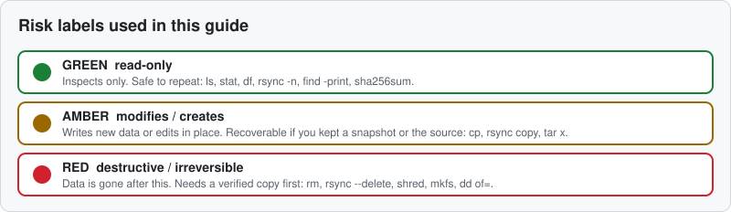

| Label | Meaning | Examples |
|---|---|---|
| 🟢 | read-only | `ls`, `stat`, `df`, `rsync -n`, `find -print` |
| 🟡 | modifies or creates | `cp`, `rsync` (copy), `tar -x` |
| 🔴 | destructive / irreversible | `rm`, `rsync --delete`, `shred`, `dd of=` |

Commands that need root are marked **(root)**. Use the least privilege that works, and never put `sudo` in front of a destructive wildcard without a preview.

### Environment differences that matter

| Topic | Variants | What to do |
|---|---|---|
| Userland | GNU coreutils (most distros) vs **busybox/musl (Alpine)** | Busybox applets accept fewer flags (`cp --reflink`, `rm -I`, `stat --format` differ). Install `coreutils` and `findutils` on Alpine if a flag is missing. |
| Init / logs | systemd (journald) vs non-systemd (syslog + logrotate: Alpine, Void, Devuan) | See [system cleaning](#how-to-clean-your-system-safely-on-any-distro) for both. |
| Mandatory access control | **SELinux** (Fedora/RHEL) vs **AppArmor** (Ubuntu/Debian/openSUSE) vs none (Arch, Alpine default) | Copying can drop SELinux labels: use `cp -a`/`rsync -aX` and `restorecon -Rv` afterwards. |
| Filesystems | ext4, xfs, btrfs, zfs, f2fs, tmpfs, FAT/exFAT/NTFS on external drives | See [copying](#how-to-copy-files-safely-in-linux) for what each loses or gains. |
| Shells | bash, zsh, fish, POSIX sh/dash | Scripts are provided in POSIX `sh` and fish. |
| Package manager | apt, dnf, pacman, zypper, apk; short notes for Nix and Void | Never presented as "the" way: always a labelled block per family. |

### Placeholders used in code blocks

Set them once per shell, then paste the examples unchanged.

```bash
# bash / zsh / dash
SRC="$HOME/study-notes"      # what you are operating on
DEST="/mnt/usb/backup"       # where it should go (a directory that exists)
```

```fish
# fish
set SRC "$HOME/study-notes"
set DEST /mnt/usb/backup
```

### macOS and BSD

Out of scope. Quick differences if you try anyway:

| Linux (GNU) | macOS / BSD |
|---|---|
| `stat -c '%s' f` | `stat -f '%z' f` |
| `sed -i 's/a/b/' f` | `sed -i '' 's/a/b/' f` |
| `cp -a`, `cp --reflink` | `cp -pR`, `cp -c` (APFS clone) |
| `sha256sum`, `find -print0 \| sort -z` | `shasum -a 256`, `sort -z` unavailable on old BSD sort |
| `trash-put` | `trash` (Homebrew) or Finder |
| `readlink -f` | `realpath` (recent) or `greadlink -f` |

---

## Safety Philosophy: The 7-Step Pipeline for Safe File Operations

### Why a pipeline

Most data loss is not hardware failure. It is a correct command run on the wrong thing: an empty variable, a trailing slash, a half-finished move, a "cleanup" that matched too much. The defence is to make **every** risky operation pass through the same gates.

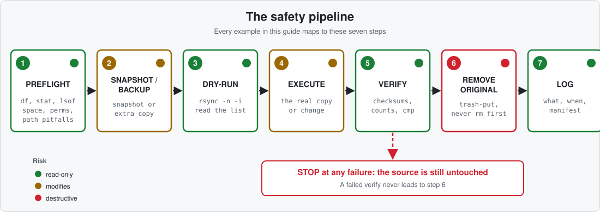

### The seven steps

| # | Step | Risk | Protects against | Typical tools |
|---|---|---|---|---|
| 1 | **Preflight** | 🟢 | full disks, wrong target, unreadable files, open files | `df`, `stat`, `findmnt`, `lsof` |
| 2 | **Snapshot / backup** | 🟡 | a change you cannot undo | `btrfs subvolume snapshot -r`, `zfs snapshot`, restic, a plain extra copy |
| 3 | **Dry-run** | 🟢 | surprises: wrong path, unexpected deletions | `rsync -n -i`, `find -print`, `rename -n` |
| 4 | **Execute** | 🟡/🔴 | n/a (this is the risky step) | `rsync`, `cp`, `mv` |
| 5 | **Verify** | 🟢 | silent corruption, partial copies | `rsync -c -n`, `sha256sum -c`, `diff -rq` |
| 6 | **Remove original (recoverably)** | 🔴 | deleting the only good copy | `trash-put`, not `rm` |
| 7 | **Log** | 🟢 | "what did I do last Tuesday?" | a log file and a checksum manifest |

> [!IMPORTANT]
> Step 6 happens **only** if step 5 passed. A failed verify stops the pipeline with the source untouched. `scripts/safe-move.sh` enforces this and has a self-test that proves it.

### Which operation do I use?

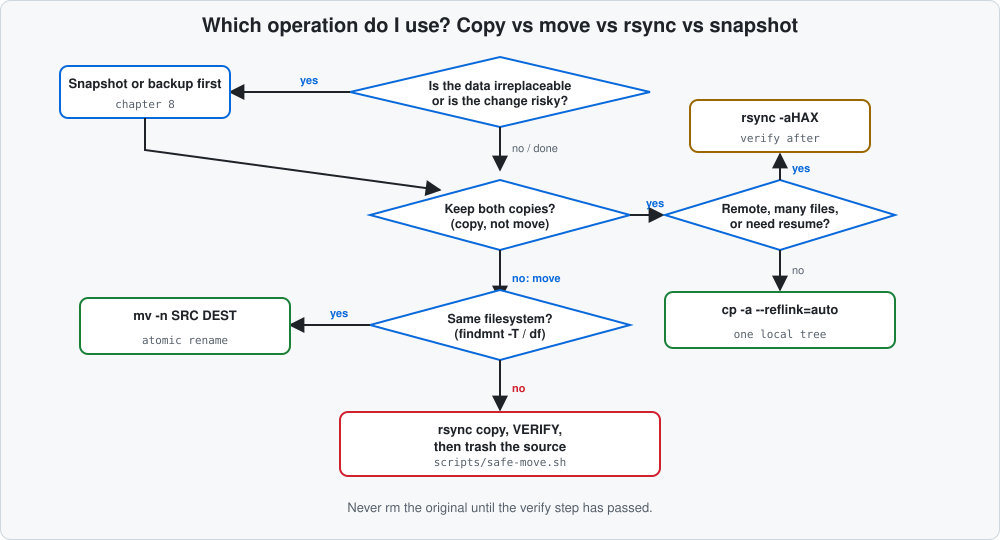

### Honest limits

- A checksum verify proves the **copy matches the source**. It does not prove either is good. If the source was already corrupt, you now have two corrupt copies.
- A snapshot on the same disk is **not a backup** ([snapshots and backups](#snapshots-and-backups-btrfs-zfs-lvm-restic-and-borg)).
- Trash is recoverable only until emptied, and not at all on filesystems or mounts where no trash directory can be created.
- `--dry-run` shows what rsync *would* do, not what a different command or a race with another process might do.

### When it goes wrong: the pipeline: a worked example

Scenario: moving a study-notes folder to a USB drive. The naive command and its failure:

```bash
mv ~/study-notes /mnt/usb/      # 🔴 cross-filesystem: copy, then delete
# the USB drive is pulled out at 70%
```

Result: some files exist on the USB, the rest were partly deleted from the source or half copied. Nothing was verified.

With the pipeline:

```bash
sh scripts/safe-move.sh -n ~/study-notes /mnt/usb     # 🟢 preflight + dry-run only
sh scripts/safe-move.sh    ~/study-notes /mnt/usb     # 🟡/🔴 copy, verify, then trash
```

If the drive is pulled mid-copy, the script exits non-zero at stage `copy`, prints that the source was **not** removed, and leaves the partial copy for inspection. Nothing was deleted.

---

## Preflight Checks Before You Copy, Move or Delete

Pipeline step 1. Everything here is 🟢 read-only unless marked **(root)**.

### Space and inodes

```bash
df -h  "$DEST"        # 🟢 free bytes on the filesystem that holds DEST
df -i  "$DEST"        # 🟢 free inodes (millions of tiny files can exhaust these first)
du -sh "$SRC"         # 🟢 how much you are about to write
```

```text
# real output from the sandbox (df -hP / df -iP)
/dev/vda        252G  8.1G   10G  45% /
/dev/vda       16777216 200509 16576707    2% /
```

**Why:** a copy that runs out of space mid-way is the most common way to end up with half a folder. **Protects against:** partial copies and `ENOSPC` surprises. `safe-move.sh` checks `du -sk` against `df -Pk` and refuses if the space is not there.

### Which filesystem is this?

```bash
findmnt -T "$DEST" -o TARGET,SOURCE,FSTYPE,OPTIONS   # 🟢 which mount, which type, ro/rw
lsblk -f                                            # 🟢 block devices, filesystems, mount points
```

```text
# real output
TARGET SOURCE   FSTYPE
/      /dev/vda ext4
```

`findmnt -T PATH` tells you whether two paths are on the **same filesystem**, which decides whether `mv` is atomic ([moving files](#how-to-move-files-safely-in-linux)). Look for `ro` in OPTIONS: a read-only mount fails writes late and confusingly.

### Permissions, ownership and the path to a file

```bash
ls -la "$SRC"              # 🟢 mode, owner, group, size, symlink targets
stat "$SRC/notes.md"       # 🟢 size, blocks, inode, times, mode, links
namei -l "$SRC/ch1/a.md"   # 🟢 every directory on the way down, with its permissions
```

```text
# real output of namei -l /tmp/ex/notes/ch1/a.md
f: /tmp/ex/notes/ch1/a.md
drwxr-xr-x root root /
drwxrwxrwt root root tmp
drwxr-xr-x root root ex
drwxr-xr-x root root notes
drwxr-xr-x root root ch1
-rw-r--r-- root root a.md
```

`namei -l` finds the one directory without the execute bit that makes "permission denied" mysterious.

### ACLs, xattrs, capabilities, SELinux and AppArmor

```bash
getfacl -p "$SRC/file"                 # 🟢 POSIX ACLs (package: acl)
getfattr -d -m - "$SRC/file"           # 🟢 extended attributes (package: attr)
getcap -r "$SRC" 2>/dev/null           # 🟢 file capabilities (package: libcap / libcap2-bin)
ls -Z "$SRC"                           # 🟢 SELinux context (Fedora/RHEL; empty elsewhere)
getenforce                             # 🟢 SELinux mode; command exists only where installed
aa-status                              # 🟢 (root) AppArmor profiles; Ubuntu/Debian/openSUSE
```

```text
# real output of getfacl -p on a plain file
# file: notes/ch1/a.md
# owner: root
# group: root
user::rw-
group::r--
other::r--
```

**Why it matters:** plain `cp` and `mv` across filesystems silently drop ACLs, xattrs and SELinux labels. `rsync -aHAX` and `cp -a` keep them when the destination supports them ([copying](#how-to-copy-files-safely-in-linux)).

### Symlinks, hardlinks and sparse files

```bash
ls -l "$SRC" | grep -- '->'            # 🟢 symlinks and where they point
find "$SRC" -type f -links +1          # 🟢 files with more than one hard link
ls -ls sparse.img; du -h sparse.img; du -h --apparent-size sparse.img   # 🟢 sparse check
```

```text
# real output for a 1 GiB sparse file created with truncate -s 1G
0 -rw-r--r-- 1 root root 1073741824 Nov 10 08:33 sparse.img
0	sparse.img
1.0G	sparse.img          # --apparent-size
```

A sparse file *looks* like 1 GiB but uses no blocks. A naive copy can expand it to a real 1 GiB: use `cp --sparse=always`/`rsync -S` and check free space against the apparent size to be safe. Hard links are separate names for one inode: copy them with `-H` or they become independent files.

### Open files

```bash
lsof +D "$SRC" 2>/dev/null | head      # 🟢 (root for other users' files) who has files open under SRC
fuser -vm "$SRC"                       # 🟢 processes using the filesystem holding SRC
```

Copying a database, VM image or mail spool while it is open gives an inconsistent copy. Stop the service, or snapshot first ([snapshots and backups](#snapshots-and-backups-btrfs-zfs-lvm-restic-and-borg)).

### Disk health

```bash
sudo smartctl -H /dev/sda              # 🟢 (root) overall SMART verdict; package smartmontools
sudo smartctl -a /dev/nvme0            # 🟢 (root) full attributes (NVMe path differs)
```

If SMART reports failing or reallocated sectors, **stop** and go to the `ddrescue` playbook in [recovery playbooks](#recovery-playbook-what-to-do-after-you-deleted-something). Retrying `cp` on a dying disk can make it worse. SMART passing does not prove the disk is healthy.

### Path pitfalls

| Pitfall | Why it bites | Safe habit |
|---|---|---|
| Spaces | unquoted `$f` splits into two words | always `"$f"`; use `find -print0 \| xargs -0` |
| Newlines in names | break line-based loops | NUL separators (`-print0`, `sort -z`) |
| Leading dash | `rm -rf` file named `-rf` is parsed as options | `rm -- -rf` or `./-rf` |
| Unicode | composed vs decomposed forms look identical but are different names | compare with `ls \| xxd` when in doubt |
| Case-insensitive FS | `Notes` and `notes` collide on FAT/exFAT/NTFS | check before copying to external drives |
| Reserved characters | FAT/exFAT/NTFS reject `< > : " \| ? *` and trailing dots/spaces | rename first, or expect copy errors |

```bash
# real: why unquoted expansion is dangerous
for f in $(find notes -name '*file*'); do echo "[$f]"; done     # WRONG: splits 'my file.md'
find notes -name '*file*' -print0 | xargs -0 -n1 printf '[%s]\n' # RIGHT
```

```text
[notes/my]
[file.md]
[notes/my file.md]
```

The first two lines are the wrong loop breaking one name in two; the last is the safe version.

### When it goes wrong: preflight

A script does `cd "$DEST" && rm -rf *` with `DEST` mistyped; `cd` fails and `rm` runs in the wrong directory. Preflight would have caught it: `findmnt -T "$DEST"` and `ls -la "$DEST"` before acting, and `set -eu` plus `${DEST:?}` in scripts ([deleting safely](#how-to-delete-files-safely-in-linux)).

Mapped to the pipeline: this section is step 1; its output decides whether you proceed to [copying](#how-to-copy-files-safely-in-linux).

---

## How to Copy Files Safely in Linux

Pipeline steps 3 to 5 for a copy. 🟡 unless noted: copying creates data but does not destroy the source.

### Choose the tool

| Situation | Tool | Why |
|---|---|---|
| One local tree, keep everything | `cp -a` | simple, preserves metadata |
| Anything large, remote, resumable, or you want a preview | `rsync -aHAX` | dry-run, resume, verify mode |
| Pipe through ssh or between users | `tar -cf - \| tar -xpf -` | preserves a lot, no temp file |
| A whole block device or partition image | `dd` | byte-for-byte, not file-aware |
| A failing disk | `ddrescue` | retries and keeps a map of bad areas |

### cp: safe flags

```bash
cp -a   "$SRC" "$DEST/"                  # 🟡 archive: recursive + preserve mode, owner, times, links, (xattrs where possible)
cp -a --reflink=auto "$SRC" "$DEST/"     # 🟡 instant clone on btrfs/xfs, normal copy elsewhere
cp -i   file "$DEST/"                    # 🟡 ask before overwriting
cp --update=none file "$DEST/"           # 🟡 never overwrite an existing file (coreutils 9.3+; verify on your system)
cp --backup=numbered file "$DEST/"       # 🟡 keep file.~1~ instead of overwriting
```

Findings from the sandbox (coreutils 9.4):

```text
$ cp -n a.md existing.md
cp: warning: behavior of -n is non-portable and may change in future; use --update=none instead
$ echo $?
0
$ mv -n a b            # skipped because b exists
mv: not replacing 'mvt/b'
$ echo $?
1
```

`-n` behaved differently between `cp` (exit 0) and `mv` (exit 1) and has changed across coreutils releases: **verify on your system**, and prefer `--update=none` where available. Busybox `cp` (Alpine) does not support `--reflink` or `--update=none`.

### rsync basics

```bash
rsync -aHAXn --itemize-changes "$SRC/" "$DEST/"   # 🟢 preview
rsync -aHAX --info=progress2 -h "$SRC/" "$DEST/"  # 🟡 copy
```

```text
# real output (dry-run): nothing written, only a plan
created directory dest/notes
cd+++++++++ ./
cL+++++++++ link.md -> physics/maxwell.md
cd+++++++++ chem/
>f+++++++++ chem/amines.md
cd+++++++++ physics/
>f+++++++++ physics/fig1.png
>f+++++++++ physics/maxwell.md
```

See [rsync deep dive](#rsync-explained-flags-trailing-slash-and-exit-codes) for every flag and the trailing-slash rule.

### tar pipes

```bash
(cd "$SRC" && tar -cf - .) | (cd "$DEST" && tar -xpf -)    # 🟡 same machine
tar -C "$SRC" -cf - . | ssh user@host 'tar -C /dest -xpf -'  # 🟡 over ssh
```

**Why:** streams without a temp file and keeps permissions, symlinks and hard links; GNU tar can also keep ACLs/xattrs with `--acls --xattrs`, busybox tar cannot. **Limit:** it has no resume and no built-in verify: always follow with `diff -rq` or a checksum compare ([verification](#how-to-verify-a-copy-checksums-and-manifests)). For creating and choosing archive formats, see the [Linux archiving guide](linux-archiving-guide.md).

### dd and ddrescue

```bash
sudo dd if=/dev/sdX of=disk.img bs=4M status=progress conv=fsync   # 🟡 (root) read device into a file
sudo dd if=disk.img of=/dev/sdY bs=4M status=progress conv=fsync   # 🔴 (root) OVERWRITES /dev/sdY entirely
```

> [!CAUTION]
> `dd of=` has no confirmation and no dry-run. A swapped `if`/`of` or a wrong device letter destroys the disk. Run `lsblk -f` immediately before, read it twice, and never use `dd` to copy plain files: use `rsync`.

Use `dd` for whole devices with a healthy source. Use `ddrescue` when the source is failing ([recovery playbooks](#recovery-playbook-what-to-do-after-you-deleted-something)).

### Reflinks (btrfs, xfs)

A reflink shares data blocks until either copy changes: instant and space-free, but **not a backup** (same blocks, same disk).

```text
# real output on ext4 (no reflink support)
$ cp --reflink=auto a.md r.md    # falls back to a normal copy: ok
$ cp --reflink=always a.md r2.md
cp: failed to clone 'r2.md' from 'a.md': Operation not supported
```

Use `=auto` in scripts so the same command works everywhere; use `=always` only when you want a loud failure.

### Preserving metadata

| Flag | rsync | cp -a | What it keeps |
|---|---|---|---|
| `-a` | yes | yes | recursion, symlinks, perms, times, owner/group (owner needs root) |
| `-H` | add | partly | hard links |
| `-A` | add | partly | ACLs |
| `-X` | add | partly | extended attributes, SELinux labels where supported |

Use `rsync -aHAX`. If the destination does not support ACLs/xattrs, rsync errors: use `-aH` and accept the loss knowingly.

### Copying to FAT, exFAT and NTFS

| Filesystem | Loses or limits |
|---|---|
| FAT32 | files over 4 GiB, symlinks, permissions, ownership, hard links, case sensitivity, `< > : " \| ? *` in names |
| exFAT | symlinks, permissions, ownership, hard links; names still case-insensitive |
| NTFS | Unix permissions/ownership (mapped by mount options), symlinks depend on driver, same reserved characters |

```bash
rsync -rltD --modify-window=2 --info=progress2 "$SRC/" "$DEST/"   # 🟡 FAT/exFAT: no perms/owner, tolerate 2s timestamp rounding
```

Use a tar or zip archive instead when permissions matter.

### Many small files vs huge files

Many small files: per-file overhead dominates, so a tar pipe or `rsync` is faster than a loop of `cp`. Huge files: use `rsync --partial --info=progress2` so an interruption does not restart from zero. Check `df -i` for inode exhaustion.

### Resuming interrupted copies

```bash
rsync -aHAX --partial --info=progress2 "$SRC/" "$DEST/"   # 🟡 re-run the same command; finished files are skipped
```

Re-running the same rsync is safe and idempotent. `cp` cannot resume.

### When it goes wrong: copying

`cp -r src dest` where `dest` already exists nests `dest/src`, and a later "cleanup" removes the wrong one. With the pipeline you ran `rsync -n -i` first and read the tree. See the [trailing-slash diagram](#the-trailing-slash-rule).

---

## How to Move Files Safely in Linux

### How mv really works

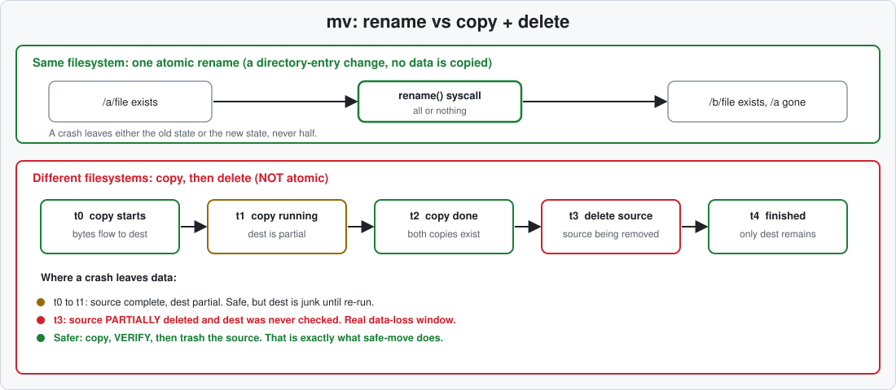

- **Same filesystem:** `mv` calls `rename()`. It is one atomic directory-entry change: after a crash you have the old state or the new state, never half.
- **Different filesystems:** `mv` copies, then deletes. It is **not atomic**. A crash at t3 leaves the source partly deleted with a copy nobody verified.

```bash
findmnt -T "$SRC" -o SOURCE; findmnt -T "$DEST" -o SOURCE     # 🟢 same SOURCE means same filesystem
```

### Why copy, verify, remove is safer

Splitting the move into steps gives you a point at which you can check. After the copy you can compare checksums while **both** copies exist. Only then do you remove the original, and into the trash, not into oblivion. That is the pipeline.

### mv flags

```bash
mv -n  SRC "$DEST/"          # 🟡 do not overwrite (verify exit status on your coreutils)
mv -i  SRC "$DEST/"          # 🟡 ask before overwriting
mv --backup=numbered SRC "$DEST/"   # 🟡 keep the replaced file as name.~1~
mv -- -weird-name "$DEST/"   # 🟡 leading dash: end option parsing with --
```

```text
# real output, coreutils 9.4
$ mv -n mvt/a mvt/b
mv: not replacing 'mvt/b'
$ echo $?
1
```

### The rsync trailing slash

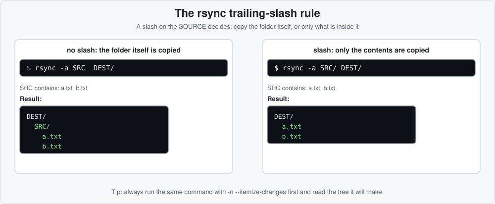

Real result in the sandbox, from `rsync -a src/notes t1/` (no slash) and `rsync -a src/notes/ t2/` (slash):

```text
# no slash: t1/notes/chem/... (the folder is copied into t1)
./notes
./notes/chem/amines.md
./notes/physics/maxwell.md
# slash: contents land directly in t2
./chem/amines.md
./physics/maxwell.md
```

### --remove-source-files and its pitfalls

```bash
rsync -aHAX --remove-source-files "$SRC/" "$DEST/"   # 🔴 deletes each source FILE after it transferred
```

Pitfalls: it removes **files only**, leaving empty source directories; it deletes a file once *transferred*, which does not mean it was *verified*; there is no trash. Prefer the explicit pipeline below.

### Moving with rsync, checksum verify and trash

```bash
rsync -aHAXn --itemize-changes "$SRC/" "$DEST/"   # 🟢 1. dry-run
rsync -aHAX --info=progress2 "$SRC/" "$DEST/"     # 🟡 2. copy
out=$(rsync -aHAXnc --itemize-changes "$SRC/" "$DEST/")   # 🟢 3. verify with checksums
[ -z "$out" ] && trash-put -- "$SRC"              # 🔴 4. recoverable removal, only if verify printed nothing
```

> [!IMPORTANT]
> `rsync -n -c` exits **0** even when it finds differences. Test its **output**, not its exit status. This was confirmed in the sandbox: a corrupted file produced `>fc........ chem/amines.md` and exit 0.

`scripts/safe-move.sh` does all of this with extra checks ([automating safely](#safe-move-and-safe-clean-scripts)).

### When it goes wrong: moving

Running `mv ~/photos /mnt/usb/` and the drive disconnects. After this section's approach: the copy stops at step 2, step 3 never runs, step 4 never runs, the original is intact.

---

## rsync Explained: Flags, Trailing Slash and Exit Codes

Flags below were checked against the rsync 3.2.7 man page and run in a sandbox. Newer 3.x releases add options but keep these.

### The trailing-slash rule


A trailing slash on the **source** means "the contents of". No slash means "the directory itself". The slash on the destination does not change what is copied. When in doubt, preview with `-n -i`.

### Core flags

| Flag | Meaning | Why you want it |
|---|---|---|
| `-a` | archive = `-rlptgoD` | recursion, symlinks, perms, times, group, owner, devices |
| `-v` | verbose | list transferred names |
| `-h` | human-readable sizes | readable progress |
| `-n` / `--dry-run` | 🟢 simulate only | the preview; always first |
| `-c` / `--checksum` | compare by content hash, not size+mtime | catches silent corruption (slow: reads everything) |
| `-P` | `--partial --progress` | keep half-copied files, show progress |
| `--partial` | keep partially transferred files | resume big files |
| `--partial-dir=DIR` | keep partials in DIR, not the final name | avoids a half file masquerading as the real one |
| `--progress` | per-file progress | |
| `--info=progress2` | one overall progress line | best for big trees |
| `-i` / `--itemize-changes` | one line per change, with a reason code | the readable dry-run |
| `-H -A -X` | hard links, ACLs, xattrs | full-fidelity copies |

```bash
rsync -aHAXn -i --info=progress2 "$SRC/" "$DEST/"   # 🟢 preview
rsync -aHAXh --info=progress2 --partial-dir=.rsync-partial "$SRC/" "$DEST/"   # 🟡 copy, resumable
```

### Reading --itemize-changes

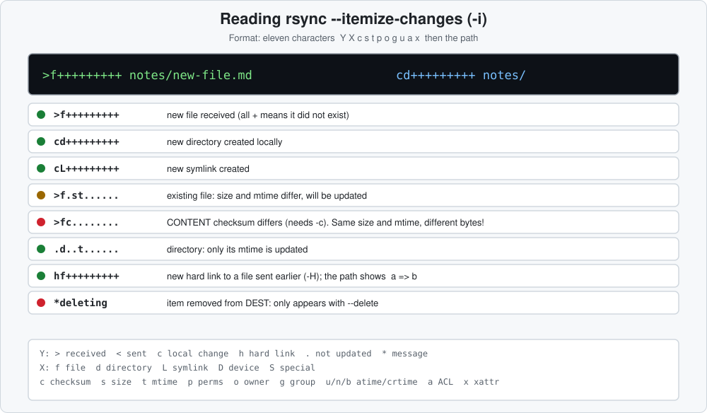

Real output from the sandbox:

```text
>f+++++++++ chem/amines.md          # new file
cd+++++++++ chem/                    # new directory
cL+++++++++ link.md -> physics/maxwell.md   # new symlink
>f.st...... dir/f                    # existing file: size and mtime differ
.d..t...... dir/                     # directory mtime only
hf+++++++++ a => b                   # hard link to an already-sent file (-H)
>fc........ chem/amines.md           # SAME size and mtime, DIFFERENT content (needs -c)
*deleting   extra.txt                # removed from DEST (only with --delete)
```

The last `>fc` line is the important one. In the sandbox, one byte was changed while preserving size and mtime. Without `-c` the dry-run printed nothing (fooled); with `-c` it reported the file:

```text
$ rsync -aHAXn --itemize-changes src/notes/ dest/notes/       # quick check
$ rsync -aHAXnc --itemize-changes src/notes/ dest/notes/      # checksum check
>fc........ chem/amines.md
```

### Overwrite and backup behaviour

| Flag | Effect | Risk |
|---|---|---|
| `--ignore-existing` | skip any file that already exists in DEST | 🟡 never updates stale files |
| `-u` / `--update` | skip files newer on the receiver | 🟡 relies on clocks; equal-time files with different sizes are still updated |
| `-b` / `--backup` | rename overwritten/deleted DEST files with a suffix | 🟡 default suffix `~` |
| `--backup-dir=DIR` | put those replaced files in DIR (keep it outside DEST) | 🟡 a cheap undo for a sync |
| `--suffix=.bak` | change the backup suffix | |

```bash
rsync -aHAX -b --backup-dir="$HOME/.rsync-backups/$(date +%F)" "$SRC/" "$DEST/"   # 🟡 overwritten files are kept
```

### The --delete family

> [!WARNING]
> `--delete` makes DEST an exact mirror: it **removes** everything in DEST that is not in SRC. Swap SRC and DEST by mistake, or point SRC at an empty or unmounted directory, and it wipes the good side.

```bash
rsync -aHAXn --delete -i "$SRC/" "$DEST/"   # 🟢 preview. READ every *deleting line.
```

```text
# real output: DEST had an extra file 'precious' that SRC does not
*deleting   precious
```

| Option | When deletions happen |
|---|---|
| `--delete-before` | before transferring |
| `--delete-during` (default with `--delete` in 3.x) | while transferring |
| `--delete-delay` | decided during, applied at the end |
| `--delete-after` | after the transfer finishes (safest if the transfer can fail) |
| `--delete-excluded` | also deletes excluded files from DEST: dangerous with filters |
| `--max-delete=N` | stop after N deletions (exit code 25): a useful safety fuse |

```bash
rsync -aHAX --delete-after --max-delete=50 -b --backup-dir="$HOME/.rsync-backups/$(date +%F)" "$SRC/" "$DEST/"   # 🔴 mirror with three safety nets
```

### Filters and boundaries

```bash
rsync -aHAX --exclude='*.tmp' --exclude='.cache/' "$SRC/" "$DEST/"      # 🟡 trailing slash on exclude = directories only
rsync -aHAX --include='*/' --include='*.md' --exclude='*' "$SRC/" "$DEST/"   # 🟡 only markdown files; first match wins
rsync -aHAX --filter='- node_modules/' "$SRC/" "$DEST/"                 # 🟡 same idea as --exclude, more general
rsync -aHAX -x "$SRC/" "$DEST/"                                          # 🟡 --one-file-system: do not cross into other mounts
```

`--one-file-system` (`-x`) stops a copy of `/` or `$HOME` from wandering into `/proc`, other drives or network mounts.

### Speed, bandwidth and priority

```bash
rsync -aHAX --bwlimit=20m "$SRC/" "$DEST/"                       # 🟡 limit to about 20 MiB/s (check your version's units)
ionice -c3 nice -n19 rsync -aHAX "$SRC/" "$DEST/"                # 🟡 idle I/O class, lowest CPU priority
```

`ionice` classes work with the CFQ/BFQ schedulers; on some setups the effect is small. On Alpine `ionice` comes from `util-linux`.

### Hard-link snapshots with --link-dest

```bash
today=$(date +%F)
rsync -aHAX --link-dest="$BACKUP/latest" "$SRC/" "$BACKUP/$today/"   # 🟡 unchanged files become hard links to the previous backup
ln -sfn "$BACKUP/$today" "$BACKUP/latest"                            # 🟡 move the 'latest' pointer
```

Each dated directory looks like a full copy but only changed files take space. Hard links need a Unix filesystem on the backup side (not FAT/exFAT). See [snapshots and backups](#snapshots-and-backups-btrfs-zfs-lvm-restic-and-borg).

### SSH usage

```bash
rsync -aHAX -e 'ssh -p 2222' "$SRC/" user@host:/backup/notes/    # 🟡 custom ssh options
rsync -aHAXn -i "$SRC/" user@host:/backup/notes/                  # 🟢 preview first, also remotely
```

Both ends need rsync. Alpine and minimal servers often lack it (`apk add rsync`, `apt install rsync`).

### Exit codes

From the man page; the two you will meet most are **23** and **24**:

| Code | Meaning | What to do |
|---|---|---|
| 0 | success | still verify |
| 1 | syntax or usage error | read the command |
| 11 | error in file I/O (for example cannot create DEST) | check permissions and space |
| 12 | error in protocol data stream | network, or rsync missing on the far side |
| **23** | partial transfer due to error | some files were **not** copied (permissions, I/O): never delete the source; read the error lines |
| **24** | partial transfer due to **vanished source files** | files disappeared while copying (logs, caches): usually benign, re-run once |
| 25 | `--max-delete` limit stopped deletions | your safety fuse fired: investigate |
| 30 | timeout | rerun, or increase `--timeout` |

Real example: an unreadable source file produced code 23.

```text
rsync: [sender] send_files failed to open "/tmp/ex/ex/s/f2": Permission denied (13)
rsync error: some files/attrs were not transferred (see previous errors) (code 23) at main.c(1356) [sender=3.2.7]
exit=23
```

**Never remove the source after a non-zero rsync exit.** `safe-move.sh` aborts at stage `copy` on any non-zero status.

### Dry-run discipline

1. Write the real command.
2. Add `-n -i` and run it.
3. Read the output: new, changed, `*deleting` lines. Do you recognise every path?
4. Remove `-n`, run it.
5. Verify with `-n -c -i`: no output means identical.

### When it goes wrong: rsync

`rsync -a --delete "$SRC/" "$DEST/"` with `SRC` unset becomes `rsync -a --delete / "$DEST/"` or, with `SRC=` plus slash, an empty source: it deletes the good data. Defences: `${SRC:?}`, a `-n` preview that shows thousands of `*deleting` lines, `--max-delete`, and `--backup-dir`.

---

## How to Verify a Copy: Checksums and Manifests

Pipeline step 5. All commands are 🟢 read-only.

### What a verify proves

That the destination matches the source **now**. It does not prove either side is the data you meant, or that it will still match tomorrow (bit rot, a failing disk).

### rsync checksum compare

```bash
rsync -aHAXnc --itemize-changes "$SRC/" "$DEST/"   # 🟢 no output = identical content and metadata
```

> [!IMPORTANT]
> Exit status is **0** even when differences are listed. Test the output: `[ -z "$(rsync -aHAXnc -i "$SRC/" "$DEST/")" ]`.

### diff -rq

```bash
diff -rq "$SRC" "$DEST"          # 🟢 exit 0 identical, 1 differences
```

```text
# real output of a failed compare
Files notes/ch1/a.md and copy/ch1/a.md differ
Only in copy: new.md
exit=1
```

`diff -r` follows no symlinks specially and ignores metadata (permissions, owners): content only.

### Checksum manifests

```bash
(cd "$SRC"  && find . -type f -print0 | sort -z | xargs -0 sha256sum) > /tmp/src.sha256   # 🟢
(cd "$DEST" && sha256sum -c /tmp/src.sha256 | grep -v ': OK$')                           # 🟢 prints only problems
```

Why `-print0 | sort -z | xargs -0`: names with spaces and newlines survive, and sorting makes two manifests comparable. `b3sum` (BLAKE3) works the same and is faster, but is not in the default repos of most distros ([install table](#appendix-install-table-package-names-per-distro)).

```text
# real: manifest (hashes shortened) and a failing check after appending one line
edd3a863872a04239eb2  ./café.md
87428fc522803d31065e  ./ch1/a.md
./ch1/a.md: FAILED
sha256sum: WARNING: 1 computed checksum did NOT match
```

`sha256sum -c` exits 1 when anything fails or is missing.

### cmp, counts and sizes

```bash
cmp "$SRC/file" "$DEST/file"                       # 🟢 byte compare, silent if identical
find "$SRC" | wc -l; find "$DEST" | wc -l          # 🟢 counts (miscounts newline names; fine as a sanity check)
du -sb "$SRC" "$DEST"                              # 🟢 apparent bytes
```

Counts and sizes are a **quick** check, not proof. Only content comparison catches same-size corruption.

### Archive tests

```bash
tar -tf backup.tar > /dev/null && echo "tar readable"   # 🟢 fails on a damaged archive
zstd -t backup.tar.zst                                  # 🟢 integrity test of the compressed stream
```

Real output: `zstd -t` on a good file prints `n.tar.zst : 10240 bytes`; on a truncated one it prints `Read error (39) : premature end` and exits 1. Format choice, compression levels and the other formats' test commands are in the [Linux archiving guide](linux-archiving-guide.md) and the [Linux archive extraction guide](linux-archive-extraction-guide.md).

### A clean verify and a failed verify

Real transcripts from `scripts/safe-move.sh`:

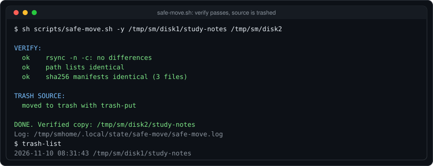

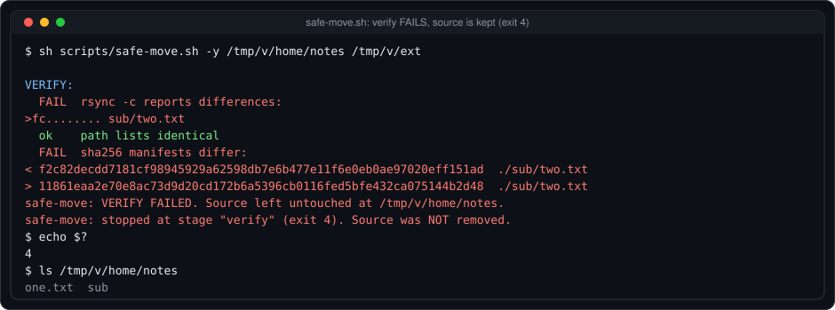

The failing run used a wrapper that corrupted one file **while preserving its size and modification time**, the case a quick rsync check misses. Both the `-c` check and the independent SHA-256 manifest caught it, and the source stayed in place.

### Honest limits

- Verification proves match, not quality.
- Checksums read every byte on both sides: expect them to take as long as the copy.
- A manifest made from a source that is already corrupt records the corruption.
- Keep the manifest ([automating safely](#safe-move-and-safe-clean-scripts) saves one): it lets you detect bit rot later.

### When it goes wrong: verification

A "verify" that compares only file size and modification time reported success on a copy where one byte had changed, and the source would then have been deleted. This guide's approach checks content two independent ways (`rsync -n -c` and SHA-256 manifests), and the failing run above stopped with exit code 4 and the source intact.

---

## How to Delete Files Safely in Linux

Pipeline step 6. Almost everything here is 🔴 or protects you from it.

> This section is about **recoverable** deletion and guard rails. For tools that overwrite data (`shred`, `srm`, `wipe`, device wipes) and the full flag reference for `rm`, see the [file deletion guide](file-deletion-guide.md).

### Trash first: trash-cli

```bash
trash-put -- "$SRC"            # 🔴→recoverable: move to the trash
trash-list                     # 🟢 what is in the trash
trash-restore "$PWD"           # 🟡 interactive: restore an item trashed from this directory
trash-empty 30                 # 🔴 permanently delete items trashed more than 30 days ago
trash-empty                    # 🔴 permanently delete everything in the trash
```

```text
# real output
$ trash-put thesis.md && trash-list
2026-11-10 12:31:35 /tmp/tr/thesis.md
$ echo 0 | trash-restore /tmp/tr
   0 2026-11-10 12:31:35 /tmp/tr/thesis.md
What file to restore [0..0]: thesis.md        # file is back in /tmp/tr
```

**Why:** `trash-put` is the same operation a file manager's "Delete" does, so your mistake is a `trash-restore` away. **Protects against:** the "wrong thing selected" class of error. Install: see the [install table](#appendix-install-table-package-names-per-distro). On GNOME/KDE, `gio trash FILE` does the same.

### The freedesktop trash and per-mount .Trash-UID

The [freedesktop.org trash specification](https://specifications.freedesktop.org/trash-spec/latest/) defines one trash per filesystem so that trashing never needs a slow cross-filesystem copy:

| Where the file lives | Where it is trashed |
|---|---|
| your home filesystem | `$XDG_DATA_HOME/Trash` (usually `~/.local/share/Trash`) with `files/` and `info/` |
| another mount, if `$topdir/.Trash/` exists with the sticky bit | `$topdir/.Trash/$UID/` |
| another mount, otherwise | `$topdir/.Trash-$UID/`, created if allowed |

Consequences: trashing a file on a USB stick leaves it **on the stick** (in `.Trash-1000`), consuming that stick's space, and it is invisible if you only look in `~/.local/share/Trash`. On a read-only mount, or one you cannot write to, trashing fails. `trash-list` shows all of them. Non-systemd or server setups without a desktop have no trash until `trash-put` creates one.

### Why rm is irreversible

`rm` unlinks the name; the blocks are marked free and may be overwritten at any moment, and on SSDs with TRIM they may be discarded almost immediately. There is no undo. The mechanics are explained in the [file deletion guide](file-deletion-guide.md).

### rm guard rails

```bash
rm -I  -- file1 file2 file3 file4     # 🔴 asks once if more than three files or recursive
rm -rf --one-file-system -- "$DIR"     # 🔴 do not cross into other mounts (GNU rm; not in busybox)
```

```text
# real output, coreutils 9.4
$ echo n | rm -I rmt/*
rm: remove 4 arguments?        # declined: nothing deleted
```

GNU `rm` refuses `/` by default (`--preserve-root`). `rm -I` is only a prompt: the real fix is not to use `rm` for things you might want back. All other `rm` flags are in the [file deletion guide](file-deletion-guide.md).

### The unset-variable disaster

```bash
DIR=                       # empty or unset by a typo
rm -rf "$DIR/"             # 🔴 becomes: rm -rf /
```

Guard every variable that feeds a destructive command:

```bash
rm -rf -- "${DIR:?DIR is unset or empty}/"      # 🔴 aborts the whole line if DIR is empty
```

```text
# real output
$ sh -c 'unset D; rm -rf "${D:?DIR is unset}/"'
sh: 1: D: DIR is unset
exit=2
```

Also use `set -eu` in scripts (`-u` makes unset variables an error), `cd -- "$DIR" || exit 1` before any relative delete, and keep `--preserve-root` on. A shell does **not** do this for you.

### Globs

`rm *` deletes whatever the shell expands, which depends on the current directory and on files named like options (`-rf`). Preview the expansion:

```bash
echo rm -- ./*.tmp          # 🟢 shows exactly what would be passed
printf '%s\n' ./*.tmp       # 🟢 same, one per line
```

Never run `sudo rm -rf` followed by a wildcard without a preview first. In zsh unmatched globs error; in bash they stay literal; in fish they error. Behaviour differs, so preview.

### find: print before delete

```bash
find . -maxdepth 1 -name '*.tmp' -print          # 🟢 1. what matches
find . -maxdepth 1 -name '*.tmp' -print0 | xargs -0 trash-put --   # 🟡 2. trash them
find . -maxdepth 1 -name '*.tmp' -delete         # 🔴 3. only after reading step 1
```

```text
# real output of step 1
./old1.tmp
./old2.tmp
```

Order matters: in `find`, `-delete` before the tests means everything is deleted. Keep `-delete` **last**.

### shred and secure erase

`shred` assumes the filesystem overwrites data in place. That is false on SSD/NVMe (wear levelling), and on btrfs, ZFS, snapshotted or reflinked data (copy-on-write), and backups keep their own copies. The GNU documentation says so in its own caution text.

**Do instead:** full-disk encryption from day one, then destroy the key (**crypto-erase**), or use the drive's secure erase on a whole device. The per-tool details (`shred`, `srm`, `wipe`, `dd`, LUKS header erase) and the SSD warning are in the [file deletion guide](file-deletion-guide.md).

### Recovery realities

| Source | Chance |
|---|---|
| Trash | excellent until emptied |
| Snapshot (btrfs, ZFS, LVM, Timeshift) | excellent if taken before |
| Backup (restic, borg, rsync) | excellent if tested |
| Still-open deleted file (`/proc/PID/fd`) | good while the process runs ([recovery playbooks](#recovery-playbook-what-to-do-after-you-deleted-something)) |
| `photorec`, `extundelete` | partial and filenames often lost; stop writing to the disk first |
| SSD with TRIM | often nothing |

### When it goes wrong: deleting

`rm -rf "$BACKUP_DIR/"` runs in a cron job after a drive failed to mount, and `$BACKUP_DIR` is empty. Blast radius: the root of whatever the shell can reach. This section's approach: `${BACKUP_DIR:?}`, `trash-put` for human cleanups, `set -eu`, and a snapshot before the cleanup ([snapshots and backups](#snapshots-and-backups-btrfs-zfs-lvm-restic-and-borg)). Recovery path: restore from the snapshot or backup.

---

## Snapshots and Backups: btrfs, ZFS, LVM, restic and borg

Pipeline step 2.

### Snapshot or backup?

| | Snapshot | Backup |
|---|---|---|
| Speed | instant | minutes to hours |
| Lives | on the **same** storage | on **different** storage |
| Survives disk failure | **no** | yes |
| Best for | "undo this risky change" | "my disk died or was stolen" |

You want both.

### Snapshot timeline

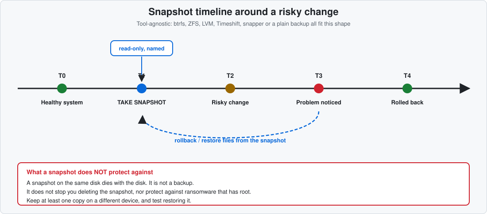

### btrfs

```bash
sudo btrfs subvolume snapshot -r /home /home/.snap-before-upgrade       # 🟡 (root) read-only snapshot, instant
sudo btrfs subvolume list /home                                        # 🟢 (root)
sudo btrfs send /home/.snap-before-upgrade | sudo btrfs receive /mnt/backup    # 🟡 (root) copy to another btrfs disk
sudo btrfs subvolume delete /home/.snap-before-upgrade                 # 🔴 (root) remove the snapshot
```

`-r` makes it read-only, so the snapshot cannot be altered by mistake and can be used with `send`. `/home` must be a subvolume for this to work. The tools **snapper** (`snapper -c root create`, `snapper list`, `snapper undochange N..0`) and **Timeshift** (btrfs mode) automate this. Verify subvolume layout on your distro: openSUSE and Fedora lay `/` and `/home` out differently.

### ZFS

```bash
sudo zfs snapshot tank/home@before-upgrade             # 🟡 (root) instant, named
sudo zfs list -t snapshot                              # 🟢
sudo zfs rollback tank/home@before-upgrade             # 🔴 (root) discards everything newer than the snapshot
sudo zfs send tank/home@before-upgrade | sudo zfs receive backup/home    # 🟡 (root) to another pool
```

`zfs rollback` only goes to the **most recent** snapshot unless you add `-r`, which destroys newer snapshots: read the prompt and the list first. For single files, copy them out of the hidden `.zfs/snapshot/` directory instead of rolling back the whole dataset.

### LVM

```bash
sudo lvcreate -s -n before-upgrade -L 5G /dev/vg0/root     # 🟡 (root) snapshot with 5 GiB of change space
sudo lvs                                                   # 🟢 (root) watch the Data% column
sudo lvconvert --merge /dev/vg0/before-upgrade             # 🔴 (root) roll back; merges on next activation
sudo lvremove /dev/vg0/before-upgrade                      # 🔴 (root) drop the snapshot
```

A classic LVM snapshot **dies if its change space fills up**, so size it for the change and monitor `lvs`. Merging into a mounted root happens at the next reboot.

### ext4 and xfs

No native snapshots. Options: LVM underneath (above), Timeshift in **rsync mode** (hard-linked copies, can be put on another disk), or ordinary backups (restic/borg/rsync). Do not rely on "I will be careful".

### restic worked example

restic was chosen as the worked example because it is a single static binary, encrypts by default, deduplicates, and has the same commands everywhere. Real run (restic 0.16.4, throw-away password and repo in `/tmp`):

```bash
export RESTIC_REPOSITORY=/mnt/backup/restic      # DEST: a directory on a DIFFERENT device
export RESTIC_PASSWORD_FILE="$HOME/.restic-pass"  # keep this file backed up separately; lose it and the data is gone
restic init                                       # 🟡 once
restic backup "$HOME/study-notes"                 # 🟡
restic snapshots                                  # 🟢
restic check                                      # 🟢 repository integrity
restic restore latest --target /tmp/restore-test  # 🟡 TEST your restore
restic forget --keep-daily 7 --keep-weekly 4 --prune --dry-run    # 🟢 preview retention first
```

```text
# real output (trimmed)
Files:           2 new,     0 changed,     0 unmodified
snapshot e26f73db saved
ID        Time                 Host        Tags        Paths
e26f73db  2026-11-10 12:32:01  vm                      /tmp/rs/data
no errors were found                                  # restic check
Summary: Restored 4 files/dirs (8 B) in 0:00          # restore test
```

In the sandbox a directory was deleted after the backup, `restic restore latest` brought it back, and `find` confirmed `b.txt` was present. `restic forget --prune` without `--dry-run` is 🔴: it permanently removes data no snapshot needs any more.

### borg compared

| | restic | borg |
|---|---|---|
| Repo init | `restic init` | `borg init --encryption=repokey REPO` (1.x); borg 2 uses `borg repo-create` (verify on your version) |
| Backup | `restic backup PATH` | `borg create REPO::name PATH` |
| Check | `restic check` | `borg check REPO` |
| Restore | `restic restore ID --target DIR` | `borg extract REPO::name` |
| Retention | `restic forget --prune` | `borg prune` then `borg compact` (1.2+) |
| Notes | many cloud backends built in | very efficient over ssh; Python tool; repo format differs between 1.x and 2.x |

Either is good: **choose one, schedule it, and test restores.** Package names are in the [install table](#appendix-install-table-package-names-per-distro).

### rsync --link-dest rotating backups

```bash
BK=/mnt/backup/home
today=$(date +%F)
rsync -aHAX --link-dest="$BK/latest" "$HOME/" "$BK/$today/"    # 🟡
ln -sfn "$BK/$today" "$BK/latest"                              # 🟡
```

Real check: after changing one of two files, `ls -li` showed the unchanged file with the **same inode** in both dated folders and the changed one with a new inode, so only the change used space.

```text
ld/bk/day1: a=680292  b=680293
ld/bk/day2: a=680292  b=680295     # a shared (hard link), b new
```

Pros: plain files, no special tool to restore. Cons: no encryption or dedupe across files, needs a Unix filesystem on the backup disk, and deleting old days is a manual 🔴 `rm -r` (preview with `ls`).

### 3-2-1 and test your restore

**3** copies of the data, on **2** kinds of media, **1** off-site. And a backup you have never restored is a hope, not a backup: schedule a restore test (restic: `restore` + `diff -rq`).

### What snapshots do not protect

- Disk failure or theft (same disk).
- Deleting the snapshot, or the filesystem, itself.
- Malware or ransomware with root, which can delete snapshots.
- Silent corruption that predates the snapshot.

### When it goes wrong: backups

The only "backup" was a snapshot on the same disk, and the disk failed: the snapshot went with it. With this section's approach there is also a restic repository on a different device, and a periodic `restic restore` test proved it works. Recovery path: install restic on the new system, point `RESTIC_REPOSITORY` at the repository, `restic restore latest --target DIR`.

---

## Finding, Organizing and Deduplicating Files

Mostly 🟢. The two 🟡/🔴 areas (dedupe, bulk rename) are always preview-first.

### find, fd, eza, tree

```bash
find "$SRC" -type f -size +100M -print          # 🟢 big files
find "$SRC" -type f -mtime +365 -print          # 🟢 not modified in a year
fd -e png . "$SRC"                              # 🟢 fd: faster, ignores .gitignore'd files by default; binary is `fdfind` on Debian/Ubuntu
tree -L 2 "$SRC"                                # 🟢 shape of a directory
eza -la --git "$SRC"                            # 🟢 modern ls (optional)
```

`fd` hides ignored and hidden files by default: add `-H -I` when you must see everything, such as before a cleanup.

### Where did the space go?

```bash
du -xh --max-depth=1 "$HOME" | sort -h          # 🟢 -x stays on one filesystem
ncdu -x "$HOME"                                 # 🟢 interactive; deleting inside ncdu is 🔴
dust -d 2 "$HOME"                               # 🟢 tree-style bars (optional, see appendix)
duf                                             # 🟢 per-mount usage table (optional)
```

`ncdu` can delete with `d`: treat it as a viewer and delete elsewhere, through the trash.

### Duplicates: review, never auto-delete

Real run on a scratch photo folder (one genuine duplicate):

```bash
jdupes -r 2024 backup           # 🟢 list sets of identical files
jdupes -rS 2024 backup          # 🟢 with sizes
fdupes -r 2024 backup           # 🟢 same idea, different tool
rmlint -T df 2024 backup        # 🟢 writes a reviewable rmlint.sh; does NOT delete by itself
```

```text
# real output of jdupes -rS
3000 bytes each:
2024/IMG_0001.jpg
backup/IMG_0001-copy.jpg
```

Decide which copy to keep, then trash the other: `trash-put -- backup/IMG_0001-copy.jpg`. Do **not** use `jdupes -dN` or `fdupes -dN` (delete without asking) on data you care about. Identical content is not identical purpose: a "duplicate" may be a deliberate backup, or a hard link of the same data.

### Safe bulk rename

Always preview before renaming. With the Perl `rename` (named `rename`/`prename`/`perl-rename` depending on the distro, see the [install table](#appendix-install-table-package-names-per-distro)) `-n` shows the plan only:

```bash
rename -n 's/IMG_/trip-/; s/\.JPG$/.jpg/' IMG_*.JPG     # 🟢 preview
```

```text
# real output of the -n preview
rename(IMG_0001.JPG, trip-0001.jpg)
rename(IMG_0002.JPG, trip-0002.jpg)
rename(IMG_0003.JPG, trip-0003.jpg)
```

Collision-safe loops, extension handling, recursive renames and a full dry-run script are in the [terminal batch renaming guide](terminal-batch-renaming-guide.md). Note that util-linux ships a **different** `rename` (`rename FROM TO FILES`): check `rename --version`.

### NUL-safe pipelines

```bash
find "$SRC" -type f -name '*.log' -print0 | xargs -0 ls -ld       # 🟢
find "$SRC" -type f -name '*.log' -print0 | xargs -0 -n1 echo | wc -l    # 🟢 count
```

Always pair `-print0` with `xargs -0`. Busybox supports both on Alpine.

### fzf and parallel

```bash
find "$SRC" -type f | fzf --preview 'head -20 {}'     # 🟢 pick files interactively
find "$SRC" -type f -print0 | parallel -0 sha256sum    # 🟢 hash in parallel (package: parallel)
```

### When it goes wrong: dedupe

`fdupes -rdN ~/Photos` "to save space" deletes the **only** copy of photos that had been synced into both folders by an app. Instead: list, review, trash individually, and keep a backup ([snapshots and backups](#snapshots-and-backups-btrfs-zfs-lvm-restic-and-borg)).

---

## How to Clean Your System Safely on Any Distro

Always **preview first**, then apply. Commands that need root are marked **(root)**. Basic package-cache, `~/.cache`, journald, orphan, `/tmp`, flatpak/snap, old-kernel and large-file cleaning for openSUSE, Arch and Debian/Ubuntu is already covered step by step in the [clearing system cache guide](../system/clear-system-cache.md). This section adds the safety layer and the families that guide does not cover: Fedora/RHEL (dnf), Alpine (apk), Nix and Void, containers and core dumps.

> [!WARNING]
> "Cleaning" is deletion. Take a snapshot or confirm a backup ([snapshots and backups](#snapshots-and-backups-btrfs-zfs-lvm-restic-and-borg)) before removing packages, kernels or logs. A package-manager preview shows what the **resolver** would do, not what you would miss later.

### Per-distro cleaning map

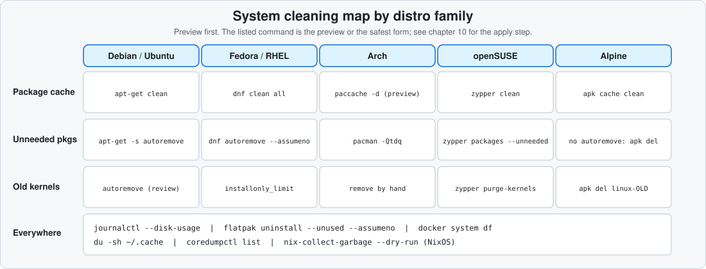

### Task × distro table

| Task | Debian/Ubuntu | Fedora/RHEL | Arch | openSUSE | Alpine |
|---|---|---|---|---|---|
| Preview cache size | `du -sh /var/cache/apt/archives` | `du -sh /var/cache/libdnf5 /var/cache/dnf` | `paccache -d` | `du -sh /var/cache/zypp` | `du -sh /var/cache/apk` |
| Clear cache | 🟡 `apt-get clean` | 🟡 `dnf clean all` | 🟡 `paccache -r` | 🟡 `zypper clean` | 🟡 `apk cache clean` |
| Preview unneeded pkgs | `apt-get -s autoremove` | `dnf autoremove --assumeno` | `pacman -Qtdq` | `zypper packages --unneeded` | n/a (no autoremove) |
| Remove unneeded pkgs | 🔴 `apt-get autoremove` | 🔴 `dnf autoremove` | 🔴 `pacman -Rns $(pacman -Qtdq)` | 🔴 `zypper remove --clean-deps PKG` | 🔴 `apk del PKG` |
| Old kernels | `apt-get autoremove` keeps current + previous | `dnf remove --oldinstallonly` | remove by hand | `zypper purge-kernels` | by hand |
| Orphans | `deborphan` (extra) | `dnf repoquery --unneeded` | `pacman -Qtdq` | `zypper packages --orphaned` | n/a |

Everything is the **preview or safest** form unless a 🟡/🔴 mark says it applies a change. Not run in the sandbox (no such distro available): the dnf, pacman, zypper and apk rows, `zypper purge-kernels --dry-run`, `xbps-remove -n` and `dnf repoquery --unneeded`: check `--help` on your release.

### Preview before apply: the safety notes that matter

```bash
apt-get -s autoremove                  # 🟢 Debian/Ubuntu: -s simulates
dnf autoremove --assumeno              # 🟢 Fedora/RHEL: shows the transaction, answers "no"
dnf remove --oldinstallonly --assumeno # 🟢 which old kernels would go (installonly_limit, default 3)
paccache -d                            # 🟢 Arch (pacman-contrib): dry run
sudo zypper purge-kernels --dry-run    # 🟢 (root) openSUSE: verify the flag on your release
```

```text
# real output on Ubuntu 24.04
$ apt-get -s autoremove
Reading package lists...
Building dependency tree...
Reading state information...
0 upgraded, 0 newly installed, 0 to remove and 18 not upgraded.
```

- **dnf:** `dnf remove --oldinstallonly` exists in DNF 4 and DNF 5 (run `dnf remove --help` to confirm); the running kernel is never removed. Changing `installonly_limit` only affects future updates.
- **pacman:** `pacman -Sc` deletes cached packages no longer installed and `-Scc` deletes **all** cache, which removes offline downgrades: prefer `paccache`. Never run `pacman -Sy PKG` (refresh without upgrading): partial upgrades are unsupported. Arch has no automatic old-kernel handling.
- **zypper:** `purge-kernels` follows `multiversion.kernels` in `/etc/zypp/zypp.conf`. "Orphaned" packages may be ones you installed from outside the repos. On btrfs, `snapper list` shows snapshots that also use space.
- **apt:** `autoremove` keeps the running kernel and the newest; check `uname -r` first.
- **SELinux systems:** restore labels after manual file moves: `restorecon -Rv PATH`.

### Alpine (apk)

```bash
du -sh /var/cache/apk                    # 🟢 empty unless the cache is enabled
sudo apk cache clean                     # 🟡 (root) removes cached packages no longer installed
sudo apk del PKG                         # 🔴 (root) explicit removal; apk has no autoremove
```

Alpine caches only if `/etc/apk/cache` exists. Busybox tools lack some GNU flags: install `coreutils` if a command in this guide fails.

### NixOS and Void notes

```bash
nix-collect-garbage --dry-run            # 🟢 what store paths are unreachable
sudo nix-collect-garbage                 # 🟡 (root) delete unreachable store paths
sudo nix-collect-garbage -d              # 🔴 (root) ALSO deletes old generations: you lose rollback
```

Void: `xbps-remove -O` (cache), `xbps-remove -o` (orphans), `-n` for a dry run: check `xbps-remove --help` on your version.

### Logs: journald vs logrotate

```bash
journalctl --disk-usage                         # 🟢 systemd
sudo journalctl --vacuum-time=2weeks            # 🔴 (root) irreversible: copy logs first if you may need them
sudo logrotate -d /etc/logrotate.conf           # 🟢 (root) non-systemd: -d = debug/dry run
```

```text
# real output in the container (no persistent journal)
No journal files were found.
Archived and active journals take up 0B in the file system.
```

On Alpine, Void and Devuan, logs live in `/var/log` and `logrotate` handles them; vacuuming applies only to systemd. User caches, thumbnails, flatpak/snap and language caches (`pip`, `npm`, `cargo`) are in the [clearing system cache guide](../system/clear-system-cache.md).

### Containers: exactly what each prune deletes

From the Docker docs (podman is similar: read its prompt):

| Command | Removes |
|---|---|
| `docker container prune` | all stopped containers |
| `docker image prune` | **dangling** (untagged) images only |
| `docker image prune -a` | all images not used by a container |
| `docker network prune` | networks not used by a container |
| `docker volume prune` | unused volumes (**your data**: databases live here) |
| `docker builder prune` | build cache |
| `docker system prune` | stopped containers, unused networks, dangling images, build cache |
| `docker system prune -a --volumes` | all of the above plus all unused images **and volumes** |

```bash
docker system df                         # 🟢 where the space is
docker system prune                      # 🔴 read the WARNING list it prints, then answer
podman system prune                      # 🔴 same idea for podman
```

Recent Docker releases prune only **anonymous** volumes with `--volumes`; older ones pruned all unused volumes. Read the prompt on your version.

### Core dumps, tmpfiles and finding /var growth

```bash
coredumpctl list                                 # 🟢 systemd-coredump
sudo systemd-tmpfiles --clean                    # 🔴 (root) applies the age rules in tmpfiles.d; read /usr/lib/tmpfiles.d/tmp.conf first
sudo du -xh --max-depth=1 /var | sort -h         # 🟢 (root) biggest directories first
sudo find /var -xdev -type f -size +200M -print  # 🟢
```

Do not `rm -rf /tmp/*` on a live system: running programs keep sockets and lock files there.

### What is safe to automate

| Task | Automate? | Why |
|---|---|---|
| Package cache clean (`apt-get clean`, `dnf clean all`, `zypper clean`, `paccache -r`, `apk cache clean`) | yes | re-downloadable |
| `journalctl --vacuum-time=…` | yes, with a generous period | loses old logs, so choose the period deliberately |
| `pip cache purge`, thumbnails | yes | rebuildable |
| `autoremove`, orphans | **no** | resolver output needs a human read |
| Old kernels | **no** | keep at least one known-good kernel |
| `docker/podman system prune -a --volumes` | **no** | can delete data volumes |
| `~/.cache` wholesale | **no** | some caches are expensive or stateful |

[`scripts/safe-clean.sh`](../scripts/safe-clean.sh) previews all of these and applies only the first group after confirmation.

### When it goes wrong: cleaning

`sudo apt-get autoremove -y` in a script removes a metapackage's dependencies after you uninstalled something unrelated. With the pipeline: `apt-get -s autoremove` first, snapshot before applying, and no `-y`. Recovery: reinstall from the package manager's history (`apt-get install`, `dnf history undo`, zypper snapshots) or restore the snapshot.

---

## Safe Move and Safe Clean Scripts

Pipeline: all seven steps in one script. Scripts live in [`scripts/`](../scripts/) at the repo root: [`safe-move.sh`](../scripts/safe-move.sh), [`safe-move.fish`](../scripts/safe-move.fish), [`safe-clean.sh`](../scripts/safe-clean.sh) and the self-test [`test-safe-move.sh`](../scripts/test-safe-move.sh).

### safe-move: what it does

`SRC` is moved **into** `DEST_DIR` (so `SRC` ends up at `DEST_DIR/<basename of SRC>`):

1. **Preflight** refuses `/`, your whole `$HOME`, empty arguments, source equal to destination, a destination inside the source, a source that contains `$HOME`, an existing target (it never merges), unreadable entries and insufficient space.
2. **Dry-run**: `rsync -n --itemize-changes`, shown to you.
3. **Confirm**: you type `yes`. `--yes` skips only this prompt.
4. **Copy**: `rsync -aHAX`. Any non-zero exit stops the pipeline.
5. **Verify**, never skipped: (a) `rsync -n -c` must print nothing, (b) the lists of paths must match, (c) independent SHA-256 manifests must match.
6. **Trash the source** with `trash-put`, or `gio trash`, or as a last resort a same-filesystem quarantine folder (a rename, no data copy). It never calls `rm` on your data.
7. **Log** to `~/.local/state/safe-move/safe-move.log` and save the manifest next to it.

### Usage

```bash
sh scripts/safe-move.sh -n "$SRC" "$DEST"     # 🟢 preflight + dry-run only
sh scripts/safe-move.sh    "$SRC" "$DEST"     # 🟡/🔴 prompts, copies, verifies, trashes
sh scripts/safe-move.sh -k "$SRC" "$DEST"     # 🟡 verified copy, source kept
SAFE_MOVE_RSYNC_FLAGS=-aH sh scripts/safe-move.sh "$SRC" /media/usb-fat   # FAT/exFAT/NTFS targets
```

```fish
sh scripts/safe-move.sh -n $SRC $DEST         # works from fish too
fish scripts/safe-move.fish -n $SRC $DEST     # native fish version
```

Exit codes: `0` ok, `1` usage or refused, `2` preflight failed, `3` copy failed, `4` **verify failed (source untouched)**, `5` copy verified but source could not be trashed, `130` not confirmed.

Dry-run, real output:

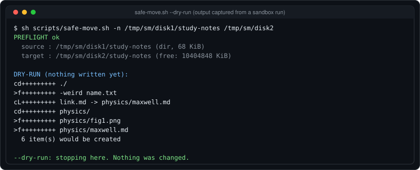

### Safety properties

- `set -eu`: an unset variable is an error and any failing command stops the script.
- Every expansion is quoted; paths are resolved with `cd -- … && pwd -P` and passed after `--`.
- A `trap` reports the stage that failed and says the source was **not** removed; partial copies are left for you to inspect, never auto-deleted.
- The only `rm` in the script removes its own `mktemp` working files.
- `--yes` still never skips verification.

### Test evidence

`scripts/test-safe-move.sh` runs in a temp directory with a fake `HOME`. It proves a good move works, that a **silently corrupted copy** (one fake `rsync` flips bytes after copying, keeping size and mtime) exits with code 4 and keeps the source, and that dangerous arguments are refused. Results are in the [verification report](#lint-and-syntax-results).


### POSIX sh version

Full source: [`scripts/safe-move.sh`](../scripts/safe-move.sh).

### Limits on busybox and dash

- Works with `dash` and busybox `ash`. The self-test passed with only busybox applets plus a real `rsync` and `trash-put`.
- **rsync is required.** On Alpine: `apk add rsync`. There is no `cp`-only fallback, on purpose, because `cp` has no dry-run and no checksum compare.
- busybox `find` has no `-readable`, so the "unreadable entries" preflight check is silently skipped there. rsync would still report unreadable files with exit 23, which stops the script.
- `sort -z`, `xargs -0`, `find -print0`, `sha256sum` and `mktemp -d` are used and worked in busybox 1.36.
- Without `trash-put` or `gio`, the source goes to a `.safe-move-trash` folder beside it on the same filesystem. Install `trash-cli` for a real trash.
- Not POSIX-guaranteed but universal on Linux: `find -print0`, `sort -z`, `xargs -0`, `df -Pk`.

### fish version

fish has no `set -e`, so `scripts/safe-move.fish` checks `$status` after each step and `return`s. It implements the same pipeline and exit codes. It was syntax-checked with `fish -n`, run on a temp tree, refused the same dangerous arguments, and a corrupted-copy run exited 4 with the source kept.

Full source: [`scripts/safe-move.fish`](../scripts/safe-move.fish).

### safe-clean wrapper

`scripts/safe-clean.sh` detects your family from `/etc/os-release` (`ID` and `ID_LIKE`), prints each cleaning step's **preview**, and changes nothing unless you pass `--apply`, which asks `yes` per step. It applies only the "safe to automate" group from [system cleaning](#how-to-clean-your-system-safely-on-any-distro) (package cache, journald vacuum, unused flatpak runtimes). Autoremove, kernels, container prunes and `~/.cache` are preview-only by design.

```bash
sh scripts/safe-clean.sh                   # 🟢 preview only
sh scripts/safe-clean.sh --apply           # 🟡/🔴 asks before each step
sh scripts/safe-clean.sh --family dnf      # override detection
```

```text
# real output on Ubuntu 24.04 (container)
family: apt   mode: PREVIEW-only

== apt download cache  [🟡 safe to automate]
   preview: du -sh /var/cache/apt/archives 2>/dev/null
8.0K	/var/cache/apt/archives

== unneeded packages (review!)  [🔴 review by hand]
   preview: apt-get -s autoremove
0 upgraded, 0 newly installed, 0 to remove and 18 not upgraded.
```

Full source: [`scripts/safe-clean.sh`](../scripts/safe-clean.sh).

### Lint and syntax results

| File | `shellcheck -s sh` | `dash -n` | `bash -n` | `busybox ash -n` | `fish -n` |
|---|---|---|---|---|---|
| `safe-move.sh` | clean | ok | ok | ok | n/a |
| `safe-clean.sh` | clean | ok | ok | ok | n/a |
| `test-safe-move.sh` | clean | ok | ok | n/a | n/a |
| `safe-move.fish` | n/a (shellcheck does not support fish) | n/a | n/a | n/a | ok |

Versions: ShellCheck 0.9.0, dash and bash from Ubuntu 24.04, busybox 1.36.1, fish 3.7.0.

### When it goes wrong: automation

The USB stick is pulled during the copy. Result: stage `copy` exits non-zero, the message says the source was not removed and where the partial copy is. A re-run refuses (target exists), so you inspect and either delete the partial copy by hand or use `rsync -aHAX` to finish it, then verify. Nothing was lost.

---

## Recovery Playbook: What to Do After You Deleted Something

### First: stop writing

Every write to the disk may overwrite the blocks you want back. Close the browser, stop downloads and package updates, and do **not** install recovery tools onto the affected filesystem. Work from a second disk or a live USB.

### Check in this order

1. **Trash.** `trash-list | grep NAME`. Remember per-mount trash: `ls -la /mnt/usb/.Trash-1000` ([deleting safely](#how-to-delete-files-safely-in-linux)).
2. **Snapshots.** `sudo snapper list`, `zfs list -t snapshot`, `sudo btrfs subvolume list /`, Timeshift's GUI. Copy files **out of** a read-only snapshot rather than rolling back the whole system.
3. **Backups.** `restic snapshots`, `borg list REPO`, your dated rsync folders.
4. **Still-open deleted files.** Next section.
5. **Undelete tools.** Last resort.

### Deleted but still open

If a running process still has the file open, the data exists until the process exits. Real run:

```bash
( exec 3> big.log; echo data >&3; rm big.log
  ls -l /proc/$BASHPID/fd/3                 # 🟢 shows "(deleted)"
  cp /proc/$BASHPID/fd/3 recovered.log )    # 🟡 copies the data back
```

```text
l-wx------ 1 root root 64 Nov 10 08:33 /proc/2336/fd/3 -> /tmp/ph/big.log (deleted)
```

In practice, find the process with `lsof +L1` (open files with link count 0), then `cp /proc/PID/fd/N /safe/place/file`. Do it **before** restarting the program. Read-only descriptors may not be copyable on every kernel, and files written continuously (logs) keep growing: copy early.

### When to power off

- If the disk is **failing** (clicking, SMART errors, I/O errors in `dmesg`): power off, and image it with `ddrescue` from a live system.
- If you deleted files on a **healthy** disk and cannot stop background writes: power off hard is acceptable, then boot a live USB and recover read-only.
- If a file is only recoverable from a still-running process: do **not** power off.

### Failing disks: ddrescue

```bash
sudo ddrescue -f -n /dev/sdX /mnt/good/disk.img /mnt/good/disk.map      # 🟡 (root) pass 1: grab easy areas fast, no retries
sudo ddrescue -f -d -r3 /dev/sdX /mnt/good/disk.img /mnt/good/disk.map  # 🟡 (root) pass 2: direct I/O, retry bad areas 3 times
sudo mount -o ro,loop /mnt/good/disk.img /mnt/rescue                    # 🟢 (root) inspect the image read-only (single-partition image)
```

`/mnt/good` must be a **different** disk with enough space. The map file lets you stop and resume. Never run `fsck` on the failing disk itself: work on the image. Package name differs: `gddrescue` on Debian/Ubuntu ([install table](#appendix-install-table-package-names-per-distro)); the binary is `ddrescue`.

### Undelete tools

| Tool | Works on | Notes |
|---|---|---|
| `photorec` (from testdisk) | any filesystem, by file signature | recovers contents, loses names and folders; write results to a **different** disk |
| `extundelete` | ext3/ext4 only | the filesystem must be unmounted; unreliable on busy or recent ext4 |
| `testdisk` | partition tables and some filesystems | for a lost partition |
| btrfs `btrfs restore` | btrfs | pulls files from an unmountable filesystem |

None of these were run for this guide. SSDs with TRIM often yield nothing.

### When it goes wrong: recovery

You ran `rm -rf ~/projects` and then started "tidying" the disk. Every new write reduces your chances. The playbook's order (stop, trash, snapshot, backup, open files, tools) is deliberately from most to least reliable.

---

## Pitfalls: 20 Things Never to Do

Each item pairs the mistake with the safe replacement and the pipeline step it belongs to.

### The list

| # | Never | Why it bites | Do this instead |
|---|---|---|---|
| 1 | `rm -rf "$DIR/"` with `DIR` unset | becomes `rm -rf /` | `rm -rf -- "${DIR:?unset}/"`, `set -eu`, or `trash-put` |
| 2 | `sudo rm -rf` + wildcard with no preview | glob expands to more than you meant | `echo rm -- ./pattern*` first, or `find … -print` |
| 3 | `mv` across filesystems for important data | copy + delete, not atomic | copy, verify, trash ([moving files](#how-to-move-files-safely-in-linux)) |
| 4 | `rsync --delete` without `-n` | mirrors an empty or wrong source and wipes DEST | `-n -i` preview, `--max-delete`, `--backup-dir` |
| 5 | `rsync --remove-source-files` as your "move" | deletes after transfer, not after verify, and no trash | the pipeline / `safe-move.sh` |
| 6 | Trusting rsync's exit code after `-n -c` | exit 0 even with differences | test the **output** is empty |
| 7 | Trusting size and mtime as "same" | same-size corruption passes | `-c` or `sha256sum -c` |
| 8 | `dd of=/dev/sdX` from memory | no confirmation, destroys the disk | `lsblk -f` twice, `status=progress`, double-check `of=` |
| 9 | Copying to FAT/exFAT and assuming permissions survived | they are lost | use `tar`, or know what you lose ([copying](#how-to-copy-files-safely-in-linux)) |
| 10 | Unquoted variables and `for f in $(ls)` | spaces and newlines split names | `"$f"`, `find -print0 \| xargs -0` |
| 11 | `rm -rf` of a file named `-rf` | parsed as options | `rm -- ./-rf` |
| 12 | `shred` on SSD, btrfs, ZFS | does not overwrite the old blocks | LUKS + crypto-erase, or device secure-erase |
| 13 | Snapshot on the same disk as your only backup | dies with the disk | add an off-device backup, 3-2-1 |
| 14 | A backup you never restored | may not work | scheduled restore test |
| 15 | `pacman -Sy PKG` or `pacman -Scc` | partial upgrade / lose downgrade cache | `pacman -Syu`, `paccache` |
| 16 | `docker system prune -a --volumes` casually | deletes data volumes | `docker system df`, prune by category |
| 17 | Auto-deleting duplicates (`fdupes -dN`) | removes the only copy | review sets, trash individually |
| 18 | `rm -rf /tmp/*` on a live system | breaks running programs | `systemd-tmpfiles --clean` after reading its rules |
| 19 | Deleting from inside `ncdu` | no trash, easy mis-key | delete via `trash-put` |
| 20 | Running a long copy on a mounted, changing database | inconsistent copy | stop the service or snapshot first |

### When it goes wrong: pitfalls

Most of these are one typo away. The pattern in each safe replacement is the same: **preview, verify, recoverable removal**.

---

## Cheat Sheet, Glossary and Decision Flowchart

### One-page cheat sheet

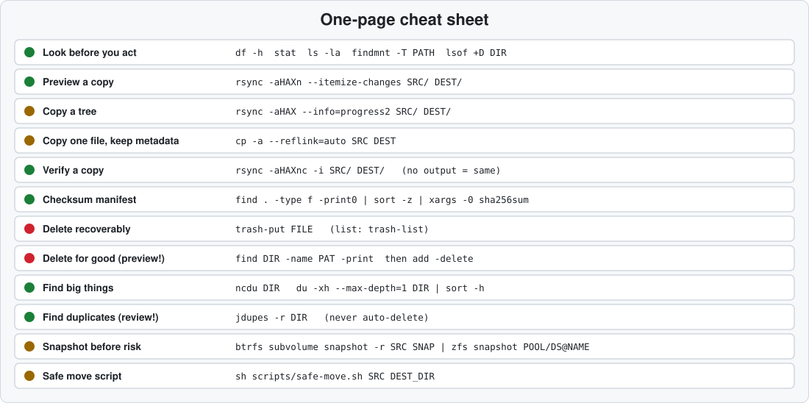

| Task | Command | Risk |
|---|---|---|
| Space and mounts | `df -h PATH`, `findmnt -T PATH` | 🟢 |
| Preview a copy | `rsync -aHAXn -i SRC/ DEST/` | 🟢 |
| Copy a tree | `rsync -aHAX --info=progress2 SRC/ DEST/` | 🟡 |
| Verify | `rsync -aHAXnc -i SRC/ DEST/` (no output = same) | 🟢 |
| Manifest | `find . -type f -print0 \| sort -z \| xargs -0 sha256sum` | 🟢 |
| Safe move | `sh scripts/safe-move.sh SRC DEST_DIR` | 🟡/🔴 |
| Recoverable delete | `trash-put FILE` | 🔴→🟡 |
| Delete for good | `find … -print` then `-delete` | 🔴 |
| Snapshot | `btrfs subvolume snapshot -r` / `zfs snapshot` / `lvcreate -s` | 🟡 |
| Backup | `restic backup PATH` / `borg create` | 🟡 |
| Preview cleaning | `sh scripts/safe-clean.sh` | 🟢 |

### Pipeline mapping

| Step | Examples in this guide |
|---|---|
| Preflight | `df`, `findmnt`, `namei`, `lsof`, `smartctl` |
| Snapshot/backup | btrfs, ZFS, LVM, restic, `--link-dest` |
| Dry-run | `rsync -n -i`, `find -print`, `rename -n`, `apt-get -s` |
| Execute | `rsync`, `cp -a`, `mv` |
| Verify | `rsync -n -c`, `sha256sum -c`, `diff -rq`, `zstd -t` |
| Remove original | `trash-put` |
| Log | log file + manifest from `safe-move.sh` |

### Which tool do I use?

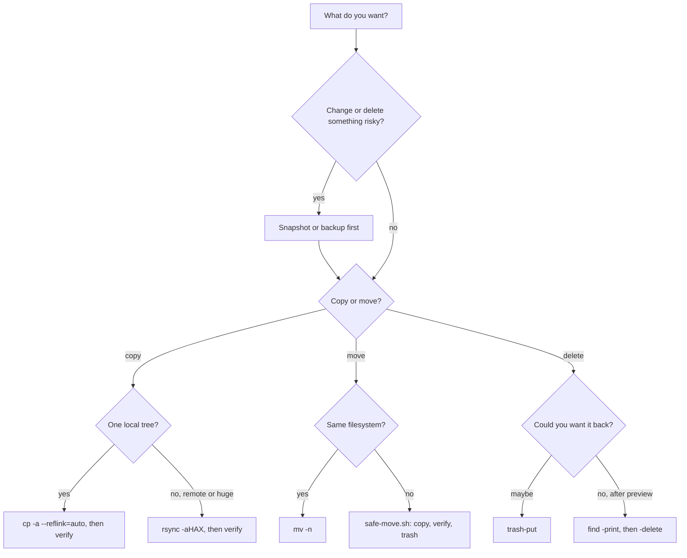

### Glossary

| Term | Meaning |
|---|---|
| **Atomic** | all-or-nothing: no half-finished state is ever visible |
| **Blast radius** | everything a command can affect if it goes wrong |
| **Crypto-erase** | making encrypted data unreadable by destroying the key |
| **CoW (copy-on-write)** | filesystems (btrfs, ZFS) that write changes to new blocks, keeping old ones |
| **Dry-run** | simulate without changing anything (`-n`) |
| **Hard link** | another name for the same inode |
| **Inode** | the filesystem record of a file; a filesystem can run out of them |
| **Manifest** | a list of files with their checksums |
| **Reflink** | a copy that shares data blocks until modified |
| **Snapshot** | a read-only (or writable) point-in-time view on the same storage |
| **Sparse file** | a file with holes that use no disk blocks |
| **Trash spec** | freedesktop.org standard for recoverable deletion, per filesystem |
| **xattr** | extended attribute attached to a file (labels, capabilities) |

---

## Appendix: Install Table, Package Names per Distro

### How to read this table

| Mark | Meaning |
|---|---|
| ✔ | checked in this session: Ubuntu 24.04 via `apt-cache policy`, or Alpine via its package index page |
| (none) | from the distro's usual packaging; **not machine-verified here**, confirm with the search commands below |
| ⚠ | needs an extra repository, or is missing in some releases |

### Packages

| Tool | Debian/Ubuntu (apt) | Fedora/RHEL (dnf) | Arch (pacman) | openSUSE (zypper) | Alpine (apk) |
|---|---|---|---|---|---|
| rsync | `rsync` ✔ | `rsync` | `rsync` | `rsync` | `rsync` |
| trash-cli | `trash-cli` ✔ | `trash-cli` | `trash-cli` | `trash-cli` | `trash-cli` |
| fd | `fd-find` ✔ (binary `fdfind`) | `fd-find` | `fd` | `fd` | `fd` |
| ncdu | `ncdu` ✔ | `ncdu` | `ncdu` | `ncdu` | `ncdu` |
| dust | `du-dust` ⚠ (absent in Ubuntu 24.04 ✔, present in newer Ubuntu) | `du-dust` | `dust` | `dust` | `dust` |
| duf | `duf` ✔ | `duf` | `duf` | `duf` | `duf` |
| jdupes | `jdupes` ✔ | `jdupes` | `jdupes` | `jdupes` | `jdupes` |
| fdupes | `fdupes` ✔ | `fdupes` | `fdupes` | `fdupes` | `fdupes` |
| rmlint | `rmlint` ✔ | `rmlint` | `rmlint` | `rmlint` | `rmlint` ⚠ (**testing** repo ✔) |
| restic | `restic` ✔ | `restic` | `restic` | `restic` | `restic` |
| borg | `borgbackup` ✔ | `borgbackup` | `borg` | `borgbackup` | `borgbackup` |
| snapper | `snapper` ✔ | `snapper` | `snapper` | `snapper` | verify |
| timeshift | `timeshift` ✔ | `timeshift` | `timeshift` | ⚠ verify (not in every release) | ⚠ verify |
| smartmontools | `smartmontools` ✔ | `smartmontools` | `smartmontools` | `smartmontools` | `smartmontools` |
| shellcheck | `shellcheck` ✔ | `ShellCheck` (capitalised) | `shellcheck` | `ShellCheck` (capitalised) | `shellcheck` |
| ddrescue | `gddrescue` ✔ | `ddrescue` | `ddrescue` | `ddrescue` | `ddrescue` |
| perl-rename | `rename` ✔ | `prename` | `perl-rename` | `perl-rename` (verify) | `perl-rename` (verify) |

Install examples:

```bash
sudo apt install rsync trash-cli fd-find ncdu                    # Debian/Ubuntu/Mint
sudo dnf install rsync trash-cli fd-find ncdu                    # Fedora/RHEL (EPEL may be needed for some on RHEL)
sudo pacman -S rsync trash-cli fd ncdu                           # Arch
sudo zypper install rsync trash-cli fd ncdu                      # openSUSE
sudo apk add rsync trash-cli fd ncdu                             # Alpine
```

### Helper packages

| Need | Debian/Ubuntu | Fedora/RHEL | Arch | openSUSE | Alpine |
|---|---|---|---|---|---|
| `getfacl` (ACLs) | `acl` ✔ | `acl` | `acl` | `acl` | `acl` |
| `getfattr` (xattrs) | `attr` ✔ | `attr` | `attr` | `attr` | `attr` |
| `lsof` | `lsof` | `lsof` | `lsof` | `lsof` | `lsof` |
| `fuser` | `psmisc` ✔ | `psmisc` | `psmisc` | `psmisc` | `psmisc` |
| `paccache` | n/a | n/a | `pacman-contrib` | n/a | n/a |
| `zstd` | `zstd` ✔ | `zstd` | `zstd` | `zstd` | `zstd` |
| `tree` | `tree` ✔ | `tree` | `tree` | `tree` | `tree` |
| GNU userland on Alpine | n/a | n/a | n/a | n/a | `coreutils findutils util-linux` |

### Renamed binaries and extra repositories

| Package | Binary you run | Note |
|---|---|---|
| `fd-find` (Debian/Ubuntu/Fedora) | `fdfind` on Debian/Ubuntu ✔ | add `alias fd=fdfind` or a symlink in `~/.local/bin` |
| `gddrescue` (Debian/Ubuntu) | `ddrescue` | package and binary names differ |
| `rename` (Debian/Ubuntu) | `rename`, `file-rename`, `prename` ✔ | Perl rename; util-linux ships a different `rename` elsewhere |
| `borgbackup` | `borg` | Arch calls the package `borg` |
| `du-dust` | `dust` | |
| `ShellCheck` (Fedora, openSUSE) | `shellcheck` | capital S and C in the package name |
| `rmlint` on Alpine | `rmlint` | in `testing`: enable that repository knowingly |
| `restic` on LTS releases | `restic` | repository versions can be old (Ubuntu 24.04 has 0.16.4 ✔); consider the upstream release for features |
| RHEL/Rocky/Alma | | many extras live in EPEL; enable it knowingly |

### Verify a name on your system

```bash
apt-cache policy PKG        # Debian/Ubuntu      🟢
dnf search PKG              # Fedora/RHEL        🟢
pacman -Ss '^PKG$'          # Arch               🟢
zypper search PKG           # openSUSE           🟢
apk search -v PKG           # Alpine             🟢
```

---

**Status:** Active | **Last Updated:** November 2026

*"Copy, verify, then remove. Never the other way round."*
