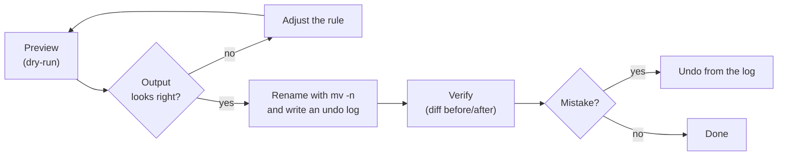

# Batch Renaming & File Structure — Terminal Guide

A practical, tested reference for renaming files in bulk from the terminal: safely, without clobbering existing files, without breaking extensions, and with a way back if you change your mind.

> [!NOTE]
> **How this was tested.** Every command block in this guide was run in a real shell before it was written down: Bash 5.2, GNU coreutils 9.4, Perl `rename` (File::Rename 2.02), ShellCheck-clean, on Ubuntu 24.04, against filenames with spaces, mixed case, Unicode, hidden files, leading dashes, glob characters and deliberate name collisions. **Not covered by those tests** (flagged *untested* where they appear): GUI tools, openSUSE package names, util-linux `rename`, and case-insensitive filesystems (exFAT, NTFS, macOS).

## Quick Start

```bash
./scripts/batch-rename.sh --dry-run        # 1. preview — changes nothing
./scripts/batch-rename.sh                  # 2. do it (spaces -> _), writes an undo log
./scripts/batch-rename.sh --undo ~/.local/state/batch-rename/rename-<timestamp>.tsv   # 3. changed your mind?
```

More rules, recursion and hidden files: see [Section 9](#9-full-script-batch-renamesh).

**Risk labels used throughout**

| Label | Meaning |
|---|---|
| 🟢 | Read-only or preview. Cannot change anything. |
| 🟡 | Renames files in one folder. Never overwrites. Undoable if you keep a log. |
| 🔴 | Recursive, renames directories, or uses a tool that *can* overwrite. Preview and snapshot first. |

## Table of Contents

1. [Safety Rules First](#1-safety-rules-first)
2. [Bash String Manipulation Refresher](#2-bash-string-manipulation-refresher)
3. [Splitting a Filename into Base + Extension](#3-splitting-a-filename-into-base--extension)
4. [Common Batch Rename Tasks](#4-common-batch-rename-tasks)
5. [Collision-Safe Renaming (Never Overwrite)](#5-collision-safe-renaming-never-overwrite)
6. [Dry-Run, Verify, and Undo](#6-dry-run-verify-and-undo)
7. [The `rename` Command (Regex Power Tool)](#7-the-rename-command-regex-power-tool)
8. [Recursive Renaming with `find`](#8-recursive-renaming-with-find)
9. [Full Script: `batch-rename.sh`](#9-full-script-batch-renamesh)
10. [Beyond Scripts: Other Tools and Special Cases](#10-beyond-scripts-other-tools-and-special-cases)
11. [Cheatsheet](#11-cheatsheet)
12. [Common Pitfalls](#12-common-pitfalls)
13. [Changelog and Roadmap](#13-changelog-and-roadmap)

---

## 1. Safety Rules First

Before touching a folder full of files, follow these rules:

1. **Always dry-run first.** Print what *would* happen before running the real command.
2. **Use `mv -n`** (no-clobber) so `mv` refuses to overwrite an existing file instead of silently destroying it.
3. **Never rename in place without a plan for collisions.** Two different filenames can normalize to the same new name (`Report Draft.txt` and `Report_Draft.txt` both become `Report_Draft.txt`).
4. **Test on a copy of a few files** in a scratch folder before running anything across a whole directory.
5. **Quote every variable and end option parsing with `--`**: `mv -n -- "$f" "$new"`, never `mv $f $new`. Unquoted variables break on spaces; without `--`, a file called `-dash file.txt` is parsed as options.
6. **Keep an undo log.** A two-column list of `old -> new` turns a mistake into a one-line fix (see [Section 6](#6-dry-run-verify-and-undo)).
7. **Skip hidden files and directories unless you mean it.** Recursing into `.git` or `.config` is how a rename job becomes an incident.
8. **For anything irreplaceable, take a snapshot first.** On the same filesystem a hard-link copy is nearly free, and renaming the originals does not touch it:

   ```bash
   cp -al photos photos.snapshot     # 🟢 instant, takes almost no extra space
   ```



---

## 2. Bash String Manipulation Refresher

These are Bash's built-in parameter expansions: no external tools (`tr`, `sed`, `awk`) required, which also means no extra processes per file.

| Expansion | Meaning |
|---|---|
| `${var%pattern}` | Remove **shortest** match of `pattern` from the **end** |
| `${var%%pattern}` | Remove **longest** match of `pattern` from the **end** |
| `${var#pattern}` | Remove **shortest** match of `pattern` from the **start** |
| `${var##pattern}` | Remove **longest** match of `pattern` from the **start** |
| `${var/pattern/repl}` | Replace **first** match of `pattern` with `repl` |
| `${var//pattern/repl}` | Replace **all** matches of `pattern` with `repl` |
| `${var//[[:space:]]/_}` | Replace every whitespace character (spaces, tabs) with `_` |
| `${var,,}` / `${var^^}` | Convert to **lowercase** / **UPPERCASE** (Bash 4+) |
| `${var^}` | Capitalize the first character (Bash 4+) |
| `${var:offset:length}` | Substring |
| `${#var}` | Length in characters |
| `${var//+(_)/_}` | Collapse runs of `_` into one (needs `shopt -s extglob`) |

> [!IMPORTANT]
> When `pattern` comes from a variable (a prefix you want to strip, say), quote it: `${f#"$prefix"}`. Otherwise glob characters in the prefix (`*`, `?`, `[`) are interpreted as wildcards instead of literal text.

> [!NOTE]
> Bash 4 or newer is required for case conversion. Linux distributions ship Bash 5. macOS still ships 3.2 as `/bin/bash`; install a current one with Homebrew.

---

## 3. Splitting a Filename into Base + Extension

The naive approach works for one well-behaved file:

```bash
filename="Linux Survival Guide for Internet Debates.md"
echo "${filename%.*}" | tr ' ' '_'   # base, spaces replaced
echo "${filename##*.}"                # extension
```

Across a whole folder, three cases break it:

- **Dotfiles.** For `.hidden file`, `${f%.*}` removes everything (the only dot is the first character), giving an *empty base* and the "extension" `hidden file`. A rename loop built on it silently skips the spaces in dotfiles.
- **"Extensions" that are not extensions.** In `v2.final notes`, the text after the last dot contains a space. It is part of the name, not an extension.
- **Multi-dot files.** `archive.tar.gz` splits into `archive.tar` + `gz`. That is usually what you want, but be aware only the last extension is detected.

A splitter that handles all of them. It sets two variables instead of printing, so it is safe to call thousands of times without spawning a subshell:

```bash
split_ext() {   # sets SPLIT_BASE and SPLIT_EXT (no subshell, so it is fast)
    local f="$1" e
    SPLIT_BASE="$f"; SPLIT_EXT=""
    if [[ "$f" != .* && "$f" == *.* ]]; then
        e="${f##*.}"
        if [[ -n "$e" && "$e" != *[[:space:]]* ]]; then
            SPLIT_BASE="${f%.*}"; SPLIT_EXT="$e"
        fi
    fi
}
```

Verified behavior:

| Input | Base | Extension |
|---|---|---|
| `photo.JPG` | `photo` | `JPG` |
| `archive.tar.gz` | `archive.tar` | `gz` |
| `.hidden file` | `.hidden file` | *(none)* |
| `.bashrc` | `.bashrc` | *(none)* |
| `noext_file` | `noext_file` | *(none)* |
| `v2.final notes` | `v2.final notes` | *(none)* |
| `name.` | `name.` | *(none)* |
| `Report v1.2 final.txt` | `Report v1.2 final` | `txt` |

---

## 4. Common Batch Rename Tasks

All recipes operate on the **current directory** (non-recursive; see [Section 8](#8-recursive-renaming-with-find) for subfolders) and skip hidden files, because `*` does not match dotfiles by default. Add `shopt -s dotglob` before the loop to include them.

> [!IMPORTANT]
> **Paste these two helpers into your shell first**: `split_ext` from [Section 3](#3-splitting-a-filename-into-base--extension) and `safe_rename` from [Section 5](#5-collision-safe-renaming-never-overwrite). Every recipe below uses them, so extensions are preserved and nothing is ever overwritten.

> [!TIP]
> `shopt` settings persist in an interactive shell. Wrap a recipe in `( ... )` to keep options like `nullglob` from leaking, or reset them afterwards with `shopt -u`. `nullglob` makes a pattern with no matches expand to *nothing*; without it the loop runs once with the literal pattern and `mv` errors out.

### Replace spaces with underscores (extension preserved)

Risk: 🟡

```bash
shopt -s nullglob
for f in *; do
    [[ -f "$f" ]] || continue
    split_ext "$f"
    new="${SPLIT_BASE//[[:space:]]/_}${SPLIT_EXT:+.$SPLIT_EXT}"
    [[ "$new" == "$f" ]] || safe_rename "$f" "$new"
done
```

Tested: `Holiday Photo 1.JPG` → `Holiday_Photo_1.JPG`, `my notes` → `my_notes`, `v2.final draft.md` → `v2.final_draft.md`; `.dot file` left alone. For hyphens use `-` instead of `_`.

### Remove all whitespace entirely

Risk: 🟡

```bash
for f in *; do
    [[ -f "$f" ]] || continue
    new="${f//[[:space:]]/}"
    [[ "$new" == "$f" ]] || safe_rename "$f" "$new"
done
```

Tested: `a b c.txt` → `abc.txt`.

### Add a prefix to every matching file

Risk: 🟡

```bash
shopt -s nullglob
for f in *.jpg; do
    safe_rename "$f" "2026_$f"
done
```

Tested: `IMG_1.jpg` → `2026_IMG_1.jpg`, `my pic.jpg` → `2026_my pic.jpg`.

### Remove a specific prefix (glob-safe)

Risk: 🟡

```bash
prefix='v1.*_'          # contains glob characters on purpose
shopt -s nullglob
for f in "$prefix"*; do   # quoted prefix = literal match
    safe_rename "$f" "${f#"$prefix"}"
done
```

Tested with a prefix that *contains glob characters* (`v1.*_`): `v1.*_x.txt` → `x.txt`, while `v1xy_z.txt` is correctly left alone. With no matching files the loop does nothing (no error).

### Add a suffix before the extension

Risk: 🟡

```bash
shopt -s nullglob
for f in *.jpg; do
    split_ext "$f"
    safe_rename "$f" "${SPLIT_BASE}_edited.${SPLIT_EXT}"
done
```

Tested: `a.jpg` → `a_edited.jpg`.

### Remove a specific suffix before the extension

Risk: 🟡

```bash
shopt -s nullglob
for f in *_OLD.*; do
    split_ext "$f"
    [[ "$SPLIT_BASE" == *_OLD ]] || continue
    safe_rename "$f" "${SPLIT_BASE%_OLD}.${SPLIT_EXT}"
done
```

Tested: `vacation_OLD.jpg` → `vacation.jpg` and `vacation_OLD.png` → `vacation.png` in the same loop; `keep.jpg` untouched.

### Change or normalize a file extension

Risk: 🟡

```bash
shopt -s nullglob nocaseglob     # *.txt now also matches .TXT and .Txt
for f in *.txt; do
    safe_rename "$f" "${f%.*}.md"
done
shopt -u nocaseglob
```

Tested: `A.TXT`, `b.Txt`, `c.txt` all become `.md`. If `d.md` already exists, `d.TXT` becomes `d_(1).md` instead of overwriting it.

### Lowercase (or uppercase) every filename

Risk: 🟡

```bash
for f in *; do
    [[ -f "$f" ]] || continue
    new="${f,,}"                          # use ${f^^} for UPPERCASE
    [[ "$new" == "$f" ]] || safe_rename "$f" "$new"
done
```

Tested: `README.MD` → `readme.md`, `Photo.JPG` → `photo.jpg`; `already.txt` is skipped by the guard. Without that guard, every already-lowercase file would produce a pointless `mv` message. See [Section 12](#12-common-pitfalls) for the locale caveat with non-ASCII letters and for case-insensitive filesystems.

### Collapse repeated separators

Risk: 🟡

```bash
shopt -s extglob
for f in *; do
    [[ -f "$f" ]] || continue
    new="${f//+(_)/_}"                    # any run of underscores -> one
    [[ "$new" == "$f" ]] || safe_rename "$f" "$new"
done
```

Tested: `a__b___c.txt` → `a_b_c.txt`. Useful as a second pass after replacing spaces.

### Keep only safe characters (allow-list)

Risk: 🟡

```bash
for f in *; do
    [[ -f "$f" ]] || continue
    new="${f//[^[:alnum:]._-]/_}"         # keep letters, digits, . _ -
    [[ "$new" == "$f" ]] || safe_rename "$f" "$new"
done
```

Tested: `a (1) [x].txt` → `a__1___x_.txt`. In a UTF-8 locale `[:alnum:]` includes accented letters; in the `C` locale it does not, and those letters would be replaced.

### Zero-pad a numbered sequence

Risk: 🟡

```bash
i=1
while IFS= read -r -d '' f; do            # natural order: photo2 before photo10
    printf -v num '%03d' "$i"
    safe_rename "$f" "IMG_${num}.jpg"
    ((i++))
done < <(printf '%s\0' ./photo*.jpg | sort -zV)
```

Tested: `photo1.jpg`, `photo2.jpg`, `photo10.jpg` → `IMG_001.jpg`, `IMG_002.jpg`, `IMG_003.jpg`. The `sort -V` matters: a plain `*.jpg` glob sorts `photo10` before `photo2`.

### Prefix files with their modification date

Risk: 🟡

```bash
for f in *.jpg; do
    safe_rename "$f" "$(date -r "$f" +%F)_$f"      # %F = YYYY-MM-DD from mtime
done
```

Tested: a file last modified on 2026-11-03 becomes `2026-11-03_a.jpg`. For photos, prefer the EXIF capture date ([Section 10.4](#104-rename-photos-and-videos-by-capture-date-exiftool)).

---

## 5. Collision-Safe Renaming (Never Overwrite)

The single biggest risk in batch renaming is two different source files normalizing to the **same** target name: a plain `mv` would silently destroy one of them.

This function checks for an existing target and, if found, appends `_(1)`, `_(2)`, ... instead of overwriting. It also **verifies the move happened**, because `mv -n` quietly skips on older coreutils:

```bash
safe_rename() {   # safe_rename SRC DST — never overwrites; picks DST_(1), DST_(2)... if taken
    local src="$1" dst="$2" dir name i=0 cand
    [[ "$src" == "$dst" ]] && return 0
    dir="$(dirname -- "$dst")"; name="$(basename -- "$dst")"
    split_ext "$name"
    cand="$dst"
    while [[ -e "$cand" || -L "$cand" ]]; do
        ((i++)); cand="$dir/${SPLIT_BASE}_($i)${SPLIT_EXT:+.$SPLIT_EXT}"
    done
    if mv -n -- "$src" "$cand" && [[ ! -e "$src" ]]; then
        echo "Renamed: '$src' -> '$cand'"
    else
        echo "FAILED (left untouched): '$src'" >&2; return 1
    fi
}
```

Tested: with both `Report Draft.txt` and `Report_Draft.txt` present, `Report Draft.txt` becomes `Report_Draft_(1).txt` and the existing file is untouched.

It also works on paths: `./Report Draft.txt` and `./sub.d/a b` (a directory with a dot in its name) both resolve correctly, because only the *filename part* of the destination is split into base and extension. Splitting the whole path string is a classic bug: `./Report_Draft.txt` would look like a dotfile and come out as `./Report_Draft.txt_(1)`.

> [!NOTE]
> If two files collide *within the same batch*, which one keeps the clean name depends on processing order (alphabetical in all the recipes here). The other gets the `_(n)` suffix. Nothing is lost either way.

---

## 6. Dry-Run, Verify, and Undo

### Preview (🟢)

**A. Print instead of executing**, as a readable old/new table:

```bash
for f in *; do
    [[ -f "$f" ]] || continue
    new="${f//[[:space:]]/_}"
    [[ "$new" == "$f" ]] || printf '%s\t%s\n' "$f" "$new"
done | column -t -s $'\t' -N OLD,NEW
```

```text
OLD      NEW
A B.TXT  A_B.TXT
c d.txt  c_d.txt
```

**B. Build a `DRY_RUN` flag into your script** (done for you in [Section 9](#9-full-script-batch-renamesh)):

```bash
DRY_RUN=false
[[ "${1:-}" == "--dry-run" ]] && DRY_RUN=true

if $DRY_RUN; then
    echo "[dry-run] '$src' -> '$dst'"
else
    mv -n -- "$src" "$dst"
fi
```

**C. Perl `rename -n`** prints each rename without doing it ([Section 7](#7-the-rename-command-regex-power-tool)).

Always preview, read the output, then run for real.

### Verify (🟢)

Snapshot the listing before and after. If the line counts match, nothing was overwritten:

```bash
ls -A | sort > /tmp/before.txt
# ... run your rename ...
ls -A | sort > /tmp/after.txt
diff /tmp/before.txt /tmp/after.txt
echo "entries before/after: $(wc -l < /tmp/before.txt) / $(wc -l < /tmp/after.txt)"
```

### Undo (🟡)

Log every successful rename as `old<TAB>new` with absolute paths, then replay the log backwards. Reverse order matters when a name was renamed more than once:

```bash
# while renaming
mv -n -- "$f" "$new" && printf '%s\t%s\n' "$PWD/$f" "$PWD/$new" >> rename.log

# to undo
tac rename.log | while IFS=$'\t' read -r old new; do
    mv -n -- "$new" "$old"
done
```

Tested: two files renamed with that loop were restored exactly. `batch-rename.sh` does this automatically, refuses to restore over an existing file, and supports `--undo LOG` (and `--dry-run` with it).

---

## 7. The `rename` Command (Regex Power Tool)

Two very different tools both go by the name `rename`:

- **util-linux `rename`** (simple substitution): `rename OLDSTRING NEWSTRING file...`. It replaces the first occurrence unless your version supports `-a`/`--all` (*untested here*; check `rename --help`).
- **Perl `rename`** (aka `prename` or `file-rename`, full regex): `rename 's/PATTERN/REPLACEMENT/' file...`

Check which one you have:

```bash
rename --version
```

The Perl version prints a `File::Rename` version line (tested); util-linux names itself in its output. On openSUSE the Perl version may not be installed by default. Look for it:

```bash
zypper search rename
sudo zypper install perl-File-Rename    # package name may vary — check the search results
```

**Perl `rename` examples** (tested with File::Rename 2.02):

```bash
rename -n 's/ /_/g' *                      # 🟢 -n = preview; prints rename(old, new)
rename -v 's/ /_/g; s/\.TXT$/.txt/' *      # 🟡 several substitutions; -v prints each rename
rename 'y/A-Z/a-z/' *                      # 🟡 lowercase every filename
rename 's/^2026_//' *                      # 🟡 strip a prefix
rename 's/\.TXT$/.md/' *                   # 🟡 change extension
```

Behavior worth knowing:

- **It refuses to overwrite by default**: `'X Y.txt' not renamed: 'X_Y.txt' already exists`. But the exit status is still `0`, so a script cannot rely on `$?` to detect a skip. `-f` forces overwrites; do not use it without a preview.
- **It matches against the whole path** you give it. Fed `./s d/X Y.TXT`, `s/ /_/g` also rewrites the *directory* part. Add `-d` (`--nopath`) to touch only the filename.
- **Reading names from a pipe**: `-0` reads NUL-separated names from stdin, which pairs with `find -print0`:

```bash
find . -type f -print0 | rename -0 -d -n 's/ /_/g'     # 🟢 preview, filenames only
```

---

## 8. Recursive Renaming with `find`

Use `find` with NUL-delimited output so names with spaces, newlines or other odd characters are handled safely. These snippets use the `split_ext` and `safe_rename` helpers.

### Files in all subfolders (🔴)

```bash
find . -type f -name '* *' -not -path '*/.*' -print0 |
while IFS= read -r -d '' f; do
    dir="${f%/*}"; base="${f##*/}"
    split_ext "$base"
    safe_rename "$f" "$dir/${SPLIT_BASE//[[:space:]]/_}${SPLIT_EXT:+.$SPLIT_EXT}"
done
```

- `-print0` / `read -r -d ''` are NUL-delimited: safe against spaces and special characters.
- `${f%/*}` / `${f##*/}` split the path so only the filename is transformed.
- `-not -path '*/.*'` skips hidden files **and hidden directories** such as `.git`.

Tested on a tree with spaces in directory names, a multi-dot `deep one.tar.gz`, and a hidden directory: files were renamed in place, directory names and hidden content untouched.

### Directories (🔴)

Renaming a directory changes the path of everything inside it, so directories must be renamed **deepest first**, from a list collected *before* any rename happens (needs Bash 4.4+ for `mapfile -d`):

```bash
mapfile -d '' dirs < <(find . -mindepth 1 -depth -type d -name '* *' -not -path '*/.*' -print0)
for d in "${dirs[@]}"; do                 # -depth lists children before parents
    base="${d##*/}"
    safe_rename "$d" "${d%/*}/${base//[[:space:]]/_}"
done
```

Tested: `a b/c d/e f/` → `a_b/c_d/e_f/` with the file inside intact, and a directory whose cleaned name already existed (`dup one` next to `dup_one`) became `dup_one_(1)` instead of being merged into it.

> [!WARNING]
> Never use `mv` to rename a directory onto an existing directory name without `-n`: `mv` will move the source *inside* the target instead of failing. `safe_rename` avoids this by checking `-e` first.

---

## 9. Full Script: `batch-rename.sh`

A ready-to-use script combining dry-run mode, collision protection, chainable rules, recursion, hidden-file safety and an undo log. It lives at [`scripts/batch-rename.sh`](scripts/batch-rename.sh); the full source is below.

| Option | Effect |
|---|---|
| `-n`, `--dry-run` | Preview only; nothing changes, no log is written |
| `-r`, `--recursive` | Include subdirectories (files only) |
| `-a`, `--all` | Include hidden files and directories (skipped by default) |
| `-R`, `--rules LIST` | Comma-separated rules applied in order. Default `spaces` |
| `-l`, `--log FILE` | Undo log location (default `~/.local/state/batch-rename/rename-<timestamp>.tsv`) |
| `-u`, `--undo FILE` | Reverse the renames in a log |

| Rule | Effect |
|---|---|
| `spaces` | whitespace → `_` |
| `dash` | whitespace → `-` |
| `nospace` | remove whitespace |
| `lower` / `upper` | change case of name **and** extension |
| `sanitize` | replace `< > : " \ \| ? *` and control characters with `_`, strip trailing dots and spaces |

Examples:

```bash
./batch-rename.sh -n -R spaces,lower -r ~/Downloads      # 🟢 preview, recursive
./batch-rename.sh -R sanitize -r /media/usb/archive       # 🔴 make a tree exFAT/Windows-safe
./batch-rename.sh --undo ~/.local/state/batch-rename/rename-20261112-101500.tsv
```

What it guarantees, all verified in testing:

- **Nothing is overwritten.** Collisions get `_(1)`, `_(2)`, ...; each rename is checked after `mv -n` actually moved the file.
- **Dry run is exact.** It tracks names it *would* claim, so collisions inside the batch are previewed correctly, and the directory is left byte-for-byte unchanged.
- **Round trip is exact.** Rename, then `--undo`, and the tree is identical to the original.
- **Hidden things are skipped** unless you pass `--all`, so `.git` is never entered.
- **It never renames itself**, and it skips the log file if that lives in the target folder.
- **Odd names are handled**: leading dashes, glob characters (`[x]*`), Unicode, multi-dot names, dotfiles with `--all`.
- Hard links or a case-insensitive filesystem where source and target are the *same file* are skipped with a message, not renamed.

What it deliberately does not do: rename directories (use [Section 8](#8-recursive-renaming-with-find)), follow symlinks, or touch names containing a tab or newline (those cannot be logged safely, so they are reported and skipped).

<details>
<summary>Full source: <code>scripts/batch-rename.sh</code></summary>

```bash
#!/usr/bin/env bash
#
# batch-rename.sh v2 — safe batch renaming: dry-run, collision protection,
# rule chaining, recursion, an undo log, and sane handling of dotfiles.
#
# Usage:
#   batch-rename.sh [options] [DIR]
#
# Options:
#   -n, --dry-run        Preview only; change nothing, write no log
#   -r, --recursive      Descend into subdirectories (files only; see guide §9 for dirs)
#   -a, --all            Include hidden files and hidden directories (default: skip them)
#   -R, --rules LIST     Comma-separated rules, applied in order (default: spaces)
#                          spaces    whitespace  -> _
#                          dash      whitespace  -> -
#                          nospace   remove all whitespace
#                          lower     lowercase name and extension
#                          upper     uppercase name and extension
#                          sanitize  replace < > : " \ | ? * and control chars with _,
#                                    strip trailing dots/spaces (Windows/exFAT safe)
#   -l, --log FILE       Where to write the undo log
#                          (default: ~/.local/state/batch-rename/rename-<timestamp>.tsv)
#   -u, --undo FILE      Reverse the renames recorded in a log (combine with -n to preview)
#   -h, --help           Show this help
#
# Examples:
#   batch-rename.sh -n                       # preview spaces -> underscores in .
#   batch-rename.sh -R sanitize,lower -r ~/Downloads
#   batch-rename.sh --undo ~/.local/state/batch-rename/rename-20261112-101500.tsv
#
# Nothing is ever overwritten: a name that is already taken gets _(1), _(2), ...

set -uo pipefail

((BASH_VERSINFO[0] >= 4)) || { echo "error: Bash 4+ required (macOS ships 3.2 — brew install bash)" >&2; exit 2; }

DRY_RUN=false
RECURSIVE=false
ALL=false
RULES="spaces"
LOGFILE=""
UNDO=""
TARGET="."
LOG_DIR="${XDG_STATE_HOME:-$HOME/.local/state}/batch-rename"

die()   { echo "error: $*" >&2; exit 2; }
usage() { sed -n '3,30p' "$0" | sed 's/^# \{0,1\}//'; }

while (($#)); do
    case "$1" in
        -n|--dry-run)   DRY_RUN=true ;;
        -r|--recursive) RECURSIVE=true ;;
        -a|--all)       ALL=true ;;
        -R|--rules)     shift; RULES="${1:?--rules needs a value}" ;;
        -l|--log)       shift; LOGFILE="${1:?--log needs a file}" ;;
        -u|--undo)      shift; UNDO="${1:?--undo needs a log file}" ;;
        -h|--help)      usage; exit 0 ;;
        --)             shift; break ;;
        -*)             die "unknown option: $1 (try --help)" ;;
        *)              TARGET="$1" ;;
    esac
    shift
done
(($#)) && TARGET="$1"

# ---------- undo mode ----------------------------------------------------------
if [[ -n "$UNDO" ]]; then
    [[ -r "$UNDO" ]] || die "cannot read log: $UNDO"
    done_n=0; fail_n=0
    while IFS=$'\t' read -r old new; do
        if [[ ! -e "$new" ]]; then
            echo "SKIP (missing now): $new"; ((fail_n++)); continue
        elif [[ -e "$old" ]]; then
            echo "SKIP (original name taken): $old"; ((fail_n++)); continue
        fi
        if $DRY_RUN; then
            echo "[dry-run] undo '$new' -> '$old'"
        elif mv -n -- "$new" "$old" && [[ ! -e "$new" ]]; then
            echo "Restored: '$new' -> '$old'"; ((done_n++))
        else
            echo "FAILED: '$new'"; ((fail_n++))
        fi
    done < <(tac -- "$UNDO")
    echo "Undo finished: $done_n restored, $fail_n skipped/failed."
    exit 0
fi

# ---------- validate rules -----------------------------------------------------
IFS=, read -ra RULE_LIST <<< "$RULES"
for r in "${RULE_LIST[@]}"; do
    case "$r" in
        spaces|dash|nospace|lower|upper|sanitize) ;;
        *) die "unknown rule: '$r'" ;;
    esac
done

cd -- "$TARGET" || die "cannot enter directory: $TARGET"

# ---------- helpers ------------------------------------------------------------
# Split "name.ext" -> SPLIT_BASE / SPLIT_EXT.
# Dotfiles, extensionless files, trailing dots, and "extensions" that contain
# whitespace (e.g. "v2.final notes") are treated as having no extension.
split_ext() {
    local f="$1" e
    SPLIT_BASE="$f"; SPLIT_EXT=""
    if [[ "$f" != .* && "$f" == *.* ]]; then
        e="${f##*.}"
        if [[ -n "$e" && "$e" != *[[:space:]]* ]]; then
            SPLIT_BASE="${f%.*}"; SPLIT_EXT="$e"
        fi
    fi
}

sanitize() {   # $1 = text; prints cleaned text
    local s="$1" bad='[<>:"\\|?*[:cntrl:]]'
    s="${s//$bad/_}"
    printf '%s' "$s"
}

apply_rules() {   # reads/writes NEW_BASE, NEW_EXT
    local r trailing='*[. ]'
    for r in "${RULE_LIST[@]}"; do
        case "$r" in
            spaces)   NEW_BASE="${NEW_BASE//[[:space:]]/_}" ;;
            dash)     NEW_BASE="${NEW_BASE//[[:space:]]/-}" ;;
            nospace)  NEW_BASE="${NEW_BASE//[[:space:]]/}" ;;
            lower)    NEW_BASE="${NEW_BASE,,}"; NEW_EXT="${NEW_EXT,,}" ;;
            upper)    NEW_BASE="${NEW_BASE^^}"; NEW_EXT="${NEW_EXT^^}" ;;
            sanitize)
                NEW_BASE="$(sanitize "$NEW_BASE")"; NEW_EXT="$(sanitize "$NEW_EXT")"
                # shellcheck disable=SC2053  # $trailing is meant to be a glob
                while [[ -n "$NEW_BASE" && "$NEW_BASE" == $trailing ]]; do NEW_BASE="${NEW_BASE%?}"; done ;;
        esac
    done
}

declare -A PLANNED=()   # targets claimed during this run (matters for --dry-run)
taken() { [[ -e "$1" || -L "$1" || -n "${PLANNED[$1]:-}" ]]; }

# unique_path DIR BASE EXT -> prints a path that does not exist yet
unique_path() {
    local dir="$1" base="$2" ext="$3" suffix="" i=0 cand
    while :; do
        cand="$dir/${base}${suffix}${ext:+.$ext}"
        taken "$cand" || { printf '%s' "$cand"; return; }
        ((i++)); suffix="_($i)"
    done
}

ts="$(date +%Y%m%d-%H%M%S)"
if ! $DRY_RUN; then
    [[ -n "$LOGFILE" ]] || LOGFILE="$LOG_DIR/rename-$ts.tsv"
    mkdir -p -- "$(dirname -- "$LOGFILE")" || die "cannot create log directory"
fi

# ---------- main loop ----------------------------------------------------------
find_args=(. -type f)
$RECURSIVE || find_args+=(-maxdepth 1)
$ALL       || find_args+=(-not -path '*/.*')

renamed=0; unchanged=0; skipped=0; collided=0

while IFS= read -r -d '' src; do
    src="${src#./}"
    [[ "$src" -ef "$0" ]] && continue                      # never rename this script
    [[ -n "$LOGFILE" && -e "$LOGFILE" && "$src" -ef "$LOGFILE" ]] && continue

    dir="."; name="$src"
    [[ "$src" == */* ]] && { dir="${src%/*}"; name="${src##*/}"; }

    if [[ "$name" == *$'\t'* || "$name" == *$'\n'* ]]; then
        echo "SKIP (tab/newline in name, can't be logged safely): ${name//[$'\t\n']/?}"; ((skipped++)); continue
    fi

    split_ext "$name"
    NEW_BASE="$SPLIT_BASE"; NEW_EXT="$SPLIT_EXT"
    apply_rules

    if [[ -z "$NEW_BASE" ]]; then
        echo "SKIP (rules would empty the name): $src"; ((skipped++)); continue
    fi

    newname="${NEW_BASE}${NEW_EXT:+.$NEW_EXT}"
    [[ "$newname" == "$name" ]] && { ((unchanged++)); continue; }

    dst="$dir/$newname"
    if taken "$dst"; then
        if [[ -e "$dst" && "$src" -ef "$dst" ]]; then
            echo "SKIP (same file — case-insensitive filesystem or hard link): $src"; ((skipped++)); continue
        fi
        dst="$(unique_path "$dir" "$NEW_BASE" "$NEW_EXT")"; ((collided++))
    fi
    PLANNED["$dst"]=1

    if $DRY_RUN; then
        echo "[dry-run] '$src' -> '${dst#./}'"
    elif mv -n -- "$src" "$dst" && [[ ! -e "$src" ]]; then
        printf '%s\t%s\n' "$PWD/$src" "$PWD/${dst#./}" >> "$LOGFILE"
        echo "Renamed: '$src' -> '${dst#./}'"; ((renamed++))
    else
        echo "FAILED (left untouched): $src"; ((skipped++))
    fi
done < <(find "${find_args[@]}" -print0 | sort -z)

echo "---"
if $DRY_RUN; then
    echo "Dry run: ${#PLANNED[@]} would be renamed, $unchanged already fine, $collided would get a _(n) suffix, $skipped skipped."
else
    echo "Done: $renamed renamed, $unchanged already fine, $collided got a _(n) suffix, $skipped skipped."
    ((renamed > 0)) && echo "Undo with: $0 --undo '$LOGFILE'"
fi
exit 0
```

</details>

---

## 10. Beyond Scripts: Other Tools and Special Cases

### 10.1 GUI tools for quick one-off jobs

*Untested here; check each tool's own documentation.* For a handful of files, numbering, or when you want a live preview, a GUI is often faster than a script:

- **Dolphin** (KDE): select several files and press `F2` for the multi-rename dialog.
- **KRename**: a dedicated batch renamer with a live preview pane (`sudo zypper install krename` on openSUSE).
- **Thunar** (Xfce): *Edit → Rename Multiple Files*; **Nautilus** (GNOME): select several files and press `F2`.

Use a GUI for one-offs; use a script when you need it repeatable, logged, or run over SSH.

### 10.2 Interactive editing with `mmv` and `qmv`

Package names `mmv` and `renameutils` were verified on Ubuntu; on openSUSE check with `zypper search mmv renameutils` (*untested*).

`mmv` renames with wildcard patterns, and `#1` refers to the text the first `*` matched:

```bash
mmv -n '*.TXT' '#1.md'     # 🟢 -n previews
mmv -v '*.TXT' '#1.md'     # 🟡 -v prints each rename
```

Tested: if a target such as `B.md` already exists, `mmv` aborts the **whole batch** (it prompts before deleting on a terminal) instead of overwriting, so nothing is half-renamed. For "replace every space" the Perl `rename` is the better tool.

`qmv` (from `renameutils`) opens your filenames in `$EDITOR`; you edit the new names in place with all your editor's power (multi-cursor, macros, `:%s`) and it applies the differences when you save:

```bash
qmv -f do .       # 🟡 edit destination names only, one column
```

Tested non-interactively by setting `EDITOR` to a `sed` substitution: `p q.txt` → `p_q.txt`.

### 10.3 Huge trees: `fd` and `parallel`

On Debian/Ubuntu the binary is `fdfind`; elsewhere it is `fd`. By default `fd` skips hidden and git-ignored files (add `-H -I` to include them).

```bash
fdfind -0 -t f ' ' . | parallel -0 -j4 'mv -n -- {} {= s:[^/]+$:($&=~s/ /_/gr):e =}'    # 🔴
```

Tested on names with spaces in nested directories and a leading dash. The `{= ... =}` part is a Perl expression that rewrites only the last path component. To preview, put `echo` in front of `mv` (the echoed text is not shell-quoted, but the real command is).

> [!NOTE]
> Renames are cheap metadata operations. Parallelism rarely speeds them up on local disks, so measure before assuming it helps. `mv -n` keeps parallel runs from overwriting each other, but two jobs racing for the same new name will leave one file unrenamed rather than corrupt anything.

### 10.4 Rename photos and videos by capture date (`exiftool`)

```bash
exiftool -d '%Y%m%d_%H%M%S' '-testname<${DateTimeOriginal}%-c.%le' .    # 🟢 preview
exiftool -d '%Y%m%d_%H%M%S' '-filename<${DateTimeOriginal}%-c.%le' .    # 🟡 rename
```

- `%-c` adds `-1`, `-2` when two files share a timestamp (tested: two photos taken in the same second became `20261103_140509.png` and `20261103_140509-1.png`); `%le` lowercases the extension.
- Add `-r` to recurse and `-ext jpg` to limit file types.
- Files without a `DateTimeOriginal` need another tag; try `CreateDate` or `FileModifyDate`.

### 10.5 Unicode normalization (NFC vs NFD)

A name like `café.txt` can be stored as `é` (one code point, **NFC**) or `e` + a combining accent (**NFD**). They look identical but compare unequal, which causes phantom duplicates, failed matches and sync conflicts, particularly for files that came from macOS-formatted disks or were copied through exFAT.

Detect decomposed names (tested):

```bash
printf '%s\n' * | grep -P '\p{M}'      # names containing combining marks (likely NFD)
```

Normalize to NFC with `convmv` (tested):

```bash
convmv -f utf8 -t utf8 --nfc -r .            # 🟢 preview (convmv is dry-run by default)
convmv -f utf8 -t utf8 --nfc -r --notest .   # 🔴 apply
```

### 10.6 Find true duplicates before renaming

Name collisions are not the same as duplicate *content*. Group identical files by checksum first (tested):

```bash
find . -maxdepth 1 -type f -print0 | xargs -0 sha256sum | sort | uniq -w64 -D     # 🟢
```

This lists every file whose SHA-256 matches another's, grouped together. Review the list by hand; do not delete automatically. If `a b.txt` and `c d.txt` are byte-identical, renaming is cosmetic and you may prefer to keep just one.

### 10.7 Renaming inside a Git repository

Use `git mv` so Git records a rename instead of delete + add. Git detects renames by content similarity, so `git log --follow` keeps the history connected (tested: two commits followed across the rename). It refuses to overwrite an existing file unless you pass `-f`.

```bash
git ls-files -z -- '* *' | while IFS= read -r -d '' f; do
    dir="${f%/*}"; [[ "$dir" == "$f" ]] && dir="."
    base="${f##*/}"
    [[ "$base" == *[[:space:]]* ]] || continue
    git mv -k -- "$f" "$dir/${base//[[:space:]]/_}"
done
```

Tested: `My File.txt` and `sub dir/in side.txt` became `My_File.txt` and `sub dir/in_side.txt`; `sub dir/clean.txt` was untouched. `-k` skips failures instead of aborting the loop. Commit renames **separately from content edits** so rename detection stays reliable.

### 10.8 Filenames that survive Windows, exFAT, and archives

Files headed for a USB stick, a NAS shared with Windows, or a zip archive should avoid what those systems reject:

| Problem | Rule |
|---|---|
| Forbidden characters | `< > : " / \ \| ? *` and control characters (the `/` cannot occur on Linux) |
| Trailing dot or space | Not allowed on Windows |
| Reserved device names | `CON`, `PRN`, `AUX`, `NUL`, `COM1`–`COM9`, `LPT1`–`LPT9`, with or without an extension |
| Length | Keep the whole name under 255 characters; ext4 limits it to 255 *bytes*, which is fewer characters for non-Latin scripts |
| Case | Windows, macOS and exFAT treat `A.txt` and `a.txt` as the same name |

The `sanitize` rule in [Section 9](#9-full-script-batch-renamesh) handles the first two rows (tested):

```bash
./batch-rename.sh -n -R sanitize -r /path/to/tree     # 🟢 preview
```

Tested: `a<b>c:d?.txt` → `a_b_c_d_.txt`, `end dot..txt` → `end dot.txt`. It does **not** rewrite reserved names or shorten long ones; check those by hand.

---

## 11. Cheatsheet

| Task | Command |
|---|---|
| Preview any rename | `echo` the target instead of calling `mv`, or `rename -n '...'` |
| Spaces → `_` (text only) | `echo "text" \| tr ' ' '_'` |
| Lowercase (text only) | `echo "TEXT" \| tr '[:upper:]' '[:lower:]'` |
| Spaces → `_`, keep extension | `split_ext "$f"; safe_rename "$f" "${SPLIT_BASE//[[:space:]]/_}${SPLIT_EXT:+.$SPLIT_EXT}"` |
| Add prefix | `for f in *.ext; do safe_rename "$f" "PREFIX_$f"; done` |
| Remove prefix (glob-safe) | `for f in "$prefix"*; do safe_rename "$f" "${f#"$prefix"}"; done` |
| Add suffix before extension | `split_ext "$f"; safe_rename "$f" "${SPLIT_BASE}_SUFFIX.${SPLIT_EXT}"` |
| Remove all whitespace | `new="${f//[[:space:]]/}"` |
| Change extension (any case) | `shopt -s nocaseglob; for f in *.txt; do safe_rename "$f" "${f%.*}.md"; done` |
| Lowercase / uppercase filename | `new="${f,,}"` / `new="${f^^}"` |
| Zero-pad a sequence | `printf -v num '%03d' "$i"` with `sort -zV` for natural order |
| Regex rename (Perl `rename`) | `rename -n 's/PATTERN/REPL/g' *`, then drop `-n` |
| Filenames only, from `find` | `find . -type f -print0 \| rename -0 -d 's/ /_/g'` |
| Recursive, space-safe | `find . -type f -print0 \| while IFS= read -r -d '' f; do ...; done` |
| Directories | collect with `find -depth`, rename deepest first |
| Never overwrite | `mv -n` plus `safe_rename`; verify the source is gone afterwards |
| Undo | `tac rename.log \| while IFS=$'\t' read -r old new; do mv -n -- "$new" "$old"; done` |
| Photos by date | `exiftool -d '%Y%m%d_%H%M%S' '-filename<${DateTimeOriginal}%-c.%le' .` |
| Inside a Git repo | `git mv -k -- "$f" "$new"` |

---

## 12. Common Pitfalls

- **Hidden files skipped silently.** `*` does not match dotfiles. Use `shopt -s dotglob` to include them and `shopt -u dotglob` afterwards.
- **Unquoted variables break on spaces.** Always `"$f"`, never bare `$f`.
- **A leading dash is an option.** `-dash file.txt` needs `--`: `mv -n -- "$f" "$new"`. Globs like `./*` also avoid it.
- **`${f#$prefix}` without quotes treats the prefix as a glob.** Quote it: `${f#"$prefix"}`.
- **An unmatched glob stays literal.** `for f in 2026_*` with no matches runs once with the text `2026_*` and `mv` fails with *No such file or directory*. Use `shopt -s nullglob`.
- **Multi-dot files** (`archive.tar.gz`) only have their last dot treated as the extension by `split_ext`.
- **`mv -n` skips, and what it reports depends on the version.** On GNU coreutils 9.4 a skipped move prints `mv: not replacing 'x'` and exits with status 1 (tested); older versions skip silently with status 0. Do not trust the exit status alone: check that the source is gone, as `safe_rename` does.
- **Perl `rename` also skips silently where scripts are concerned.** It warns on stderr but exits 0 (tested).
- **Perl `rename` rewrites the whole path** unless you pass `-d`, which can rename a directory component you did not mean to touch (tested).
- **Alphabetical is not numeric.** `photo10.jpg` sorts before `photo2.jpg`. Use `sort -V` / `sort -zV` for natural order.
- **`${f,,}` depends on your locale.** In a UTF-8 locale `ÜNÏ.TXT` becomes `ünï.txt`; in the `C` locale only the ASCII letters change: `ÜnÏ.txt` (both tested). Check `locale` if cron or a container gives different results from your terminal.
- **Case-only renames on case-insensitive filesystems** (exFAT, NTFS, macOS default) can fail because `Foo.txt` and `foo.txt` are the same file. The usual workaround is a two-step move through a temporary name (*untested here*):

  ```bash
  mv -n -- "Foo.txt" "Foo.txt.tmp$$" && mv -n -- "Foo.txt.tmp$$" "foo.txt"
  ```

  `batch-rename.sh` detects "target is the same file" and skips with a message rather than guessing.
- **Renaming a file onto itself** (lowercasing an already-lowercase name) triggers a harmless `mv: not replacing` message unless you guard with `[[ "$new" == "$f" ]] || ...`.
- **`rename` command ambiguity.** util-linux and Perl `rename` use completely different syntax. Run `rename --version` before assuming which one you have.
- **Tabs and newlines in names** break simple line-based logs. The script reports and skips them; handle them by hand with `find -print0`.
- **Symlinks.** `find -type f` ignores them. `[[ -f "$f" ]]` follows them, so a loop over `*` can rename the *link* itself. Know which you want.
- **Do not rename inside a synced folder** (Syncthing, Dropbox, Nextcloud) while the client is running; it can see half the batch and propagate conflicts.

---

## 13. Changelog and Roadmap

### Changes in this revision

**Bugs found and fixed in the previous revision** (each reproduced in a real shell before fixing):

- The spaces-to-underscores loop mishandled dotfiles under `dotglob`: `.hidden file` produced an empty base and the extension `hidden file`, so spaces were never replaced. Replaced by `split_ext`.
- The remove-prefix recipe errored when no file matched (`mv: cannot stat '2026_*'`). Fixed with `nullglob`.
- `safe_rename` split the *whole path*: `./Report_Draft.txt` was treated as a dotfile and became `./Report_Draft.txt_(1)`, and a directory containing a dot corrupted the new name. It now splits only the filename.
- `safe_rename` printed "Renamed" even when `mv -n` had skipped the move. It now verifies the source is gone.
- The recursive `find` recipe only matched files, and for directories there was no safe order. Added a deepest-first directory recipe (whose first draft had its own bug, a trailing newline from `basename` turning into `_`, caught by the tests).
- "`mv -n` fails silently" corrected to match actual coreutils 9.4 behavior.

**Added:** risk labels, quick start, a workflow diagram, undo log and `--undo`, verify step, rule chaining and `sanitize` in the script, hidden-file safety, snapshot tip, nine more recipes, Perl `rename` flags (`-v`, `-0`, `-d`), locale and case-insensitivity notes, and all eight former TODO items: GUI tools, Unicode normalization, `exiftool`, `fd` + `parallel`, `mmv`/`qmv`, checksum dedupe, `git mv`, and a cross-platform filename sanitizer.

### Roadmap

- [ ] A fish-shell version of `batch-rename.sh`
- [ ] A `bats` test suite so the "tested" claims can be re-run by anyone
- [ ] macOS/BSD notes (BSD `mv`, `sed`, `date -r` differences)
- [ ] Verify the untested items on openSUSE Tumbleweed and a case-insensitive filesystem
