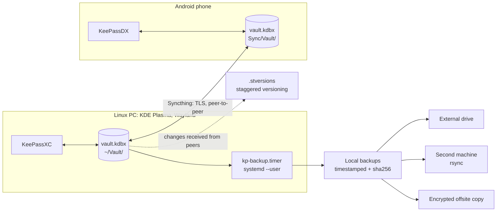

<div align="center">

# 🔐 KeePassXC + KeePassDX: Free, Open-Source Passwords, Passkeys & TOTP on Linux and Android

### One encrypted vault. Two devices. No server. No account. No subscription.

[](https://keepassxc.org)
[](https://www.keepassdx.com)
[](https://syncthing.net)
[](#2-the-clean-solution)
[](#37-passkeys-on-the-desktop)
[](#35-passwords-organisation-and-totp)

</div>

> A complete walkthrough for running **KeePassXC on Linux** and **KeePassDX on Android** against one shared `.kdbx` vault holding passwords, passphrases, TOTP codes and passkeys, synced peer-to-peer with **Syncthing** and protected by a layered, verified backup system.

| | |
|---|---|
| **Tested on** | openSUSE Tumbleweed · KDE Plasma (Wayland) · zsh · Android phone <!-- ⚠️ Confirm after your own end-to-end run before merging --> |
| **Last updated** | November 2026 |
| **Verified versions** | KeePassXC **2.8.0** (released 2026-10-21; User Guide read 2026-11-14) · KeePassDX **4.5.x** (⚠️ check the latest tag) · Syncthing **2.1.x** · Syncthing-Fork for Android **2.1.2.0** (F-Droid, 2026-07-10) |
| **Difficulty** | Intermediate. Terminal comfort required |
| **Time** | ~60–90 minutes for the first run, plus a restore drill |

### How to read the markers

| Marker | Meaning |
|---|---|
| ✅ | Read in the upstream docs or release notes on the date above |
| 🔶 | Version-dependent: labels or behaviour may differ in your build |
| 💡 | Recommendation (opinion, not upstream fact) |
| ⚠️ Verify | Could not be confirmed. Check before relying on it |

> [!NOTE]
> Read the whole guide once before you start. The order matters: create and harden the vault **first**, add Syncthing **second**, prove sync and restore with throwaway data **third**, and only then import real credentials.

---

## 📑 Table of Contents

1. [The Problem](#1-the-problem)
   - [Threat model](#threat-model)
   - [Why KeePass? An honest comparison](#why-keepass-an-honest-comparison)
   - [The TOTP trade-off](#the-totp-trade-off)
2. [The Clean Solution](#2-the-clean-solution)
3. [The Commands](#3-the-commands)
   - [3.1 Decisions first](#31-decisions-first)
   - [3.2 Install KeePassXC on Linux](#32-install-keepassxc-on-linux)
   - [3.3 Create the vault](#33-create-the-vault)
   - [3.4 Tune KeePassXC](#34-tune-keepassxc)
   - [3.5 Passwords, organisation and TOTP](#35-passwords-organisation-and-totp)
   - [3.6 Browser integration](#36-browser-integration)
   - [3.7 Passkeys on the desktop](#37-passkeys-on-the-desktop)
   - [3.8 Wayland and KDE specifics](#38-wayland-and-kde-specifics)
   - [3.9 Syncthing on Linux](#39-syncthing-on-linux)
   - [3.10 Syncthing-Fork on Android](#310-syncthing-fork-on-android)
   - [3.11 KeePassDX on Android](#311-keepassdx-on-android)
   - [3.12 Android autofill, passkeys and TOTP](#312-android-autofill-passkeys-and-totp)
   - [3.13 Daily workflow and sync conflicts](#313-daily-workflow-and-sync-conflicts)
   - [3.14 Backups](#314-backups)
   - [3.15 Verify everything](#315-verify-everything)
   - [3.16 Hardening and maintenance](#316-hardening-and-maintenance)
   - [3.17 Importing safely](#317-importing-safely)
   - [3.18 Troubleshooting](#318-troubleshooting)
4. [Alternatives](#4-alternatives)
5. [Rollback](#rollback)
6. [Cheat Sheet](#cheat-sheet)
7. [Known Unverified Items](#known-unverified-items)
8. [References](#references)

---

## 1. The Problem

You want one password manager that:

- runs on **Linux** and **Android**,
- stores **passwords, passphrases, TOTP secrets and passkeys**,
- is **free and open source**, with no feature locked behind a subscription,
- keeps the vault **under your control**, with no vendor server in the middle,
- and can be **synced and backed up** without trusting a third party with anything readable.

Most hosted managers fail at least one of those: TOTP behind a paid tier, a closed-source client, or a vault on someone else's server. Self-hosting a server fixes the last point but adds a machine to patch, back up and keep online.

### Threat model

| Protects against | Does **not** protect against |
|---|---|
| Vendor or server breach (there is no server) | Malware on an *unlocked* PC or phone |
| Cloud-provider snooping (file is encrypted client-side) | A keylogger capturing your passphrase at unlock |
| Phishing of site passwords (extension matches origins; passkeys are origin-bound ✅) | A weak or reused master passphrase |
| Credential stuffing from other breaches (unique passwords) | Losing the passphrase. **Nothing can recover it** ✅ |
| Theft of a powered-off, encrypted-disk laptop | Coercion |
| Accidental deletion or corruption (versions + backups) | Never testing a restore |

### Why KeePass? An honest comparison

| | KeePassXC + KeePassDX | Bitwarden / Vaultwarden | Proton Pass | Keyguard | pass / gopass |
|---|---|---|---|---|---|
| Server or account needed | **No** | Yes (cloud, or you host Vaultwarden) | Yes | Client for a Bitwarden-compatible backend ⚠️ Verify scope | No (GPG + git) |
| Source | Open (GPL) ✅ | Open clients; Vaultwarden is a community server | Open clients ⚠️ Verify | ⚠️ Verify license/pricing | Open |
| TOTP | Built in ✅ | Built in (premium on Bitwarden cloud ⚠️ Verify) | Built in | Via backend | Extension (`pass-otp`) |
| Passkeys | KeePassXC (browser ext.) ✅ + KeePassDX (Android 14+) ✅ | Yes | Yes | ⚠️ Verify | No |
| Sync | **You choose** (Syncthing here) | Built in | Built in | Built in | git |
| Family sharing | Awkward (shared file) | **Good** | Good | Via backend | GPG recipients |
| Passphrase recovery | **None** | Varies | Varies | n/a | None |
| Best for | Control, portability, minimal trust | Teams, families, ease | "It just works" | Nicer Android UI for Bitwarden | CLI-first users |

> [!NOTE]
> KeePassXC has **no built-in cloud sync, on purpose**: upstream says to keep the file in any synced folder and let that tool do the syncing ✅. That design choice is the reason this guide exists.

### The TOTP trade-off

Keeping TOTP secrets **in the same vault as the passwords** means one compromised vault yields *both* factors. KeePassXC's own FAQ says so: it weakens the 2FA advantage but can still beat having no 2FA, and for maximum security you should keep TOTP in a **separate database with a different password**, ideally on a different computer ✅.

| If you are protecting… | Do this |
|---|---|
| **High-value accounts**: primary email, bank, crypto, domain registrar, GitHub/OBS/AUR maintainer accounts, anything that can reset other accounts | 💡 Put their TOTP in a **separate vault** (different passphrase, not auto-opened), a dedicated authenticator app such as Aegis ⚠️ Verify current status, or a **FIDO2 hardware key**. Prefer passkeys or hardware keys wherever the site supports them |
| **Ordinary accounts** where 2FA mainly blocks credential stuffing | 💡 Same-vault TOTP is an acceptable, documented trade-off |
| Unsure | Start with same-vault TOTP for low-value accounts only; keep high-value TOTP separate |

> [!WARNING]
> Same-vault TOTP is only as strong as your weakest unlock path (quick unlock, biometrics, an unlocked screen). Treat the vault as "one factor that holds two secrets".

---

## 2. The Clean Solution

Use the **KeePass database format (`.kdbx`)**: a single encrypted file that many compatible apps can open. There is nothing to host. Sync is just *copying a file*, and you pick the copier.

| Role | Tool | Why this one |
|---|---|---|
| Linux client | **[KeePassXC](https://keepassxc.org)** | Actively maintained Qt app, browser integration, TOTP, passkeys, CLI |
| Android client | **[KeePassDX](https://www.keepassdx.com)** | Open source, no ads, autofill, TOTP, passkey provider |
| Sync | **[Syncthing](https://syncthing.net)** | Peer-to-peer, encrypted in transit, no cloud account |
| Backup | **systemd timer + one readable script** | No daemon, works offline, every step auditable |



| Layer | Job | Fails when |
|---|---|---|
| Vault file | Encrypts everything | You lose the passphrase or key file |
| Syncthing | Keeps two devices identical | A bad edit or deletion syncs everywhere |
| Backups + versions | Undo | You never test a restore |

### What gets installed and what it touches

| Component | Installed to | Touches |
|---|---|---|
| KeePassXC | Distro package (or Flatpak/AppImage) | `~/.config/keepassxc/`, `~/.local/state/keepassxc/`, browser native-messaging manifests once enabled |
| Syncthing (Linux) | Distro package | A user service, its state dir under your home, `127.0.0.1:8384` for the web UI |
| Syncthing-Fork (Android) | F-Droid or GitHub APK | Storage permission, background service, battery exemption |
| KeePassDX (Android) | F-Droid, Play Store or GitHub APK | Autofill and credential-provider slots in Android settings |
| Backup script + timer | `~/.local/bin/`, `~/.config/systemd/user/` | `~/backups/keepass/` and a log file |
| Your vault | `~/Vault/vault.kdbx` | Nothing outside that folder |

---

## 3. The Commands

### 3.1 Decisions first

Settle these before you create anything. Changing them later is possible ([3.16](#316-hardening-and-maintenance)) but old copies of the file keep the *old* credentials.

| Decision | Recommendation | Why |
|---|---|---|
| Vault name and folder | `~/Vault/vault.kdbx` (Linux), `/storage/emulated/0/Sync/Vault/` (Android) | One dedicated folder, so Syncthing shares *only* this |
| Format | KDBX 4 | Modern KDF; supported by both apps |
| Master credential | 💡 A **7–8 word random passphrase** | Memorable, strong, typeable on a phone |
| Key file | Optional. If used, it must **not** live in the synced folder | See below |
| TOTP location | Same vault, or a separate vault for high-value accounts | See [the trade-off](#the-totp-trade-off) |
| Sync | Syncthing, **Send & Receive** on both devices | Peer-to-peer, no account |

> [!IMPORTANT]
> Never put `Vault/` inside a git repository or a dotfiles tree managed by [GNU Stow](../shell/gnu-stow-dotfiles.md). If it is anywhere near a repo, add this to that repo's `.gitignore` immediately:
>
> ```gitignore
> *.kdbx
> *.keyx
> *.key
> ```

#### The master credential

A KeePass master key is a **composite** of up to three parts, all supplied at unlock:

| Component | What it is | Recommended? |
|---|---|---|
| **Passphrase** | Words you memorise | ✅ Always |
| **Key file** | A random file stored separately | 💡 Optional |
| **Hardware key** | YubiKey/OnlyKey HMAC-SHA1 challenge-response ✅ | 💡 Optional, only if you can back up its secret and have verified phone support |

#### Generate the passphrase (offline)

Use **random words**, not a phrase you invented. A 7,776-word list gives log₂(7776) ≈ 12.9 bits per word:

| Words | Entropy | Use |
|---|---|---|
| 5 | ~65 bits | Too low for a vault |
| 6 | ~78 bits | Minimum if you also use a key file |
| **7** | **~90 bits** | 💡 Good default |
| **8** | **~103 bits** | 💡 No key file, offsite copies exist |

**Option 1. KeePassXC generator** ✅: `Tools → Password Generator → Passphrase`. Pick word count and separator; EFF word lists are suggested upstream ✅.

**Option 2. Physical dice** (best): the EFF large list uses 5 rolls per word.

**Option 3. Offline CLI** using KeePassXC's bundled lists:

```bash
# Where are the bundled lists? (upstream: <install dir>/share/wordlists ✅, /usr/share/keepassxc on Linux)
ls /usr/share/keepassxc/wordlists/

# 8 random words, with replacement, from the system CSPRNG.
# `awk '{print $NF}'` keeps the last column, so it works with or without dice numbers.
WL=/usr/share/keepassxc/wordlists/eff_large.wordlist   # ⚠️ Verify the filename with the ls above
awk '{print $NF}' "$WL" | shuf -r -n 8 --random-source=/dev/urandom | paste -sd' ' -
clear   # don't leave it in scrollback
```

What it touches: reads one file, prints to the terminal, writes nothing.

> [!WARNING]
> Never paste the passphrase into a command line (shell history), a notes app, a chat or a cloud document. Memorise it, then write the paper copy ([emergency kit](#emergency-kit)).

#### Key file: the placement rule

A key file is "a password you've written down" and is only as secure as you keep it ✅. Upstream's rules:

- It must **never change** and must contain unpredictable data. Let KeePassXC generate it (`Database → Database Settings → Security → Add Key File → Generate`) ✅.
- If you sync via a cloud, **sync only the `.kdbx`** and distribute the key file another way (USB) ✅.
- Never use a key file *instead of* a passphrase ✅.
- Back it up safely. Lose it, lose the vault ✅.

> [!WARNING]
> **Never put the key file in the Syncthing folder, the backup directory, or anywhere that travels with the `.kdbx`.** That cancels its purpose.

To deliver it to the phone without syncing: copy over USB (MTP) into a private folder **outside** the Syncthing folder, then select it in KeePassDX.

#### Hardware key (optional)

KeePassXC uses **HMAC-SHA1 challenge-response** (slot 2); it *enhances* the key rather than acting as a true second factor, and the response changes every save ✅. Requirements ✅:

- Save the HMAC secret you program (paper, offline) or program a second identical key. Lost key without the secret means a lost vault.
- KeePassDX supports YubiKey unlock since 3.5.0 ✅. ⚠️ Verify compatibility with KeePassXC's challenge-response and which transport your phone supports (NFC / USB-OTG) **before** enabling it on a vault you depend on.

#### KDBX 4 and Argon2id

| KDF | Verdict |
|---|---|
| **Argon2id** | ✅ Upstream recommends it. KeePassDX supports it (since 2.9.4) ✅ |
| Argon2d | Maximum compatibility with other KeePass apps |
| AES-KDF | Legacy; weaker against GPUs |

**The rule: the slowest device sets the ceiling.** One vault means one KDF setting. KeePassXC advises ~1 second unlock and warns phones take **2–4× longer** to open *and save* ✅. Saves matter because every TOTP or passkey created on the phone triggers one.

| Setting | 💡 Starting point | Why |
|---|---|---|
| KDF | Argon2id | See above |
| Memory | **64 MiB**; raise to 128 MiB only if the phone still opens quickly | Big values can make mid-range phones slow or fail ⚠️ Verify on your device |
| Parallelism | 2 | Phones gain little from more threads |
| Iterations | Tune with a benchmark | KeePassDX has a KDF benchmark (4.4.0 ✅) and a 1-second benchmark (4.5.0 ✅). Use it on the **phone**, then confirm the desktop is not faster than ~0.3 s |

Target **1–3 s on the phone**. Don't chase maximum numbers. A 7–8 word random passphrase already makes offline guessing infeasible, so the KDF is defence in depth.

#### Emergency kit

- **Forgotten passphrase = permanent loss.** No reset, no support line ✅.
- Keep on **paper, offline**, in a safe or second physical location: the passphrase; where the key-file copies are; the YubiKey HMAC secret if used; short restore steps (see [the restore drill](#restore-drill-i-lost-everything)).
- **Never** store the kit as a photo, a phone note, a cloud doc, or inside the vault.
- Keep **two** copies of the key file on separate USB sticks.
- Review it once a year.

### 3.2 Install KeePassXC on Linux

| Method | Trust chain | Updates | Browser integration | Take |
|---|---|---|---|---|
| **Distro package** | Your distro's signing and build | Package manager; may lag upstream | Easiest | 💡 **Recommended** on Tumbleweed. Check the version: older than 2.8.0 lacks Wayland Auto-Type ✅ |
| **Flatpak** | Flathub + upstream | Automatic | Sandbox caveats ([3.6](#36-browser-integration)) | Upstream's recommended Linux package ✅; fine without browser integration |
| **AppImage** | Upstream GPG signature ✅ | Manual | Native-messaging path breaks if you move the file ⚠️ Verify | Good portable fallback |
| **Source build** | Upstream tarball + your compiler | Manual | Native | Minimal trust, highest effort |

> [!IMPORTANT]
> 2.7.x and earlier have five low-to-moderate vulnerabilities fixed in 2.8.0, several in browser-integration code ✅. End up on 2.8.0 or a distro build that backports the fixes.

**Distro package**

```bash
# openSUSE Tumbleweed (primary)
sudo zypper refresh && sudo zypper install keepassxc
zypper info keepassxc | grep -i '^version'     # compare against 2.8.0

sudo pacman -S keepassxc                        # Arch
sudo dnf install keepassxc                      # Fedora
sudo apt install keepassxc                      # Debian/Ubuntu (may lag)
# Ubuntu only: upstream's PPA ✅ (a third-party repo; widens your trust chain)
# sudo add-apt-repository ppa:phoerious/keepassxc && sudo apt update && sudo apt install keepassxc

keepassxc-cli --version
```

**Flatpak**

```bash
flatpak remote-add --user --if-not-exists flathub https://dl.flathub.org/repo/flathub.flatpakrepo
flatpak install --user flathub org.keepassxc.KeePassXC
flatpak run org.keepassxc.KeePassXC
```

**AppImage with verification.** No `curl | bash`. Download the file, its signature and its digest, then verify:

```zsh
cd /data/itachi/AppImages
V=2.8.0
BASE=https://github.com/keepassxreboot/keepassxc/releases/download/$V
F=KeePassXC-$V-1-x86_64.AppImage        # AArch64: KeePassXC-$V-1-aarch64.AppImage (experimental ✅)

curl -fL -O "$BASE/$F" -O "$BASE/$F.sig" -O "$BASE/$F.DIGEST"

# 1) Authenticity + integrity: GPG signature
gpg --keyserver keys.openpgp.org --recv-keys BF5A669F2272CF4324C1FDA8CFB4C2166397D0D2
gpg --fingerprint BF5A669F2272CF4324C1FDA8CFB4C2166397D0D2
gpg --verify "$F.sig" "$F"

# 2) Download-error check: SHA-256 digest
sha256sum -c "$F.DIGEST"     # upstream shows `shasum -a 256 -c`; ⚠️ Verify the DIGEST format works with sha256sum
```

Look for ✅ a `Good signature from "KeePassXC Release …"` line and primary fingerprint `BF5A 669F 2272 CF43 24C1 FDA8 CFB4 C216 6397 D0D2`. The "key is not certified with a trusted signature" warning is expected. **If the fingerprint differs, do not run the file.**

> [!NOTE]
> Upstream's "Verifying Signatures" page lists signing subkeys that expired in 2024 ✅. If `gpg` complains, run `gpg --refresh-keys BF5A669F2272CF4324C1FDA8CFB4C2166397D0D2` and judge by the **primary** fingerprint. The `.DIGEST` only proves the download wasn't corrupted, not who made it ✅.

```zsh
chmod +x "$F"
"./$F"                    # GUI
"./$F" cli --version      # the CLI is the AppImage with the `cli` argument ✅

# Wrapper so `keepassxc-cli` works everywhere (the backup script uses it)
mkdir -p ~/.local/bin
cat > ~/.local/bin/keepassxc-cli <<'EOF'
#!/usr/bin/env bash
exec /data/itachi/AppImages/KeePassXC-2.8.0-1-x86_64.AppImage cli "$@"
EOF
chmod +x ~/.local/bin/keepassxc-cli
```

Updating means repeating download and verify with the new `V`, changing the wrapper path, and deleting the old file.

**Build from source (minimal trust)**

```bash
cd ~/src
V=2.8.0
BASE=https://github.com/keepassxreboot/keepassxc/releases/download/$V
curl -fL -O "$BASE/keepassxc-$V-src.tar.xz" -O "$BASE/keepassxc-$V-src.tar.xz.sig" -O "$BASE/keepassxc-$V-src.tar.xz.DIGEST"
gpg --verify "keepassxc-$V-src.tar.xz.sig" "keepassxc-$V-src.tar.xz"
sha256sum -c "keepassxc-$V-src.tar.xz.DIGEST"
tar xf "keepassxc-$V-src.tar.xz" && cd "keepassxc-$V"
```

Install the **Qt 6** build dependencies (2.8.0 migrated from Qt 5 ✅). Package names differ per distro, so follow upstream's *Building KeePassXC* wiki ✅. Then:

```bash
mkdir build && cd build
# -DWITH_XC_NETWORKING=OFF disables favicon download / update check ✅
cmake -DCMAKE_BUILD_TYPE=Release -DWITH_XC_ALL=ON -DWITH_XC_NETWORKING=OFF \
      -DCMAKE_INSTALL_PREFIX="$HOME/.local" ..       # ⚠️ Verify option names for 2.8.0
make -j"$(nproc)"
make install
```

Prefix `~/.local` means no root and nothing under `/usr`. Undo: `xargs rm < install_manifest.txt` from the build dir.

### 3.3 Create the vault

```bash
mkdir -p ~/Vault
chmod 700 ~/Vault
```

1. KeePassXC → **Database → New Database…**, name it, **Continue**.
2. **Encryption Settings** → *Advanced Settings*:

   | Setting | Value |
   |---|---|
   | Database format | **KDBX 4** |
   | Cipher | **ChaCha20** or **AES-256** (both fine) |
   | KDF | **Argon2id** (fall back to Argon2d only if a client needs it) |
   | Memory / parallelism / iterations | Per [the KDF table](#kdbx-4-and-argon2id) |

   > [!TIP]
   > The desktop slider benchmarks *this* PC. Re-test on the phone ([3.11](#311-keepassdx-on-android)); if it takes many seconds there, lower memory/iterations here and re-save.

3. **Database Credentials**: your passphrase, plus key file / hardware key if chosen.
4. Save as `~/Vault/vault.kdbx`.

> [!TIP]
> `~/Vault/` should contain **only** `vault.kdbx` (and Syncthing's `.stfolder`). It becomes the Syncthing folder in [3.9](#39-syncthing-on-linux).

> [!WARNING]
> **There is no "forgot password" button.** Treat the recovery copy as part of the setup, not an afterthought.

### 3.4 Tune KeePassXC

**Security** (`Tools → Settings → Security`; wording is 🔶 version-dependent):

- [ ] Lock databases after inactivity (💡 5 minutes)
- [ ] Lock databases when the session is locked or the lid is closed
- [ ] Clear clipboard after a timeout (💡 10–15 seconds)
- [ ] Hide passwords in the entry editor and preview by default
- [ ] Keep **Quick Unlock off** until you have read [3.8](#quick-unlock-polkit)

**File handling** (`Tools → Settings → General`):

- **Save mode:** keep the default **safe save** (write a temp file, atomic rename) ✅. It behaves well with Syncthing. Avoid *direct-write* ✅.
- **Backup before save:** enable it with an **absolute** path **outside** the Syncthing folder so it doesn't sync, e.g. `/home/<you>/backups/keepass-presave/{DB_FILENAME}-{TIME:yyyyMMdd-hhmmss}.bak.kdbx`. Placeholders ✅; whether `~` expands is ⚠️ Verify, so use the full path.
- **Autosave after every change** and **reload when modified externally**: 💡 on, so phone edits arrive and nothing sits unsaved.
- **History:** upstream suggests ≤10 items and ~6 MiB per entry ✅. Keep **compression** and **recycle bin** on ✅ (`Database → Database Settings → General`).
- **Update check:** 💡 off for distro/Flatpak installs, on for the AppImage. Label ⚠️ Verify.

> [!NOTE]
> KeePassXC blocks screenshots of its window on Windows and macOS by default ✅. The docs don't list Linux, so don't rely on it here.

### 3.5 Passwords, organisation and TOTP

#### Generate, don't invent

In an entry, click the **dice**:

- **Password tab:** 20+ characters for sites.
- **Passphrase tab:** 6+ words, only for things you must *type* (disk encryption, the vault, device PINs).

#### Structure

💡 Keep it boring and searchable:

```text
Vault
├── 00 Inbox                 ← new/imported items, triage weekly
├── 10 Identity & Email
├── 20 Finance
├── 30 Dev & Packaging       ← SSH keys, API tokens, GitHub, OBS, AUR, registrars
├── 40 Shopping & Services
├── 50 Social & Media
├── 60 Devices & Wi-Fi
├── 70 Documents & Recovery  ← 2FA recovery codes, licences
├── 80 TOTP-only             ← only if you keep separate-secret entries
└── Recycle Bin
```

- **Titles:** `Service – account` (e.g. `GitHub – itachi-re`).
- **Tags** (searchable in both apps ✅): `2fa`, `passkey`, `critical`, `legacy`.
- Fill the **URL** field with the exact login URL; the extension matches on it ✅. Extra URLs and wildcards (2.7.10+) go on the entry's *Browser Integration* page ✅.
- Keep **attachments small**; they slow KDF-bound saves and sync ✅.
- **History** is your undo; **Recycle Bin** catches deletes. Deletions are recorded by UUID so merges don't resurrect entries ✅. Empty the bin deliberately.

#### Adding TOTP correctly

**Option A. Raw secret (most reliable) ✅:** on the site's 2FA setup page choose "can't scan" to reveal the Base32 key. In KeePassXC: right-click the entry → `TOTP → Set up TOTP…` → paste → OK.

**Option B. Decode the QR offline:**

```zsh
# Screenshot with Spectacle (Wayland-safe), then decode locally:
zbarimg -q --raw ~/Pictures/totp-qr.png        # prints otpauth://totp/...?secret=...  (package `zbar`; ⚠️ Verify name per distro)
shred -u ~/Pictures/totp-qr.png                # see 3.17 for what "delete" really means on btrfs/SSD
```

| Field | Default | Change when |
|---|---|---|
| Algorithm | SHA-1 | URI says `algorithm=SHA256` / `SHA512` |
| Digits | 6 | URI says `digits=8` |
| Period | 30 s | URI says `period=60` etc. |
| Steam | n/a | Steam Guard (non-standard). ⚠️ Verify KeePassXC's setting name; KeePassDX gating in [3.11](#311-keepassdx-on-android) |

**Verify before you trust it:**

1. Clock synced (TOTP depends on it ✅):
   ```bash
   timedatectl status          # "System clock synchronized: yes"
   ```
2. Compare the code against the site's *Verify* step **before** enabling 2FA there.
3. Open the same entry on the phone: codes must match. A difference means wrong algorithm/digits/period or clock drift.
4. **Save the site's recovery codes in the same entry** (Notes or a protected custom field). 💡 For the highest-value accounts, also keep them in your emergency kit.

> [!WARNING]
> Don't switch on "require 2FA" on an important account until step 2 passes **and** the recovery codes are saved and synced.

**CLI quick checks** (verify flags with `keepassxc-cli <command> -h` ✅):

```bash
V=~/Vault/vault.kdbx
keepassxc-cli ls "$V"                              # groups and entries (prompts for passphrase)
keepassxc-cli show "$V" "Email/Proton – me"        # show an entry
keepassxc-cli show -t "$V" "Email/Proton – me"     # current TOTP code ⚠️ Verify flag
keepassxc-cli clip "$V" "Email/Proton – me" 15     # copy password, clear after 15 s ⚠️ Verify
keepassxc-cli search "$V" github
keepassxc-cli --help                               # find the vault-statistics command ⚠️ Verify name
```

Add `-k /path/to/keyfile` if the vault uses one. Don't use `--pw-stdin` with the passphrase in a script. That is how passphrases leak.

### 3.6 Browser integration

```text
KeePassXC ──(native messaging)── keepassxc-proxy ──(browser)── KeePassXC-Browser extension
```

1. `Tools → Settings → Browser Integration → Enable browser integration`, then tick your browser(s) ✅. This writes a native-messaging manifest.
2. Install **KeePassXC-Browser** from the official store links on the download page ✅.
3. Unlock the database, restart the browser, click the extension → **Connect** → give it a **unique name** (e.g. `brave-tumbleweed`) → *Save and allow access* ✅. Reusing a name **overwrites** the earlier connection ✅.
4. Extension settings → enable **Passkeys** ([3.7](#37-passkeys-on-the-desktop)) ✅.

> [!WARNING]
> **Sandbox caveat ✅:** Flatpak- and Snap-packaged **browsers** are generally unsupported (Ubuntu's Firefox Snap is the one known exception). Use your browser's native package on Tumbleweed. For KeePassXC itself as a Flatpak, extra permissions are likely needed ⚠️ Verify against the browser-extension troubleshooting wiki.

Other browsers (LibreWolf, Waterfox, betas): `Settings → Browser Integration → Custom Browser`; type **Firefox** for Firefox-based or **Chromium** for Chromium-based; set the exact `native-messaging-hosts` folder ✅. Brave quirks: [Brave Linux Troubleshooting](../browsers/brave-linux-troubleshooting-guide.md). Upstream: [extension troubleshooting wiki](https://github.com/keepassxreboot/keepassxc-browser/wiki/Troubleshooting-guide) ✅.

List exactly what KeePassXC wrote (useful for [rollback](#rollback)):

```bash
find ~ -name 'org.keepassxc.keepassxc_browser.json' 2>/dev/null
```

Wayland changes nothing here: it is a local socket plus an extension ✅.

### 3.7 Passkeys on the desktop

Passkeys are handled **only through the browser extension** with a connected database ✅. They live **inside the vault**, so your normal backup is also your passkey backup.

1. Finish [3.6](#36-browser-integration) first.
2. In the extension settings, tick **Enable Passkeys** (optionally disable fallback to browser/OS dialogs) ✅.
3. **Create:** the site's *Add a passkey* → KeePassXC prompts → a new entry appears in **`KeePassXC-Browser Passwords`** with *(passkey)* in the title ✅. Choosing "update" **overwrites** an existing passkey ✅.
4. **Use:** *Sign in with a passkey* → confirm in KeePassXC ✅.
5. **Export/import ✅:** `Database → Passkeys…` lists them with Import/Export. Exports are **unencrypted JSON `.passkey` files**; handle like plaintext secrets ([3.17](#317-importing-safely)).

> [!TIP]
> Practise on a throwaway site such as [webauthn.io](https://webauthn.io): register, lock the vault, log in again. Do a full cycle before trusting it with a real account.

> [!WARNING]
> Until sync and backup are verified ([3.13](#313-daily-workflow-and-sync-conflicts)–[3.15](#315-verify-everything)), keep a password + TOTP fallback on important accounts and don't delete the password login after adding a passkey.

**Limits ✅/🔶:** only works in browsers with the extension connected and unlocked; native apps and OS-level prompts aren't served by KeePassXC; it is not a platform authenticator for "use your phone to log in on another computer" QR flows.

### 3.8 Wayland and KDE specifics

| Area | Behaviour | Where |
|---|---|---|
| Auto-Type | Works on Wayland **since 2.8.0** via XDG portals ✅ | below |
| Browser integration | Native messaging; unaffected by Wayland | [3.6](#36-browser-integration) |
| Clipboard | Wayland clear bug fixed in 2.8.0 ✅; focus rules still apply 🔶 | [3.4](#34-tune-keepassxc) |
| Secret Service | Conflicts with KWallet's provider | below |
| Quick Unlock | Polkit-based, new in 2.8.0 ✅ | below |

#### Auto-Type on Wayland

Verified against the 2.8.0 User Guide ✅:

- Uses the **XDG Desktop Portals**: both **Remote Desktop** and **Global Shortcuts** must exist.
- **KDE Plasma 6.6+** has full support; before 6.6 reconfigure via `System Settings → Shortcuts → KeePassXC`; before **6.4** a bug shows the configuration dialog on every start.
- **Limitations:** no window-title matching (the dialog lists all entries; "remember last used entry" helps); no active-window tracking (if focus changes mid-sequence, typing continues in the new window); IMEs such as fcitx5/ibus may corrupt keys.

```bash
plasmashell --version                 # need 6.6+ for the smooth path
systemctl --user status xdg-desktop-portal xdg-desktop-portal-kde
```

First use: press the global shortcut (`Tools → Settings → Auto-Type`), then **approve the portal permission prompt**.

> [!WARNING]
> Auto-Type can type into the wrong window (a chat, an email). On Wayland there is no title safety net. **Look at the focused window before you fire it.**

> [!NOTE]
> Upstream's FAQ still says Auto-Type on Linux works "only in an X11 session". That page is stale; the 2.8.0 release notes and User Guide document Wayland support.

#### Secret Service and the KWallet conflict

KeePassXC can act as the **Freedesktop Secret Service** provider so apps (`secret-tool`, seahorse, python-secretstorage…) store secrets in your vault. **Only one provider can own that D-Bus name** ✅, and on KDE that is normally **KWallet**.

💡 For most people: **don't.** Keep KWallet for system secrets (Wi-Fi, mail, browser safe-storage keys) and KeePassXC for the vault. If the vault is locked, apps that depended on it stall.

If you want it:

1. Disable KWallet as provider. ⚠️ Verify the exact path (likely `System Settings → KDE Wallet`).
2. Prefer KeePassXC on D-Bus:

   ```bash
   mkdir -p "${XDG_DATA_HOME:-$HOME/.local/share}/dbus-1/services"
   cat > "${XDG_DATA_HOME:-$HOME/.local/share}/dbus-1/services/org.freedesktop.secrets.service" <<'EOF'
   [D-BUS Service]
   Name=org.freedesktop.secrets
   Exec=/usr/bin/keepassxc
   EOF
   ```

3. Log out and in. Then enable `Tools → Settings → Secret Service Integration` and `Database → Database Settings → Secret Service Integration → Expose entries under this group` ✅.

**Rollback:**

```bash
rm -f "${XDG_DATA_HOME:-$HOME/.local/share}/dbus-1/services/org.freedesktop.secrets.service"
# untick the option in KeePassXC, re-enable KWallet, log out and in
```

> [!WARNING]
> `Exec=/usr/bin/keepassxc` is wrong for AppImage/Flatpak. Point it at your launcher ⚠️ Verify. With access confirmation enabled, `secret-tool` prompts on every call ✅.

#### SSH agent

KeePassXC is a *client* of an existing OpenSSH-compatible agent; it loads keys on unlock and removes them on lock. `gpg-agent` is **not** compatible ✅.

```bash
ssh-add -l               # "The agent has no identities." = agent reachable
echo "$SSH_AUTH_SOCK"    # must be set when KeePassXC starts ✅
```

Enable at `Tools → Settings → SSH Agent`; attach the key to an entry (Advanced → attachments, then its SSH Agent tab) ✅. 2.8.0 can **generate** RSA/ECDSA/Ed25519 keys ✅. If `SSH_AUTH_SOCK` is empty on Plasma Wayland, start a user ssh-agent and export its socket in a Plasma env script ⚠️ Verify the unit name for your distro.

#### Quick Unlock (Polkit)

2.8.0 adds **Quick Unlock using Polkit on Linux** ✅. On first launch it **adds a UUID to the database's public metadata and marks the database as modified** ✅.

- **Trade-off:** it exists so you *don't* type the full credentials. Any weakness in that path becomes a weakness of the vault. 💡 Leave it **off** on a laptop that leaves the house.
- **Sync side effect:** the first launch **modifies the file**. Do it on **one** device, let Syncthing finish, *then* open the vault elsewhere.
- The menu path and how the secret is stored: ⚠️ Verify against the 2.8 docs. Not confirmed, so not described.

### 3.9 Syncthing on Linux

**Core facts ✅:** a conflict happens when a file is modified on two devices at once; one version wins and the loser is renamed `<name>.sync-conflict-<date>-<time>-<modifiedBy>.<ext>`; conflict files then **sync like normal files**. In v2 a *delete* can win a conflict (the file becomes a conflict copy).

**Install and run as a user service**

```bash
sudo zypper install syncthing         # openSUSE
sudo pacman -S syncthing              # Arch
sudo dnf install syncthing            # Fedora
sudo apt install syncthing            # Debian/Ubuntu (or the official repo: https://apt.syncthing.net/ ✅)

systemctl --user enable --now syncthing.service     # ⚠️ Verify the unit name your package ships
systemctl --user status syncthing.service
```

Optional, for an always-on box: `loginctl enable-linger "$USER"` 💡.

**First-run hardening** (GUI at <http://127.0.0.1:8384>):

1. `Actions → Settings → GUI`: set a **username and password**; keep it bound to localhost.
2. Turn **anonymous usage reporting** off if you prefer.
3. Delete the default `~/Sync` folder if you don't use it.
4. LAN-only? On both devices disable **Global Discovery**, **NAT traversal** and **Relaying** (`Settings → Connections`). Trade-off: no sync away from your network.
5. KDE tray: use *Syncthing Tray* (`syncthingtray`) from your distro or Flathub ⚠️ Verify the package name.

What it touches: Syncthing's state dir (`~/.local/state/syncthing` on current versions ⚠️ Verify; `~/.config/syncthing` on older ones) and one `.stfolder` per shared folder.

**Add the vault folder:** *Add Folder* → Label `Vault`, ID `vault`, Path `~/Vault`. Folder type **Send & Receive** on both devices (this guide's default, since you create entries, TOTP and passkeys on both). Use **Send Only (PC) + Receive Only (phone)** only if you *never* edit on the phone.

**`.stignore`** in the vault folder (per-device, **not synced** ✅, so set it on both):

```text
// keep editor/lock/backup debris out of the sync set
*.lock
.~lock.*
*.tmp
*.bak.kdbx
*.old.kdbx
```

**File Versioning:** `Folder → Edit → File Versioning → Staggered` ✅ (max age defaults to 365 days in the GUI). Old copies live in `.stversions/`. Facts that bite:

- Versioning applies to changes **received from other devices** ✅ and is **per device**. Turn it on at *both* ends.
- It is **not** triggered by conflicts ✅ (the loser is a `.sync-conflict-` file instead).
- It is **not a backup** ([3.14](#314-backups)).

### 3.10 Syncthing-Fork on Android

The **official Syncthing Android app was retired** (last release shipped the December 2024 Syncthing version) ✅. The maintained successor is **Syncthing-Fork**, now at `researchxxl/syncthing-android` ✅ (F-Droid package `com.github.catfriend1.syncthingfork`, latest seen 2.1.2.0 from 2026-07-10, Android 6.0+) ✅.

> [!WARNING]
> 💡 Install from **F-Droid** (or Obtainium / GitHub), not Google Play. The Play listing's ownership has changed hands (community notice) ✅, so don't rely on it.

1. Install **Syncthing-Fork** from F-Droid. Migrating from the old official app: *Settings → Backup* in the old app → force-stop it → restore in the Fork → uninstall the old app ✅.
2. **Storage permission:** grant *All files access* (`MANAGE_EXTERNAL_STORAGE`) so it can write to shared storage where KeePassDX can open the file ✅.
3. **Battery:** set to **Unrestricted / Don't optimize**, *and* check vendor "auto-start" and "battery saver" pages ⚠️ Verify per brand.
4. **Run conditions:** 💡 **Wi-Fi only**, **not** charging-only (you want edits to sync promptly).
5. **Pair devices:**
   1. PC: `Actions → Show ID`.
   2. Phone: Devices → **+** → scan/paste the ID (name it `tumbleweed`).
   3. PC: accept the phone's request and name it `phone`.
   4. PC: share the `Vault` folder with the phone (Sharing tab).
   5. Phone: accept the folder → choose a path **in shared storage**, e.g. `/storage/emulated/0/Sync/Vault`.
6. On the phone's folder, enable **Staggered File Versioning**, set `.stignore`, and a short rescan interval (~60 s) as a fallback.
7. Wait for **Up to Date** on both sides. On Android, if you see permission errors, tick *Ignore Permissions* on the phone side ⚠️ Verify.

> [!WARNING]
> The Fork documents only **partial Android 15+ support for the run-condition monitor** ✅. If you rely on "Wi-Fi only", test it on your phone.

### 3.11 KeePassDX on Android

| Source | Variant | Notes |
|---|---|---|
| **F-Droid** (`com.kunzisoft.keepass.libre`) | **Libre** | Upstream's **recommended** route; built from source by F-Droid ✅. Slower updates (1–5 days) ✅ |
| **Google Play** (`com.kunzisoft.keepass.free`) | **Free** | Compiled and signed by the developer ✅ |
| **GitHub releases / Obtainium** | Free & Libre | Signed by the author ✅ |
| **IzzyOnDroid** | Both | Free and Libre builds ✅ |

**Verify a GitHub APK** ✅:

```bash
apksigner --version      # from Android SDK build-tools
apksigner verify --verbose --print-certs -min-sdk-version 24 KeePassDX-*.apk
# ⚠️ Verify: some apksigner builds expect the double-dash form --min-sdk-version
```

Expect `Verified using v2 scheme … true`, one signer, and:

```text
Signer #1 certificate SHA-256 digest: 7d55b8af210381aabf960f07e17cf7857b6d2a642ca2da6bf0bdf1b200362f04
Signer #1 public key SHA-256 digest: 5d261d3176db1e077b80112824d9390167f3be0561827e42112ed6b71192db81
```

If digests differ, **don't install**. Cross-check against the upstream README itself, not this guide, in case the key rotates.

**Free vs Libre vs Pro ✅:** "The main features remain completely free; no security features are reserved for a specific version." Pro is a donation that unlocks **cosmetic themes** only. The Free build includes some non-libre conveniences (Steam-style OTP, a pre-populated privileged-browser list for passkeys); Libre has no proprietary code and you pick trusted browsers yourself. Free and Libre are signed with different keys, so you can't update across them; use the app's backup/transfer.

> [!NOTE]
> ⚠️ Verify one upstream conflict: one FAQ paragraph says Steam OTP is in the Free build, another says manual selection of the Steam algorithm needs a contribution. If you need Steam Guard codes, test your build first.

**Open the synced vault** (through Android's document picker, not an in-app network stack ✅):

1. Finish [3.10](#310-syncthing-fork-on-android) so `Sync/Vault/vault.kdbx` exists in shared storage.
2. KeePassDX → **Open existing vault** → pick the file in the system picker.
3. Enter the passphrase (+ key file). Check the menu header shows `KDBX 4.0` ✅.
4. If the first unlock takes many seconds, lower the KDF on the PC and re-save.
5. If the Edit button is missing, you opened it **read-only** (pencil icon on the unlock screen) ✅.

> [!TIP]
> If KeePassDX loses the file link after an update or reboot, re-open it from the picker. The vault itself is untouched ✅.

**Settings worth tightening ✅**

| Setting | Where | 💡 Recommended |
|---|---|---|
| App lock timeout | `Settings → App settings → Timeout` | 2–5 minutes |
| Clipboard timeout | `Settings → Form filling → Clipboard timeout` | 10–20 s, or avoid the clipboard (Magikeyboard) |
| Screenshot mode | `Settings → App Settings → Screenshot mode` | **Off** (screens stay protected) |
| Remember database location | `Settings → App → App settings → History` | Your call; off avoids advertising where the vault lives |
| Biometric / device unlock | After unlocking, advanced unlock settings | Biometrics only; see below |

**Biometric unlock:** upstream calls it "only a faster unlocking tool"; you must always know the master password ✅. It is off by default (since 3.3.3) and stores a credential copy protected by Android KeyStore ✅. Anyone who passes your biometric or knows your PIN can open the vault. 💡 Biometrics only, no short PIN or pattern fallback, set the advanced-unlock timeout (2.9.3+) ✅.

**Tapjacking guard ✅:** if buttons don't respond, an overlay app ("Display over other apps") is covering KeePassDX.

### 3.12 Android autofill, passkeys and TOTP

**Autofill ✅**

```text
Android Settings → Passwords → "Preferred service for passwords, passkeys & autofill" → KeePassDX   (Android 14+)
KeePassDX → Settings → Form filling → Credential provider service / Autofill
```

- Browsers block third-party autofill by default: enable it in the browser (**Settings → Autofill → Use other services**) ✅.
- On Android 8–13 the older "Autofill service" setting applies ⚠️ Verify exact path.
- After enabling, you can switch the *primary* service back and keep KeePassDX as an *additional* one; it still answers passkey requests ✅.
- **Magikeyboard** types credentials into any field without the clipboard ✅ (`Settings → Form filling → Magikeyboard settings`; enable it in Android's keyboard settings). 💡 Use it for apps that block autofill.

**Passkeys: Android 14 (API 34) or newer ✅**

1. `KeePassDX → Settings → Form filling → Credential provider service` → enable.
2. Android Settings → *Passwords* → choose **KeePassDX**; confirm the trust dialog.
3. Allow third-party credential services in your **browser** ✅.
4. **Libre build:** add your browser under `Settings → Form filling → Passkeys settings → Privileged apps` ✅. Without it: "Origin is not being returned as the calling app did not match the privileged allowlist".

**Create:** site's *Create passkey* → KeePassDX opens in *Registration mode* → open the vault → **+ → Add entry** → confirm the title ✅.
**Use:** *Sign in with passkey* → *Selection mode* → pick the entry ✅.

**Known limitations ✅**

- **Cross-device sign-in** (phone passkey → PC login) relies on Google Play Services; on **Libre** you must mark Play Services as privileged (the wiki lists signatures to verify).
- Some native apps block creating a passkey in a separate activity: create it in a **browser** first.
- **Passkeys created elsewhere** can be rejected on backup-eligibility (BE) mismatch; fix by creating a **new** passkey. Don't hand-edit `KPEX_PASSKEY_FLAG_*` fields as a first resort.
- Errors: *Signature missing*, *Wrong signature*, *User not verified*, *Out of time*.
- KeePassDX 4.5.0 adds the **PRF extension** ✅.

Passkey entries use the same `KPEX_PASSKEY_*` field names as KeePassXC ✅, so passkeys are stored the same way in the shared vault. Whether a given site accepts one on the other platform is the BE/signature caveat above.

**TOTP in KeePassDX:** entries with an `otp` field show a live code ✅ (option to show it in the list, a notification, a Magikeyboard OTP button, and 4.5.0's *hide OTP token*). KeePassDX reads TOTP created in KeePassXC without conversion (the stored format is an `otpauth://` URI in the `otp` attribute ⚠️ Verify against the 2.8 TOTP docs). To add one on the phone: edit the entry, add a **One-time password** field, type **TOTP**, paste the Base32 secret. It also accepts `otpauth://` links from QR-scanner apps (2.9.2+) ✅.

### 3.13 Daily workflow and sync conflicts

**Golden rules** (put them on a sticky note):

1. **Never edit on two devices at once.**
2. **Wait for "Up to Date"** before opening the vault on the *other* device.
3. **Lock/close the vault** before leaving a device, so no autosave is pending.
4. After first launching 2.8.0 with Quick Unlock, expect the file to change and let it sync.

**What a conflict looks like:**

```zsh
cd ~/Vault
ls -1 vault*.kdbx
# vault.kdbx
# vault.sync-conflict-20261114-134502-ABCDEFG.kdbx   ← the loser (may hold the *newer* edits)
```

**Resolve it. Nothing is lost if you back up first:**

1. **Pause Syncthing** on both devices; lock KeePassDX.
2. **Copy both files aside:**
   ```bash
   mkdir -p ~/backups/keepass-conflict-"$(date +%Y%m%d-%H%M)"
   cp -v ~/Vault/vault*.kdbx ~/backups/keepass-conflict-"$(date +%Y%m%d-%H%M)"/
   ```
   (Run the two lines in the same shell minute, or set the directory name in a variable first.)
3. KeePassXC → open `vault.kdbx` → `Database → Merge From Database…` → pick the conflict file → enter its credentials ✅. The merge compares entries by **UUID + modified time**; the newer wins and the older goes into history ✅; new entries/groups are added; deletions are remembered ✅.
4. Check entry counts, recent edits, TOTP and passkey entries. **Save.**
5. Delete the conflict file. Resume Syncthing on the PC, wait, then on the phone.
6. *Phone-side conflicts:* KeePassDX has **merge from file** and **save as copy** (3.3.0 ✅); merge bugs were fixed in 4.2.1/4.2.2 ✅, so use **4.2.2+**. Menu wording 🔶 ⚠️ Verify.

CLI alternative (⚠️ Verify flags with `-h`):

```bash
keepassxc-cli merge -s ~/Vault/vault.kdbx ~/Vault/vault.sync-conflict-20261114-134502-ABCDEFG.kdbx
# -s / --same-credentials: both files use the same master credentials
```

> [!TIP]
> If you see a conflict file and are unsure, **do not delete anything**. Copy the whole `Vault/` folder somewhere safe first, then merge.

> [!NOTE]
> KeePassXC may detect an external change and offer to reload or merge ⚠️ Verify the wording. 2.8.0 fixed a case of the database locking after autosave due to external changes ✅.

### 3.14 Backups

Sync copies your *mistakes* too. Delete an entry, corrupt the file or merge badly, and Syncthing faithfully propagates it. You need *independent, timestamped* copies.

| Layer | What | Protects against |
|---|---|---|
| 1. KeePassXC pre-save backup | [3.4](#34-tune-keepassxc) | Bad edit on the PC |
| 2. Syncthing staggered versioning | `.stversions/` | Bad edit or overwrite received from a peer |
| 3. Scheduled, verified, timestamped copies + offsite | The script below | Disk failure, ransomware, theft, deleted folder |

**3-2-1 for this vault:** 3 copies (live + phone + ≥2 independent backups), 2 media (internal disk **and** external drive/second machine), 1 offsite (an encrypted copy elsewhere).

```text
Live vault (PC) ──Syncthing──► Phone (live copy; NOT a backup)
      │
      └─ kp-backup.sh (daily timer) ──► ~/backups/keepass/        (copy #1, same disk)
                                         ├─► external drive        (copy #2, other media)
                                         ├─► second machine rsync  (copy #3)
                                         └─► encrypted offsite copy
```

The `.kdbx` is **already encrypted**. 💡 Offsite: copy it as-is *if you use a key file*, or add a second layer (`age` / `gpg -c`) with its **own** passphrase if you don't. Every extra secret is another thing to lose.

#### The backup script

Save as `~/.local/bin/kp-backup.sh`. Readable and auditable on purpose. It never needs or stores your passphrase and supports `--dry-run`.

```bash
#!/usr/bin/env bash
# kp-backup.sh: timestamped, verified, pruned backups of a KeePass vault.
# It never needs (or stores) your passphrase. Run with --dry-run to preview.
set -euo pipefail
umask 077

VAULT="${VAULT:-$HOME/Vault/vault.kdbx}"            # what to back up
DEST="${DEST:-$HOME/backups/keepass}"              # local backup dir (NOT inside the Syncthing folder)
EXTRA_DEST="${EXTRA_DEST:-}"                       # optional: mounted external drive path; skipped if not mounted
KEEP_LAST="${KEEP_LAST:-30}"                       # keep the newest N backups
KEEP_MONTHS="${KEEP_MONTHS:-12}"                   # …plus the newest backup of each of the last N months
LOG="${LOG:-$HOME/.local/state/kp-backup/backup.log}"
DRY=0; [[ "${1:-}" == "--dry-run" ]] && DRY=1

mkdir -p "$DEST" "$(dirname "$LOG")"
log() { printf '%s %s\n' "$(date -Is)" "$*" | tee -a "$LOG" >&2; }
die() { log "ERROR: $*"; exit 1; }

[[ -f "$VAULT" ]] || die "vault not found: $VAULT"

# 1) Snapshot into a temp file on the SAME filesystem as DEST (so the final mv is atomic).
tmp="$(mktemp "$DEST/.tmp.XXXXXX")"
trap 'rm -f "$tmp"' EXIT
src_sum_before="$(sha256sum "$VAULT" | cut -d' ' -f1)"
cp --reflink=auto -- "$VAULT" "$tmp"
src_sum_after="$(sha256sum "$VAULT" | cut -d' ' -f1)"
tmp_sum="$(sha256sum "$tmp" | cut -d' ' -f1)"

# 2) Verify: source didn't change mid-copy, and the copy is identical.
[[ "$src_sum_before" == "$src_sum_after" ]] || die "vault changed while copying; try again later"
[[ "$tmp_sum" == "$src_sum_before" ]]       || die "copy checksum mismatch"

# 3) Sanity: must look like a KeePass 2.x database (KDBX signature bytes 03 d9 a2 9a 67 fb 4b b5).
magic="$(od -An -tx1 -N8 "$tmp" | tr -d ' \n')"
[[ "$magic" == "03d9a29a67fb4bb5" ]] || die "not a KDBX file (magic=$magic)"
[[ "$(stat -c %s "$tmp")" -gt 1024 ]] || die "suspiciously small file"

# 4) Skip if identical to the newest existing backup (no pointless growth).
latest="$(find "$DEST" -maxdepth 1 -name 'vault-*.kdbx' -printf '%f\n' | sort | tail -n1)"
if [[ -n "$latest" ]] && [[ "$(sha256sum "$DEST/$latest" | cut -d' ' -f1)" == "$tmp_sum" ]]; then
  log "unchanged since $latest: nothing to do"; exit 0
fi

final="$DEST/vault-$(date +%Y%m%d-%H%M%S).kdbx"
if (( DRY )); then
  log "DRY-RUN: would store $(basename "$final") (sha256 $tmp_sum)"
else
  mv -- "$tmp" "$final"; trap - EXIT
  ( cd "$DEST" && sha256sum "$(basename "$final")" > "$(basename "$final").sha256" \
                && sha256sum -c "$(basename "$final").sha256" >/dev/null ) || die "post-write verify failed"
  log "stored $(basename "$final") (verified)"
fi

# 5) Optional full open-test: INTERACTIVE ONLY, so no passphrase is ever stored.
#    Run:  VERIFY_OPEN=1 kp-backup.sh   (export KPXC_KEYFILE for key-file vaults)
if [[ "${VERIFY_OPEN:-0}" == 1 && $DRY -eq 0 ]]; then
  if [[ -n "${KPXC_KEYFILE:-}" ]]; then keepassxc-cli ls -q -k "$KPXC_KEYFILE" "$final" >/dev/null
  else keepassxc-cli ls -q "$final" >/dev/null; fi
  log "open-test passed for $(basename "$final")"
fi

# 6) Mirror to an external drive, if it is mounted.
if [[ -n "$EXTRA_DEST" ]] && (( ! DRY )); then
  if mountpoint -q "$EXTRA_DEST"; then
    rsync -a --partial -- "$final" "$final.sha256" "$EXTRA_DEST/"
    ( cd "$EXTRA_DEST" && sha256sum -c "$(basename "$final").sha256" >/dev/null ) || die "external copy failed verify"
    log "mirrored to $EXTRA_DEST (verified)"
  else
    log "WARN: $EXTRA_DEST not mounted: skipped external copy"
  fi
fi

# 7) Prune: keep newest KEEP_LAST + newest-of-each-month for KEEP_MONTHS months.
mapfile -t all < <(find "$DEST" -maxdepth 1 -name 'vault-*.kdbx' -printf '%f\n' | sort -r)
declare -A keep=() months=()
for f in "${all[@]:0:KEEP_LAST}"; do keep["$f"]=1; done
for f in "${all[@]}"; do
  m="${f:6:6}"                                   # vault-YYYYMM… → YYYYMM
  if [[ -z "${months[$m]:-}" && ${#months[@]} -lt $KEEP_MONTHS ]]; then months["$m"]=1; keep["$f"]=1; fi
done
for f in "${all[@]}"; do
  [[ -n "${keep[$f]:-}" ]] && continue
  if (( DRY )); then log "DRY-RUN: would prune $f"; else rm -f -- "$DEST/$f" "$DEST/$f.sha256"; log "pruned $f"; fi
done
```

| Section | What it does | Touches |
|---|---|---|
| `set -euo pipefail`, `umask 077` | Stop on any error; new files are owner-only | Nothing |
| Variables | Every path/limit is overridable, so you can test with another `VAULT`/`DEST` | n/a |
| Steps 1–2 | Copy to a temp file on the same filesystem; hash before/after; abort on mid-copy change | `$DEST/.tmp.*` (removed on exit) |
| Step 3 | Check the 8-byte KDBX signature and minimum size | n/a |
| Step 4 | Skip duplicates | n/a |
| `mv` + `.sha256` | Atomic final name, checksum sidecar, re-verified | `$DEST` |
| Step 5 | Optional **interactive** open-test; deliberately not automated | Prompts you |
| Step 6 | `rsync` to an external disk **only if mounted**, re-verify | `$EXTRA_DEST` |
| Step 7 | Keep newest *N* + newest of each of the last *M* months; delete the rest | Old backups in `$DEST` only |

```bash
chmod +x ~/.local/bin/kp-backup.sh
~/.local/bin/kp-backup.sh --dry-run            # preview first
~/.local/bin/kp-backup.sh                      # real run
VERIFY_OPEN=1 ~/.local/bin/kp-backup.sh        # also prompts for the passphrase and opens the backup
ls -l ~/backups/keepass/
```

> [!NOTE]
> Why no automated open-test? It would mean storing the passphrase where a timer can read it. Checksum, signature and size checks catch corruption; **a manual open-test and the restore drill** prove the credentials.

#### Schedule it: systemd user timer

`~/.config/systemd/user/kp-backup.service`

```ini
[Unit]
Description=Timestamped, verified backup of the KeePass vault

[Service]
Type=oneshot
ExecStart=%h/.local/bin/kp-backup.sh
# Optional: mirror to an external disk when it's mounted
# Environment=EXTRA_DEST=/run/media/%u/BACKUP/keepass
Nice=10
```

`~/.config/systemd/user/kp-backup.timer`

```ini
[Unit]
Description=Run the KeePass backup daily

[Timer]
OnCalendar=*-*-* 21:00:00
Persistent=true
RandomizedDelaySec=5m

[Install]
WantedBy=timers.target
```

```bash
systemctl --user daemon-reload
systemctl --user enable --now kp-backup.timer
systemctl --user list-timers kp-backup.timer         # next/last run
systemctl --user start kp-backup.service             # run it now
journalctl --user -u kp-backup.service -n 20         # logs
```

`Persistent=true` runs a missed backup at next login. Cron alternative: `0 21 * * * $HOME/.local/bin/kp-backup.sh` (no journal, no catch-up).

#### Destinations

| Destination | How | Notes |
|---|---|---|
| **External drive** | `EXTRA_DEST=/run/media/<you>/BACKUP/keepass` | Skipped if not mounted. 💡 Use a LUKS-encrypted drive |
| **Second machine** | `rsync -a --partial ~/backups/keepass/ user@host:keepass-backups/` over key-only SSH | `rsync` verifies transfers |
| **Encrypted offsite** | Copy the newest `vault-*.kdbx` + `.sha256` elsewhere | Key file kept separately, or wrap with `age`/`gpg` with its own passphrase |
| **Phone** | 💡 Second Syncthing folder `VaultBackups`: **Send Only** on PC → **Receive Only** on phone, pointing at `~/backups/keepass` | Read-only last-N backups, out of the live folder. KeePassDX "Save as copy" also works ✅ |

#### Restore drill: "I lost everything"

**Do this once now, then yearly.**

```text
1. Get a machine with KeePassXC (live USB or fresh install; verify the download as in 3.2).
2. Get the newest backup + its .sha256 (external drive / second machine / offsite).
3. Verify:  sha256sum -c vault-YYYYMMDD-HHMMSS.kdbx.sha256
4. Get the passphrase (memory or emergency kit) and, if used, the key file + YubiKey HMAC secret.
5. Open with KeePassXC (or `keepassxc-cli ls`). Check entry count, recent entries, a few TOTP codes
   against the real service, and one passkey on a test site.
6. Put it back in service:
   a) Pause Syncthing on ALL devices.
   b) Place the restored file at ~/Vault/vault.kdbx on the PC.
   c) On the phone, delete the old vault.kdbx in the sync folder (or restore the one you verified).
   d) Resume the PC first; wait "Up to Date"; resume the phone.
   e) If a .sync-conflict- file appears, resolve it per 3.13.
7. Re-run the backup script to confirm backups resume.
```

> [!WARNING]
> An *older* restored file can **lose** to a newer file elsewhere and generate conflicts. That is why you pause every device first. If in doubt, use Syncthing's **Override Changes** on a Send-Only PC folder to force-push the restored file. ⚠️ Verify the label in your version and test it in the drill, not in a panic.

A phone-only loss is the easy case: re-pair via Syncthing and the vault returns from the PC.

### 3.15 Verify everything

Run through this once, in order, with throwaway data **before** migrating real credentials.

- [ ] `keepassxc --version` shows 2.8.0 or newer
- [ ] Vault at `~/Vault/vault.kdbx` with a 7–8 word passphrase; emergency kit written
- [ ] KDF unlocks in a reasonable time **on the phone**, not just the PC
- [ ] Browser extension connects; a test login fills correctly
- [ ] PC: create entry `ZZ-sync-test-1`, save, wait for **Up to Date**
- [ ] Phone: entry present; add note "from phone", save, lock
- [ ] PC: wait **Up to Date**, open, the note is there
- [ ] PC: add a TOTP to the test entry; phone shows the **same code** (checks fields and clock)
- [ ] Phone: create a passkey on `webauthn.io`, save it; PC sees the entry (Android 14+)
- [ ] Phone: log in with a passkey; PC: log in with a passkey
- [ ] **Deliberate conflict drill (once):** pause Syncthing on the phone, edit the *same* entry on both, resume, merge per [3.13](#313-daily-workflow-and-sync-conflicts); confirm neither edit was lost
- [ ] `.stversions/` exists and holds an older copy; versioning on at both ends
- [ ] `kp-backup.sh --dry-run` then a real run succeed; `kp-backup.timer` listed in `systemctl --user list-timers`
- [ ] [Restore drill](#restore-drill-i-lost-everything) passed
- [ ] Recovery copy of the master passphrase exists **off both devices**
- [ ] 2FA recovery codes for important accounts stored in the vault *and* somewhere independent
- [ ] Delete the test entries (empty Recycle Bin) and confirm the deletion syncs

### 3.16 Hardening and maintenance

**One-time**

- [ ] **Full-disk encryption** on the PC (LUKS); phone storage encryption (default on modern Android)
- [ ] Strong **screen lock** on both devices; auto-lock ≤ 5 min
- [ ] KeePassXC and KeePassDX lock/clipboard/screenshot settings per [3.4](#34-tune-keepassxc) and [3.11](#311-keepassdx-on-android)
- [ ] Quick Unlock **off** unless a deliberate choice
- [ ] Syncthing GUI password set; GUI on localhost only
- [ ] Backup timer enabled; **restore drill done**
- [ ] **2FA on the accounts that hold the most value**, preferably FIDO2/passkeys; TOTP for those kept **outside** this vault
- [ ] KeePassXC-Browser installed only from official store links; browser is a native package, not sandboxed

**Recurring**

| When | Do |
|---|---|
| Monthly | Update KeePassXC, KeePassDX, Syncthing, Syncthing-Fork; check `journalctl --user -u kp-backup.service`; check Syncthing for conflict files |
| Quarterly | Open a *backup* (not the live file) and confirm it unlocks; run Database Reports (weak/reused/expired) |
| Yearly | Full restore drill; review the emergency kit; review paired Syncthing devices |

**Update procedure**

1. Make a manual backup first: `~/.local/bin/kp-backup.sh`.
2. Read the release notes. New versions can change the database format or metadata (2.8.0's Quick Unlock touches public metadata ✅).
3. Update **one** device, open the vault, let Syncthing settle, then update the other.
4. KeePassXC: `sudo zypper dup` / `flatpak update` / verify the new AppImage ([3.2](#32-install-keepassxc-on-linux)). KeePassDX: via the store you installed from (F-Droid may lag).
5. **Format upgrades:** KDBX 3.1 → 4 via `Database Settings → Security → Encryption Settings` ✅. Check every app you use first; KeePassDX handles v1–v4 ✅.

**Re-keying (changing passphrase / key file / KDF)**

1. Back up and let the phone sync; close the vault on the phone.
2. Change credentials on the PC, **save**, let Syncthing finish, reopen on the phone with the **new** credentials.
3. Re-run the restore drill with the **new** credentials.
4. **Old copies keep the old credentials:** every earlier backup, `.stversions/` file and offsite copy still opens with your *old* passphrase. If the old one was exposed, rotate the important passwords *inside* the vault and delete old copies.

### 3.17 Importing safely

KeePassXC imports ✅: CSV, 1Password (`.1pux`, OPVault), **Bitwarden JSON**, **Proton Pass JSON**, KeePass 1 `.kdb`, remote database (`Database → Import…`). Delete every plaintext export afterwards ✅.

**Do it offline and in RAM:**

```zsh
# 1. Pause sync (or disconnect the network).
systemctl --user stop syncthing.service

# 2. Export from the old manager INTO tmpfs, not ~/Downloads.
#    $XDG_RUNTIME_DIR is a per-user tmpfs on systemd systems.
cd "$XDG_RUNTIME_DIR"        # point the browser's download dir here for this one export

# 3. KeePassXC: Database → Import… → choose the format → import into the vault.
# 4. Verify entry counts, TOTP counts and passkeys.

# 5. Remove the plaintext, then restart sync.
rm -f "$XDG_RUNTIME_DIR"/*.csv "$XDG_RUNTIME_DIR"/*.json
systemctl --user start syncthing.service
```

**What "secure delete" really means.** `shred` assumes blocks are overwritten *in place*. That is **false** on:

- **btrfs / ZFS / copy-on-write** (Tumbleweed's default root is btrfs): writes go to *new* blocks, and **snapshots** (e.g. snapper) may keep the old file entirely.
- **SSDs/NVMe:** wear levelling may leave "overwritten" cells intact.
- **Journaling filesystems:** contents can survive in the journal; editors and browsers make temp copies and thumbnails.
- **Swap / zram / hibernation images:** RAM contents can reach disk.

So the order of defence is: (1) **never write plaintext to persistent storage** (tmpfs above); (2) **full-disk encryption** (a "deleted" block is ciphertext); (3) treat any plaintext that *did* hit disk as **leaked** and rotate the most sensitive secrets. See also [File Deletion Guide](../files/file-deletion-guide.md).

> [!TIP]
> Klipper (Plasma's clipboard manager) may skip KeePassXC's copied secrets 🔶 ⚠️ Verify on your Plasma version, but never paste *exports* through the clipboard anyway.

### 3.18 Troubleshooting

| # | Symptom | Likely cause → fix |
|---|---|---|
| 1 | **Browser extension won't connect** | Integration not enabled for *that* browser; sandboxed (Flatpak/Snap) browser ✅; stale manifest; locked database; reused connection name ✅. → Re-tick the browser in `Settings → Browser Integration`, restart the browser, **Reload** in the extension, see the [troubleshooting wiki](https://github.com/keepassxreboot/keepassxc-browser/wiki/Troubleshooting-guide) |
| 2 | **Wayland Auto-Type does nothing** | Portals missing, permission prompt dismissed, or Plasma < 6.4 re-prompt bug ✅. → Install/enable `xdg-desktop-portal-kde`, check Remote Desktop + Global Shortcuts portals, reconfigure the shortcut on Plasma < 6.6 |
| 3 | **Auto-Type typed into the wrong window** | No title matching or active-window tracking on Wayland ✅. → Click the target field first; use "remember last used entry"; use the extension for risky logins |
| 4 | **TOTP code rejected** | Clock drift; wrong algorithm/digits/period; typo. → `timedatectl status` (NTP on); check `otp` fields; re-scan; compare phone vs PC |
| 5 | **Syncthing stops on Android** | Battery optimisation; run conditions (partial Android 15+ support ✅); missing *All files access*; folder paused. → Exempt from battery optimisation, grant storage, check the folder and device link |
| 6 | **`.sync-conflict-` files appear** | Edited on two devices before sync finished ✅. → [3.13](#313-daily-workflow-and-sync-conflicts); revisit the golden rules |
| 7 | **KeePassDX not autofilling** | Service not enabled; browser blocks third-party autofill ✅; Android < 8. → [3.12](#312-android-autofill-passkeys-and-totp); try Magikeyboard |
| 8 | **Passkey option missing** | Android < 14 ✅; KeePassDX not the preferred provider ✅; browser not allowed to use other services; **Libre** without a privileged browser ✅. → [3.12](#312-android-autofill-passkeys-and-totp); toggle the service to restart it |
| 9 | **Vault won't open or is very slow on the phone** | KDF too heavy ✅ (phones 2–4× slower). → Lower the KDF **on the PC**, re-save, re-benchmark on the phone |
| 10 | **KeePassDX asks to re-open the file** | Storage Access Framework link broke ✅. → Re-open via the picker |
| 11 | **Edit button missing in KeePassDX** | Opened read-only ✅. → Re-open in write mode (pencil icon) |
| 12 | **Secret Service "name already owned"** | Two providers fighting ✅. → [3.8](#secret-service-and-the-kwallet-conflict) |
| 13 | **Vault shows "modified" after upgrade** | Quick Unlock first launch adds a UUID to metadata ✅. → Do it once, on one device, let it sync |
| 14 | **Wayland clipboard not cleared** | Old bug fixed in 2.8.0 ✅. → Upgrade; try the experimental portal-clipboard option |
| 15 | **Passkey "Signature missing" / "Wrong signature"** | Calling app/browser not trusted or not recorded ✅. → Add the browser to *Privileged apps*; accept the signature prompt if you recognise the package |
| 16 | **Server rejects an imported passkey** | Backup-eligibility mismatch ✅. → Create a **new** passkey |
| 17 | **Backup timer never fires** | Timer not enabled, or machine off. → `systemctl --user list-timers kp-backup.timer`, `journalctl --user -u kp-backup.service`; `Persistent=true` catches up at next login |
| 18 | **KDF change broke unlock in an old app** | App lacks KDBX 4/Argon2 ✅. → Use an app that supports KDBX 4 |
| 19 | **AppImage won't start (Ubuntu)** | Missing FUSE 2. → `sudo apt install libfuse2` |

**Short FAQ**

- **Is there a KeePassXC for the phone?** No ✅. Upstream recommends KeePassDX and KeePass2Android on Android, Strongbox and KeePassium on iOS.
- **Is syncing a `.kdbx` with Syncthing safe?** Yes, *if* you follow [3.13](#313-daily-workflow-and-sync-conflicts). KeePassXC's safe-save writes a temp file and atomically replaces it ✅.
- **Do I need KeePassDX Pro?** No. It is a donation for themes ✅.
- **Two vaults (TOTP separate)?** Yes ✅. Use different passphrases and sync scopes.
- **Plugins?** KeePassXC deliberately has none ✅.
- **Phone stolen?** The vault is encrypted at rest. Revoke the device in Syncthing, rotate your most important secrets as a precaution, re-pair a new device.

---

## 4. Alternatives

| Approach | Pick it when | The catch |
|---|---|---|
| **Bitwarden / Vaultwarden** | You share with family/team, want emergency access, want zero-friction sync | An account and server to trust or maintain; recovery is a service feature |
| **Proton Pass** | Hosted, end-to-end encrypted, easy, with aliases | Proton account dependency; not self-hosted; some features paid |
| **Keyguard** | You use a Bitwarden-compatible backend and want a nicer Android client ⚠️ Verify license/pricing/KeePass support | Another dependency layer |
| **`pass` / `gopass`** | CLI-first, git-native, GPG-based | No built-in TOTP/passkeys; awkward on phones |
| **KeePass2Android** | You want an Android client with built-in network-file backends ✅ | Different feature set, same `.kdbx` |
| **KeePassium / Strongbox (iOS)** ✅ | You also have an iPhone | Out of scope here |
| **Aegis (or similar)** for TOTP | TOTP separate from passwords ⚠️ Verify current status | A second backup to maintain |
| **FIDO2 hardware keys** | Highest-value accounts | Buy two; keep one off-site |
| **KeePassXC only (no phone)** | You don't need mobile | Fewer conveniences; backups still needed |

**Other sync methods**

| Method | Pros | Cons |
|---|---|---|
| **Syncthing** (default) | No server or account, encrypted in transit, works on LAN, simple conflict files | Both devices online at once; Android background limits; relies on a community fork |
| **Nextcloud / WebDAV** | Always-on server, versioning, sharing | You run and secure it; KeePassDX reaches it via a file manager/DocumentsProvider, **not** natively ✅ |
| **SFTP / rsync** (KeePassXC *Remote Sync* ✅) | Simple, auditable; built-in remote commands (`Database → Database Settings → Remote`) | **Not atomic**: remote changes between download and upload are overwritten ✅; no phone-native flow |
| **Cloud drive with encrypted vault** | Zero setup | A third party holds ciphertext, metadata and availability; DocumentsProvider quirks |
| **Git** | Every version recoverable | Binary merges conflict; **old versions stay in history, unlockable with your old passphrase**; awkward on phone |

**Why this guide chose KeePassXC + KeePassDX + Syncthing:** **no server** (minimal trust), **plain-file vault** (portability), **stop a service and delete a folder to undo** (clean rollback), **one script you can read** (readable automation).

---

## Rollback

> [!CAUTION]
> **Your vault holds your passkeys and TOTP secrets.** Do not delete `vault.kdbx` or its backups until every account has been re-enrolled somewhere else. Removing the *software* below leaves the vault untouched.

**1. Migrating out: what survives**

| Export | Survives | **Lost** |
|---|---|---|
| **CSV** (`Database → Export`) ✅ | Title, username, password, URL, notes | **Attachments, advanced attributes (so TOTP `otp` fields), Auto-Type settings, custom icons** |
| **XML** ✅ | Most fields, structure | Attachments. Still plaintext |
| **HTML** ✅ | Human-readable paper backup | Not importable |
| **`.passkey` JSON** ✅ | KeePassXC-format passkeys | Import elsewhere ⚠️ Verify; no common format yet |
| **TOTP via QR** ✅ | `TOTP → show QR` to re-scan elsewhere | Manual, entry by entry |

CSV exports drop TOTP secrets and passkeys. Move TOTP by QR/secret and **re-register passkeys** at each site. Test with one TOTP entry and one passkey first. All exports are plaintext: write them to tmpfs, import, delete ([3.17](#317-importing-safely)).

**2. Stop automation and remove the software**

```bash
# Stop automation
systemctl --user disable --now kp-backup.timer syncthing.service
rm -f ~/.config/systemd/user/kp-backup.{service,timer} ~/.local/bin/kp-backup.sh ~/.local/bin/keepassxc-cli
systemctl --user daemon-reload

# See where Syncthing keeps its state BEFORE removing the package
syncthing paths

# Remove packages
sudo zypper remove keepassxc syncthing        # openSUSE
sudo pacman -Rns keepassxc syncthing          # Arch
sudo dnf remove keepassxc syncthing           # Fedora
sudo apt purge keepassxc syncthing            # Debian/Ubuntu
flatpak uninstall --user --delete-data org.keepassxc.KeePassXC     # if you used Flatpak
rm -f /data/itachi/AppImages/KeePassXC-*.AppImage                  # if you used the AppImage

# Config and state (does NOT touch your vault or backups)
rm -rf ~/.config/keepassxc ~/.local/state/keepassxc
rm -rf ~/.local/state/syncthing ~/.config/syncthing                # only the one that exists ⚠️ Verify

# Secret Service override, if you enabled it
rm -f "${XDG_DATA_HOME:-$HOME/.local/share}/dbus-1/services/org.freedesktop.secrets.service"

# Browser native-messaging manifests KeePassXC wrote (⚠️ Verify exact paths; list first)
find ~ -name 'org.keepassxc.keepassxc_browser.json' 2>/dev/null
```

Review that `find` output, then delete exactly what it lists. Also remove the **KeePassXC-Browser** extension from each browser.

**3. Vault and backups. Delete only when you are certain you've migrated:**

```bash
# rm -r ~/Vault ~/backups/keepass
```

**4. Android:** un-select KeePassDX under autofill and passkey providers, uninstall KeePassDX and Syncthing-Fork (the `.kdbx` stays on the phone until you delete it ✅), then delete `Sync/Vault` once the PC copy and backups are confirmed.

---

## Cheat Sheet

| Task | Command / shortcut |
|---|---|
| Copy password / username / TOTP | **Ctrl+C** / **Ctrl+B** / **Ctrl+T** on the entry (defaults; 🔶 check `Tools → Settings`) |
| Lock vault | **Ctrl+L** (default) |
| Open URL | **Ctrl+Shift+U** (default) |
| List entries (CLI) | `keepassxc-cli ls ~/Vault/vault.kdbx` |
| Show entry (CLI) | `keepassxc-cli show ~/Vault/vault.kdbx "Group/Entry"` |
| Show TOTP code (CLI) | `keepassxc-cli show -t ~/Vault/vault.kdbx "Group/Entry"` ⚠️ |
| Merge a conflict (CLI) | `keepassxc-cli merge -s vault.kdbx vault.sync-conflict-….kdbx` ⚠️ |
| Syncthing status | `systemctl --user status syncthing` |
| Syncthing UI | <http://127.0.0.1:8384> |
| Backup preview / now | `~/.local/bin/kp-backup.sh --dry-run` / `~/.local/bin/kp-backup.sh` |
| Backup + open-test | `VERIFY_OPEN=1 ~/.local/bin/kp-backup.sh` |
| Next backup time | `systemctl --user list-timers kp-backup.timer` |
| Verify a backup | `sha256sum -c vault-YYYYMMDD-HHMMSS.kdbx.sha256` |
| Clock check (TOTP) | `timedatectl status` |

---

## Known Unverified Items

Everything marked ⚠️ above could not be confirmed. Check these before publishing or relying on them:

- **"Tested on" is yours to attest.** Run the sync test ([3.15](#315-verify-everything)), the backup script and the restore drill on your own machine first. The script is untested and needs bash ≥ 4.4.
- **Latest KeePassDX tag** and **exact Syncthing version** your package ships.
- **Quick Unlock (Polkit):** menu path and secret storage not confirmed.
- **KeePassDX FAQ contradiction** on Steam OTP gating.
- **KeePassXC GPG subkeys:** upstream's page lists expired subkeys; judge by the primary fingerprint.
- **`keepassxc-cli` flags** (`show -t`, `clip`, `merge`, `ls -q`, statistics command name), the `otp` attribute format, the Steam TOTP setting name.
- **`apksigner`** flag spelling; whether `.DIGEST` works with `sha256sum -c`; the bundled wordlist filename.
- **Syncthing:** user-unit name, state directory, Tray package name, Android *Ignore Permissions* need, vendor battery pages, *Override Changes* label.
- **KDE/KWallet** disable path; browser native-messaging paths; source-build CMake options for 2.8.0.
- **KeePassDX:** merge menu wording; YubiKey compatibility with KeePassXC.
- **Third parties:** Keyguard license/KeePass support, Aegis current status; whether Klipper ignores KeePassXC's clipboard entries.

---

## References

- KeePassXC: [keepassxc.org](https://keepassxc.org) · [downloads](https://keepassxc.org/download) · [user guide](https://keepassxc.org/docs/) · [2.8.0 release notes](https://keepassxc.org/blog/2026-10-21-2.8.0-released/) · [verifying signatures](https://keepassxc.org/verifying-signatures) · [GitHub](https://github.com/keepassxreboot/keepassxc)
- KeePassXC-Browser: [GitHub](https://github.com/keepassxreboot/keepassxc-browser) · [Troubleshooting guide](https://github.com/keepassxreboot/keepassxc-browser/wiki/Troubleshooting-guide)
- KeePassDX: [keepassdx.com](https://www.keepassdx.com) · [GitHub](https://github.com/Kunzisoft/KeePassDX)
- Syncthing: [syncthing.net](https://syncthing.net) · [docs](https://docs.syncthing.net) · Android: [Syncthing-Fork](https://github.com/researchxxl/syncthing-android) ⚠️ confirm the current repo location
- Related guides in this repo: [GNU Stow Dotfiles](../shell/gnu-stow-dotfiles.md) · [Brave Linux Troubleshooting](../browsers/brave-linux-troubleshooting-guide.md) · [File Deletion Guide](../files/file-deletion-guide.md) · [Linux VPN Guide](../networking/linux-vpn-guide.md)

---

<div align="center">

**Disclaimer:** This guide describes one person's setup and threat model. It protects a password vault, not a compromised machine. Read it, adapt it, and **test the restore** before you trust it.

*"A vault you can't restore is a vault you don't have."*

</div>
