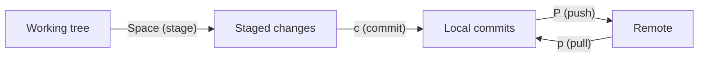

# 🧰 The lazygit Guide: From First Launch to Power User

> A practical, keyboard-driven tour of [lazygit](https://github.com/jesseduffield/lazygit), the terminal UI for Git.


*Caption: lazygit's default layout: five side panels, a main view, and the command log.*

**lazygit** wraps the Git commands you already know in a fast, keyboard-driven interface. You see your files, branches, commits, and stashes at once, and every action is one or two keystrokes away. Under the hood it runs real `git` commands, and it shows you each one in the command log, so you learn Git while you use it.

This guide takes you from "I have never used a Git TUI" to "I rewrite history from the keyboard without blinking."

> [!NOTE]
> Keybindings and config options in this guide follow the official lazygit docs for recent stable releases (the 0.4x to 0.5x series). lazygit evolves quickly. Press `?` inside lazygit to see the exact keys for your version. Anything I am not certain about is marked **(verify)**.

> [!TIP]
> **Quick Start in 2 Minutes**
>
> ```bash
> # 1. Install (pick yours, see section 1.2 for more)
> sudo zypper install lazygit      # openSUSE
> brew install lazygit             # macOS / Linuxbrew
> sudo pacman -S lazygit           # Arch
>
> # 2. Open any repository
> cd ~/projects/my-repo && lazygit
> ```
>
> Then inside lazygit:
>
> | Step | Keys |
> |------|------|
> | See all keys for the current panel | `?` |
> | Stage / unstage a file | `Space` |
> | Commit staged changes | `c` |
> | Push / pull | `P` / `p` |
> | Undo the last action | `z` |
> | Quit | `q` |

---

## 📑 Table of Contents

- [🌱 Part 1: Beginner](#-part-1-beginner)
  - [1.1 What is lazygit and why use it](#11-what-is-lazygit-and-why-use-it)
  - [1.2 Installation](#12-installation)
  - [1.3 First launch: the six panels](#13-first-launch-the-six-panels)
  - [1.4 Essential navigation keys](#14-essential-navigation-keys)
  - [1.5 Your first workflow](#15-your-first-workflow)
  - [1.6 Branching basics](#16-branching-basics)
  - [1.7 Undoing mistakes safely](#17-undoing-mistakes-safely)
- [🚀 Part 2: Intermediate](#-part-2-intermediate)
  - [2.1 Staging lines and hunks](#21-staging-lines-and-hunks)
  - [2.2 Stashing](#22-stashing)
  - [2.3 Interactive rebase](#23-interactive-rebase)
  - [2.4 Cherry-picking](#24-cherry-picking)
  - [2.5 Resolving merge conflicts](#25-resolving-merge-conflicts)
  - [2.6 Remotes, tags, and upstream tracking](#26-remotes-tags-and-upstream-tracking)
  - [2.7 Filtering, searching, and diffs](#27-filtering-searching-and-diffs)
  - [2.8 Worktrees and submodules](#28-worktrees-and-submodules)
- [🔥 Part 3: Advanced](#-part-3-advanced)
  - [3.1 Config file](#31-config-file)
  - [3.2 Custom keybindings](#32-custom-keybindings)
  - [3.3 Custom commands](#33-custom-commands)
  - [3.4 Themes and UI tweaks](#34-themes-and-ui-tweaks)
  - [3.5 Pagers and better diffs](#35-pagers-and-better-diffs)
  - [3.6 Editors and terminals](#36-editors-and-terminals)
  - [3.7 Bisect, reflog, and rescuing lost commits](#37-bisect-reflog-and-rescuing-lost-commits)
  - [3.8 Performance tips for large repos](#38-performance-tips-for-large-repos)
  - [3.9 Hooks and team workflows](#39-hooks-and-team-workflows)
- [📚 Part 4: Reference](#-part-4-reference)
  - [4.1 Keybinding cheat sheet](#41-keybinding-cheat-sheet)
  - [4.2 Common recipes](#42-common-recipes)
  - [4.3 Troubleshooting and FAQ](#43-troubleshooting-and-faq)
  - [4.4 Useful links](#44-useful-links)
- [📋 Cheat Sheet at a Glance](#-cheat-sheet-at-a-glance)
- [🤝 Contributing and Credits](#-contributing-and-credits)

---

## 🌱 Part 1: Beginner

You know what a commit and a branch are. Here you learn to do the everyday things without typing a single `git` command.

---

### 1.1 What is lazygit and why use it

lazygit is a terminal UI (TUI) for Git, written in Go. It runs in any terminal, including over SSH, and it needs nothing but `git` itself.

| | Plain `git` CLI | GUI clients | lazygit |
|---|---|---|---|
| Speed for common tasks | Fast if you remember the flags | Mouse-heavy, slower | Very fast, a few keystrokes |
| Learning curve | Steep | Gentle | Gentle, with on-screen key hints |
| Interactive rebase | Edit a todo file by hand | Varies, often limited | One key per action (`s`, `f`, `d`, `r`) |
| Staging single lines | `git add -p`, clunky | Good | Good, keyboard-driven |
| Works over SSH | Yes | No | Yes |
| Resource use | Minimal | Heavy | Light |
| Shows what it runs | n/a | Usually hidden | Yes, in the command log |

**Pick lazygit when** you live in the terminal, want to see repo state at a glance, and want complex operations (rebase, cherry-pick, partial staging) to stop being scary.

**Stick with plain `git` when** you are scripting, running in CI, or doing a one-off command you already know by heart. The two work together, and lazygit never hides your repo from the CLI.

> [!TIP]
> lazygit is not a replacement for understanding Git. It is a faster way to *use* what you understand. Watch the command log (bottom right) to see exactly which `git` command each key runs.

**Try it yourself**

```bash
mkdir lazygit-playground && cd lazygit-playground
git init
echo "hello" > hello.txt
lazygit
```

Look around. You should see `hello.txt` listed in the Files panel. Press `q` to quit. We will use this playground for the rest of Part 1.

---

### 1.2 Installation

> [!NOTE]
> Package versions vary by distribution, and some repos lag behind. Check with `lazygit --version` after installing. If your distro ships an old version, use the binary download or Homebrew instead.

<details>
<summary><strong>Debian / Ubuntu</strong></summary>

Availability in the official repositories depends on your release **(verify with `apt search lazygit`)**. The reliable method is the official release binary:

```bash
LAZYGIT_VERSION=$(curl -s "https://api.github.com/repos/jesseduffield/lazygit/releases/latest" | grep -Po '"tag_name": *"v\K[^"]*')
curl -Lo lazygit.tar.gz "https://github.com/jesseduffield/lazygit/releases/download/v${LAZYGIT_VERSION}/lazygit_${LAZYGIT_VERSION}_Linux_x86_64.tar.gz"
tar xf lazygit.tar.gz lazygit
sudo install lazygit -D -t /usr/local/bin/
lazygit --version
```

For ARM machines, replace `Linux_x86_64` with the matching asset name from the [releases page](https://github.com/jesseduffield/lazygit/releases).

</details>

<details>
<summary><strong>Fedora</strong></summary>

Recent Fedora releases may carry it in the main repos **(verify with `dnf search lazygit`)**. The documented route is the COPR repository:

```bash
sudo dnf copr enable dejan/lazygit
sudo dnf install lazygit
```

</details>

<details>
<summary><strong>Arch Linux</strong></summary>

```bash
sudo pacman -S lazygit
```

</details>

<details>
<summary><strong>openSUSE</strong></summary>

Available in Tumbleweed. On Leap, check whether your release has it **(verify with `zypper search lazygit`)**.

```bash
sudo zypper install lazygit
```

</details>

<details>
<summary><strong>Homebrew (macOS and Linux)</strong></summary>

```bash
brew install lazygit
```

</details>

<details>
<summary><strong>Snap</strong></summary>

A community-maintained snap exists. Its confinement and freshness vary, so prefer other methods if you can **(verify before relying on it)**.

```bash
sudo snap install lazygit
```

</details>

<details>
<summary><strong>Go install</strong></summary>

Requires a recent Go toolchain.

```bash
go install github.com/jesseduffield/lazygit@latest
```

Make sure `$(go env GOPATH)/bin` is on your `PATH`.

</details>

<details>
<summary><strong>Binary download (any platform)</strong></summary>

1. Download the archive for your OS and CPU from the [releases page](https://github.com/jesseduffield/lazygit/releases).
2. Extract the `lazygit` binary.
3. Move it somewhere on your `PATH`:

```bash
tar xf lazygit_*_Linux_x86_64.tar.gz lazygit
sudo install lazygit -D -t /usr/local/bin/
```

</details>

<details>
<summary><strong>Other options (Windows, Nix, and more)</strong></summary>

```bash
winget install -e --id=JesseDuffield.lazygit   # Windows (winget)
scoop install lazygit                          # Windows (Scoop)
nix-env -iA nixpkgs.lazygit                    # Nix
```

See the [official install section](https://github.com/jesseduffield/lazygit#installation) for the full, current list.

</details>

> [!TIP]
> Add a short alias so you can launch it in two keystrokes:
>
> ```bash
> alias lg='lazygit'
> ```

**Try it yourself:** Install lazygit, run `lazygit --version`, then run `lazygit --help` and skim the flags. Note `--print-config-dir`, we will use it in Part 3.

---

### 1.3 First launch: the six panels

Run `lazygit` inside a repository. The screen is split into a column of side panels on the left, a main view on the right, and the command log at the bottom.

```text
┌─ 1 Status ───────────┐┌─ Main view ──────────────────────────────────┐
│ repo → main          ││                                              │
├─ 2 Files ────────────┤│  Diff / log / patch of whatever is selected  │
│ M  src/app.py        ││  in the panel on the left.                   │
│ ?? notes.txt         ││                                              │
├─ 3 Local branches ───┤│                                              │
│ * main               ││                                              │
│   feature/login      │├─ Command log ────────────────────────────────┤
├─ 4 Commits ──────────┤│ git status --porcelain                       │
│ a1b2c3d Fix typo     ││ git diff --no-ext-diff ...                   │
│ 9f8e7d6 Add login    ││                                              │
├─ 5 Stash ────────────┤│                                              │
│ (empty)              ││                                              │
└──────────────────────┘└──────────────────────────────────────────────┘
 Stage: <space> | Commit: c | Push: P | Keybindings: ?
```


*Caption: The six areas of the default layout, numbered as in the diagram above.*

| # | Panel | What it shows | Jump with |
|---|-------|---------------|-----------|
| 1 | **Status** | Current repo and branch. Press `Enter` to switch recent repos. | `1` |
| 2 | **Files** | Changed files, staged and unstaged. Extra tabs for Worktrees and Submodules. | `2` |
| 3 | **Branches** | Tabs for Local branches, Remotes, and Tags. | `3` |
| 4 | **Commits** | Commit history. A second tab shows the Reflog. | `4` |
| 5 | **Stash** | Your stashed work in progress. | `5` |
| 6 | **Command log** | Every `git` command lazygit runs, plus the keybinding hint bar. | n/a (display only) |

The **main view** on the right changes depending on what you select: a diff for a file, the commit contents for a commit, and so on.

> [!NOTE]
> Some panels have **tabs**. Switch between them with `[` and `]`. For example, in the Branches panel `]` moves from Local branches to Remotes to Tags.

**Try it yourself:** In your playground, press `1` to `5` to jump between panels. In the Files panel, move onto `hello.txt` with `j`/`k` and watch the main view show its diff. Then press `]` in the Branches panel to see the tabs.

---

### 1.4 Essential navigation keys

| Key | Action |
|-----|--------|
| `j` / `k` or `↓` / `↑` | Move down / up in a list |
| `h` / `l` or `←` / `→` | Move to the previous / next panel |
| `1` to `5` | Jump straight to a side panel |
| `[` / `]` | Previous / next tab within a panel |
| `Tab` | Switch focus between the side panel and the main view (the diff), where applicable |
| `Enter` | Drill into the selected item (files in a commit, commits of a branch, lines to stage) |
| `Esc` | Go back / cancel |
| `/` | Search or filter the current list |
| `?` | **Open the keybindings menu for the current panel** |
| `q` | Quit (or go back out of a sub-view) |
| `+` / `_` | Cycle screen mode larger / smaller |

> [!IMPORTANT]
> `?` is the one key to memorize. It shows every action available in the panel you are in, with a search box. You never need to remember anything else on day one.

**Try it yourself:** Go to each of the five side panels and press `?`. Notice how the list of actions changes per panel. Press `Esc` to close it each time.

---

### 1.5 Your first workflow

The core loop: **stage, commit, push, pull**.



**Step by step**

1. **Go to Files** (`2`). Your changed files are listed.
2. **Stage** a file with `Space`. Press `a` to stage or unstage *all* files.
3. **Commit** with `c`. A small box opens. Type your message and press `Enter`.
4. **Push** with `P` (capital). On a brand-new branch lazygit asks which remote and branch name to use.
5. **Pull** with `p` (lowercase) to bring in remote changes.

| Key | Action | Panel |
|-----|--------|-------|
| `Space` | Stage / unstage file | Files |
| `a` | Stage / unstage all | Files |
| `c` | Commit | Files |
| `C` | Commit using your Git editor (for long messages) | Files |
| `A` | Amend the last commit with staged changes | Files |
| `P` | Push | Anywhere |
| `p` | Pull | Anywhere |
| `f` | Fetch | Files / Branches |


*Caption: Staged files appear green, unstaged files red; the main view shows the diff.*

> [!TIP]
> Recent versions give the commit box two fields: a summary line and a description. `Tab` moves between them. If your version behaves differently, press `?` while the box is open **(verify)**.

**Try it yourself**

1. In your playground, stage `hello.txt` and commit with the message `Add hello`.
2. Edit `hello.txt`, stage and commit again with `Update hello`.
3. Look at the Commits panel (`4`). You should see two commits. Select each one and read the main view.

---

### 1.6 Branching basics

All branch actions live in the **Branches** panel (`3`).

| Key | Action |
|-----|--------|
| `n` | **New** branch (from the selected branch or commit) |
| `Space` | **Checkout** the selected branch |
| `M` | **Merge** the selected branch into the one you have checked out |
| `r` | **Rebase** the checked-out branch onto the selected one |
| `d` | **Delete** (menu: local, remote, or both) |
| `R` | Rename branch |
| `-` | Checkout the previous branch |
| `f` | Fast-forward the selected branch from its upstream |
| `u` | Upstream options (set or unset tracking) |
| `o` | Create a pull request in your browser |

**Typical feature-branch flow**

1. Press `3`, then `n`, type `feature/greeting`, press `Enter`. You are now on the new branch.
2. Commit some work (section 1.5).
3. Move the cursor to `main`, press `Space` to check it out.
4. Move to `feature/greeting`, press `M` to merge it into `main`.
5. Press `d` on `feature/greeting` and choose to delete the local branch.

> [!NOTE]
> `M` merges the **selected** branch into the **currently checked-out** branch. Always check which branch has the `*` before merging.

> [!WARNING]
> Deleting a branch with unmerged commits can lose work. lazygit warns you first. If you delete by mistake, the commits are still in the reflog for a while. See [3.7](#37-bisect-reflog-and-rescuing-lost-commits).

**Try it yourself:** Create `feature/greeting`, add a commit that edits `hello.txt`, switch back to `main`, merge the branch, then delete it. Check the Commits panel to see the merge result.

---

### 1.7 Undoing mistakes safely

lazygit offers several levels of undo, from gentle to nuclear.

| Situation | What to do | Keys |
|-----------|------------|------|
| Undo the last lazygit action (commit, checkout, rebase step...) | Built-in undo, based on the reflog | `z` (redo with `Ctrl+z`) |
| Unstage a file | Same key that staged it | `Space` |
| Throw away changes to one file | Discard menu | `d` in Files |
| Throw away *everything* | Reset menu | `D` in Files |
| Fix the last commit (message) | Reword | `r` in Commits |
| Add forgotten changes to the last commit | Stage, then amend | `A` in Files, or `A` on the commit in Commits |
| Move a branch pointer back | Reset menu (soft / mixed / hard) | `g` in Commits |
| Reverse a commit without rewriting history | Revert | `t` in Commits |

**Reset in plain words**

| Mode | Moves branch pointer | Keeps staged changes | Keeps working-tree changes |
|------|:---:|:---:|:---:|
| Soft | Yes | Yes | Yes |
| Mixed | Yes | No (unstaged) | Yes |
| Hard | Yes | No | **No (lost)** |

> [!WARNING]
> **Discarding changes and hard resets are destructive for uncommitted work.** `z` (undo) is based on the reflog, which only knows about *committed* states. Uncommitted edits you discard, and untracked files you delete, **cannot be recovered** by lazygit or the reflog. Commit or stash first if you are unsure.
>
> **Recovery for committed work:** a hard reset only moves the branch pointer. Press `z` right away, or find the old commit in the Reflog tab (section 3.7).

> [!TIP]
> If you pushed a bad commit to a shared branch, prefer **revert** (`t`) over reset plus force-push. Revert adds a new commit that cancels the bad one and is safe for teammates.

**Try it yourself**

1. Make a commit with a typo in the message. Press `r` on it and fix it.
2. Make another commit, then press `z` to undo it. Press `Ctrl+z` to redo it.
3. Edit a file, press `d` in Files, and choose the discard option to throw the edit away.

---

## 🚀 Part 2: Intermediate

You are comfortable with the basics. Now speed up and clean up your history.

---

### 2.1 Staging lines and hunks

Sometimes one file holds two unrelated changes. Commit them separately by staging only part of a file.

1. In **Files** (`2`), select the file and press `Enter`. The main view becomes a staging view.
2. Move with `j`/`k`.
3. Press `Space` to stage or unstage the **selected line**.
4. Press `a` to select or stage a whole **hunk**.
5. Press `v` to start a **range selection**, move, then `Space` to stage the range.
6. Press `Tab` to flip between the unstaged and staged views. `Esc` returns to the file list.

| Key | Action (staging view) |
|-----|-----------------------|
| `Space` | Stage / unstage the selected line or range |
| `a` | Toggle hunk selection mode |
| `v` | Toggle range selection |
| `Tab` | Switch between unstaged and staged changes |
| `d` | Discard the selected lines **(destructive)** |
| `e` | Open the file in your editor at this line |
| `Esc` | Back to the file list |


*Caption: Line-by-line staging in the main view; the selected lines are highlighted.*

> [!TIP]
> Small, focused commits make rebasing, reverting, and reviewing far easier. This view is how you get them.

**Try it yourself:** Change two separate lines in a file. Open it with `Enter`, stage only the first change, commit it, then stage and commit the second.

---

### 2.2 Stashing

A stash saves your uncommitted work and gives you a clean tree.

**Stash from the Files panel:** press `s` to open the stash menu. Typical options are stash all changes, stash all changes but keep the index, include untracked files, stash only staged changes, or stash only unstaged changes. Pick one and name it.

**Manage stashes in the Stash panel (`5`):**

| Key | Action |
|-----|--------|
| `Space` | **Apply** the stash (keep it in the list) |
| `g` | **Pop** (apply, then remove) |
| `d` | **Drop** (delete) |
| `n` | New branch from the stash |
| `r` | Rename |
| `Enter` | Browse the files inside the stash |

> [!WARNING]
> Dropping a stash is hard to undo. If you do it by accident, `git fsck --unreachable | grep commit` can sometimes help locate it, but do not count on it. Apply a stash before you drop it.

**Try it yourself:** Edit two files, stash everything with `s`, confirm the Files panel is empty, then apply the stash from panel `5` with `Space`.

---

### 2.3 Interactive rebase

Interactive rebase is where lazygit shines. In plain Git you edit a todo list. In lazygit you press a key on the commit you want to change.

Open the **Commits** panel (`4`) and move to the commit.

| Key | Action | What it does |
|-----|--------|--------------|
| `s` | **Squash** | Merge into the commit below, combining messages |
| `f` | **Fixup** | Merge into the commit below, discarding this message |
| `r` | **Reword** | Change the commit message |
| `R` | Reword in your editor | Same, in `$EDITOR` |
| `d` | **Drop** | Remove the commit entirely |
| `e` | **Edit** | Pause the rebase at this commit so you can change it |
| `Ctrl+k` / `Ctrl+j` | **Move** commit up / down | Reorder history |
| `A` | Amend | Add currently staged changes to this commit |
| `F` | Create fixup commit | Makes a `fixup!` commit targeting the selected one |
| `S` | Apply fixup commits | Squash all pending `fixup!` commits above automatically |
| `i` | Start interactive rebase | Begin a rebase session from here **(verify)** |
| `t` | Revert | New commit that undoes this one |

**Example: tidy five messy commits into one**

1. In Commits, select the oldest of the five.
2. Select the next one up and press `s` (or `f` to discard its message).
3. Repeat until one commit remains.
4. Press `r` to write a good message.

**Example: fix an older commit without rewriting by hand**

1. Stage your fix in Files.
2. In Commits, select the target commit and press `F` (create fixup commit).
3. Press `S` to apply the fixup commits. The fix is folded into the right place.

If a rebase hits a conflict, lazygit shows it and lets you resolve it (section 2.5). Press `m` in the Commits panel to open the merge/rebase options menu (continue, abort, skip).


*Caption: Commits marked with their pending rebase action while a rebase is in progress.*

> [!WARNING]
> **Rebasing rewrites history.** Never rebase commits that teammates have already pulled unless you have agreed to it. Pushing rewritten history needs a force push, see [2.6](#26-remotes-tags-and-upstream-tracking).
>
> **Recovery:** press `z` to undo the last step, or open the Reflog tab (`]` in the Commits panel), select the commit from before the rebase, and use `g` to reset to it.

> [!NOTE]
> You can also rebase a whole branch from the Branches panel: select the target branch and press `r`. You will get a choice between a simple and an interactive rebase.

**Try it yourself**

1. Make three commits named `wip 1`, `wip 2`, `wip 3`.
2. Squash `wip 2` and `wip 3` into `wip 1` with `s`.
3. Reword the result to something meaningful with `r`.
4. Press `z` to undo it all, and watch your history return.

---

### 2.4 Cherry-picking

Cherry-picking copies a commit onto your current branch.

1. In the **Commits** panel (or after pressing `Enter` on a branch to see its commits), select a commit and press `C` to **copy** it. Use `v` first to select a range.
2. **Check out** the destination branch.
3. Go to the Commits panel and press `V` to **paste** the copied commits.
4. Press `Ctrl+r` to clear the copied selection.

Copied commits are highlighted in the list until you paste or clear them.

**Between branches without leaving your branch:** in the Branches panel, press `Enter` on another branch to list *its* commits, select the ones you want with `C`, press `Esc`, and paste with `V`.

> [!TIP]
> Cherry-picked commits get new hashes. If you later merge the source branch, Git usually handles the duplicates fine, but avoid cherry-picking the same commit repeatedly.

**Try it yourself:** Make a commit on `feature/greeting`. Switch to `main`, open the branch's commits, copy that commit with `C`, and paste it onto `main` with `V`.

---

### 2.5 Resolving merge conflicts

When a merge, rebase, or cherry-pick conflicts, the affected files show a conflict marker in the Files panel.

1. Select the conflicted file and press `Enter`.
2. The main view shows each conflict **hunk** with both sides (yours and theirs).
3. Pick what to keep:

| Key | Action |
|-----|--------|
| `↑` / `↓` or `k` / `j` | Move between hunks |
| `←` / `→` or `h` / `l` | Move between the sides of a hunk |
| `Space` | Pick the highlighted section |
| `b` | Pick **both** sections |
| `z` | Undo your last pick |
| `e` | Edit the file in your editor |
| `Esc` | Back to the file list |

4. When all conflicts in all files are resolved, lazygit offers to **continue** the merge or rebase. You can also use `m` in the Commits panel (or the options menu) to continue, skip, or abort.


*Caption: The built-in merge tool showing the two sides of a conflict hunk.*

> [!TIP]
> Prefer an external merge tool? Select the file and press `M` in Files to launch the tool configured in `git config merge.tool`.

> [!WARNING]
> Lost in a conflict you cannot sort out? Abort. From the options menu choose abort, or press `z` right after the operation, to return to the state before you started.

**Try it yourself:** Create `main` and `feature` branches that edit the *same line* of `hello.txt` differently. Merge one into the other and resolve the conflict using `Space` and `b`.

---

### 2.6 Remotes, tags, and upstream tracking

**Remotes tab** (Branches panel, press `]` once):

| Key | Action |
|-----|--------|
| `n` | Add a remote |
| `f` | Fetch from the remote |
| `e` | Edit the remote |
| `d` | Remove the remote |
| `Enter` | Browse the remote's branches |

**Tags tab** (press `]` again):

| Key | Action |
|-----|--------|
| `n` | Create a tag |
| `Space` | Checkout the tag |
| `P` | Push the tag |
| `d` | Delete the tag (menu) |

You can also create a tag from a commit with `T` in the Commits panel.

**Upstream tracking:** in **Local branches**, press `u` to see the upstream options (set or unset the upstream, or reset to it). When your branch and its upstream have diverged, the push key `P` offers a **force push**.

> [!WARNING]
> **Force push overwrites remote history.** lazygit uses the safer `--force-with-lease` variant, which refuses to overwrite commits you have not seen, but it can still destroy a teammate's work if you have fetched it and ignored it.
>
> **Before you do it:** fetch first and check what you are about to overwrite.
> **Recovery:** the old remote commits may still be in the Reflog of whoever pushed them (and in your own reflog if you had pulled them). Ask your hosting provider about restoring a branch if needed.
>
> To block force pushing entirely, set `git.disableForcePushing: true` in your config **(verify the option name in your version's docs)**.

**Try it yourself:** Add a second remote with `n` in the Remotes tab (a throwaway local bare repo works: `git init --bare /tmp/test.git`), push your branch to it, and create a tag from the Tags tab.

---

### 2.7 Filtering, searching, and diffs

| Key | Action |
|-----|--------|
| `/` | Search / filter the current list; `n` / `N` jump to next / previous match |
| `Ctrl+s` | **Filter commits by path** (history of a file or folder) |
| `W` or `Ctrl+e` | **Diffing menu:** compare any two refs or commits |
| `Ctrl+w` | Toggle whitespace in diffs |
| `{` / `}` | Show fewer / more context lines in diffs |
| `Ctrl+l` | **Log menu** in Commits: graph, order, and what to show |

**Commit graph:** open the log menu with `Ctrl+l` in the Commits panel to toggle the graph and change the sort order. In the Status panel, `a` shows the log for all branches.

**Comparing two things:** press `W`, choose to diff against a ref (or "mark" a base), then select another commit or branch. The main view shows the diff between them. Run the menu again to reset.


*Caption: Diff mode active, showing the difference between two selected refs.*

> [!NOTE]
> Exact menu wording changes between versions. Use `?` and the in-app menus as your source of truth.

**Try it yourself:** Press `Ctrl+s` in Commits and enter a filename to see only the commits touching it. Then use `/` to search commit messages for a word.

---

### 2.8 Worktrees and submodules

Both live as **tabs of the Files panel**. Switch with `[` / `]` while the Files panel is focused.

**Worktrees** let you check out several branches of one repo into separate folders at once.

| Key | Action |
|-----|--------|
| `n` | Create a new worktree |
| `Space` | Switch to the selected worktree |
| `o` | Open the worktree in your file manager / editor |
| `d` | Remove the worktree |

**Submodules**

| Key | Action |
|-----|--------|
| `Enter` | Enter the submodule (opens it as a repo in lazygit) |
| `u` | Update |
| `i` | Initialize |
| `b` | Bulk submodule options menu |
| `n` | Add a new submodule |
| `e` | Edit the submodule URL |
| `d` | Remove the submodule |

> [!TIP]
> Entering a submodule opens a fresh lazygit view of it. Press `q` or `Esc` to return to the parent repo.

**Try it yourself:** In your playground, create a worktree for `feature/greeting` from the Worktrees tab, then switch between the two folders and watch the Status panel update.

---

## 🔥 Part 3: Advanced

Customize lazygit until it feels like your own tool.

---

### 3.1 Config file

lazygit reads a single YAML file, `config.yml`. Find your config directory with:

```bash
lazygit --print-config-dir
```

| OS | Typical location |
|----|------------------|
| Linux | `~/.config/lazygit/config.yml` |
| macOS | `~/Library/Application Support/lazygit/config.yml` (or `~/.config/lazygit` if `XDG_CONFIG_HOME` is set) |
| Windows | `%APPDATA%\lazygit\config.yml` |

You can also open it from lazygit: in the **Status** panel, press `e` to edit or `o` to open the config file.

Point lazygit at a different file with the `LG_CONFIG_FILE` environment variable, or `--use-config-file=<path>`. Recent versions also support a repo-local config **(verify in the docs for your version)**.

**Structure at a glance**

```yaml
gui:            # look and layout
git:            # how lazygit runs git (paging, commits, merging, logs)
os:             # editor, opener, clipboard
refresher:      # auto-refresh and auto-fetch timing
keybinding:     # remap keys
customCommands: # your own commands
update:         # update checks
```

> [!TIP]
> The full, always-current list of options with defaults is in the official [Config.md](https://github.com/jesseduffield/lazygit/blob/master/docs/Config.md). Copy its default block and delete what you do not change.

---

### 3.2 Custom keybindings

Keybindings live under `keybinding:`, grouped by context.

```yaml
keybinding:
  universal:
    pushFiles: 'P'
    pullFiles: 'p'
    quit: 'q'
  files:
    commitChanges: 'c'
    commitChangesWithEditor: 'C'
```

Special keys use angle brackets: `<space>`, `<enter>`, `<esc>`, `<c-r>` (Ctrl+r), `<a-b>` (Alt+b), `<pgup>`, and so on. Set a binding to `<disabled>` to turn it off.

> [!IMPORTANT]
> The names of the config keys (like `commitChangesWithEditor`) are not always obvious. Look them up in the [Keybindings section of Config.md](https://github.com/jesseduffield/lazygit/blob/master/docs/Config.md) rather than guessing. A wrong name is silently ignored.

> [!WARNING]
> Remapping common keys breaks muscle memory and makes screenshots and docs confusing. Change as little as you need.

---

### 3.3 Custom commands

Custom commands bind a shell command to a key in a given **context**, and can ask the user for input first.

**Fields you will use most**

| Field | Meaning |
|-------|---------|
| `key` | The key that triggers it |
| `context` | Where it is active: `global`, `files`, `localBranches`, `commits`, `stash`, `commitFiles`, `remotes`, `tags`, and others |
| `command` | The shell command, with Go-template variables |
| `description` | Shown in the keybindings menu |
| `prompts` | Input steps: `input`, `menu`, `confirm`, `menuFromCommand` |
| `subprocess` | `true` to suspend lazygit and give the command your terminal |
| `loadingText` | Message shown while it runs |

**Useful template variables:** `{{.SelectedFile.Name}}`, `{{.SelectedLocalBranch.Name}}`, `{{.SelectedCommit.Hash}}`, `{{.CheckedOutBranch.Name}}`, and answers to prompts as `{{.Form.<Key>}}`.

**Example 1: Conventional Commits prompt**

```yaml
customCommands:
  - key: 'X'
    context: 'files'
    description: 'Conventional commit'
    loadingText: 'Committing...'
    prompts:
      - type: 'menu'
        title: 'Type of change'
        key: 'Type'
        options:
          - name: 'feat'
            description: 'A new feature'
            value: 'feat'
          - name: 'fix'
            description: 'A bug fix'
            value: 'fix'
          - name: 'docs'
            description: 'Documentation only'
            value: 'docs'
          - name: 'refactor'
            description: 'Code change that is neither a fix nor a feature'
            value: 'refactor'
          - name: 'chore'
            description: 'Maintenance'
            value: 'chore'
      - type: 'input'
        title: 'Scope (optional)'
        key: 'Scope'
        initialValue: ''
      - type: 'input'
        title: 'Message'
        key: 'Message'
        initialValue: ''
      - type: 'confirm'
        title: 'Commit?'
        body: 'Create "{{.Form.Type}}: {{.Form.Message}}" ?'
    command: >-
      git commit -m "{{.Form.Type}}{{if .Form.Scope}}({{.Form.Scope}}){{end}}: {{.Form.Message}}"
```

> [!NOTE]
> Pick a key that is not already used in that context, or you will shadow a built-in action. Press `?` in the panel to check which keys are taken.

**Example 2: Open the selected commit in `tig`**

```yaml
customCommands:
  - key: 'T'
    context: 'commits'
    description: 'Show commit in tig'
    subprocess: true
    command: 'tig show {{.SelectedCommit.Hash}}'
```

**Example 3: Create a branch with a ticket prefix**

```yaml
customCommands:
  - key: 'N'
    context: 'localBranches'
    description: 'New ticket branch'
    prompts:
      - type: 'input'
        title: 'Ticket ID (e.g. ABC-123)'
        key: 'Ticket'
      - type: 'input'
        title: 'Short description (kebab-case)'
        key: 'Desc'
    command: 'git checkout -b "{{.Form.Ticket}}-{{.Form.Desc}}"'
```

<details>
<summary><strong>Advanced: menus built from a command's output</strong></summary>

`menuFromCommand` runs a command and turns each output line into a menu entry, which is handy for choosing a remote branch or a tag.

```yaml
customCommands:
  - key: 'C'
    context: 'localBranches'
    description: 'Checkout a branch matching a pattern'
    prompts:
      - type: 'menuFromCommand'
        title: 'Branch'
        key: 'Branch'
        command: 'git branch --all --format="%(refname:short)"'
        filter: '(?P<name>.*)'
        valueFormat: '{{ .name }}'
        labelFormat: '{{ .name | green }}'
    command: 'git checkout {{.Form.Branch}}'
```

The exact fields of `menuFromCommand` (`filter`, `valueFormat`, `labelFormat`) are documented in the [Custom Command Keybindings guide](https://github.com/jesseduffield/lazygit/blob/master/docs/Custom_Command_Keybindings.md). Check it for your version **(verify)**.

</details>

> [!WARNING]
> Custom commands run arbitrary shell. Never paste a config from an untrusted source without reading it. Be careful with destructive commands (`reset --hard`, `clean -fd`) and add a `confirm` prompt.

---

### 3.4 Themes and UI tweaks

```yaml
gui:
  theme:
    activeBorderColor:
      - '#a6e3a1'
      - bold
    inactiveBorderColor:
      - '#6c7086'
    selectedLineBgColor:
      - '#313244'
    optionsTextColor:
      - '#89b4fa'
    unstagedChangesColor:
      - red
    cherryPickedCommitBgColor:
      - '#45475a'
    cherryPickedCommitFgColor:
      - '#a6e3a1'
  nerdFontsVersion: '3'        # show icons; use '' to disable
  showFileTree: true           # tree view of files (toggle with ` in Files)
  sidePanelWidth: 0.3333       # fraction of the screen
  expandFocusedSidePanel: true # bigger focused panel
  showCommandLog: true
  showRandomTip: false
  border: 'rounded'            # single, double, rounded, hidden
  commitLength:
    show: true
  language: 'auto'
```

Colors accept names (`red`, `green`), hex codes, and attributes like `bold`, `underline`, `reverse`.

> [!NOTE]
> Icons need a [Nerd Font](https://www.nerdfonts.com/) in your terminal. Older versions used `showIcons: true` instead of `nerdFontsVersion` **(verify for your version)**.


*Caption: An example theme with rounded borders and Nerd Font icons.*

---

### 3.5 Pagers and better diffs

A pager changes how diffs look in the main view. Two popular choices are [delta](https://github.com/dandavison/delta) and [diff-so-fancy](https://github.com/so-fancy/diff-so-fancy).

**delta**

```yaml
git:
  paging:
    colorArg: always
    pager: delta --dark --paging=never
```

**delta, side by side**

```yaml
git:
  paging:
    colorArg: always
    pager: delta --dark --paging=never --line-numbers --side-by-side --width={{columnWidth}}
```

**diff-so-fancy**

```yaml
git:
  paging:
    colorArg: always
    pager: diff-so-fancy
```

**An external diff tool such as difftastic**

```yaml
git:
  paging:
    externalDiffCommand: difft --color=always
```

> [!IMPORTANT]
> Always pass `--paging=never` to delta. lazygit draws its own scrolling view, and a nested pager will hang or garble the screen.

> [!TIP]
> Newer lazygit versions can hold a **list** of pagers under `git.pagers` and let you cycle through them with a key **(verify in Config.md for your version)**. Staging lines in a paged view may be limited, since lazygit needs the plain diff to build patches. Toggle the pager off when you need to stage lines.

---

### 3.6 Editors and terminals

**Editor integration** (the `e` key opens a file; `o` opens it with the system opener):

```yaml
os:
  editPreset: 'nvim'     # also: vim, nvim-remote, vscode, helix, emacs, and more
```

Check the list of presets in [Config.md](https://github.com/jesseduffield/lazygit/blob/master/docs/Config.md) **(verify)**. For anything else, set `edit`, `editAtLine`, and `editAtLineAndWait` yourself:

```yaml
os:
  edit: 'code -- {{filename}}'
  editAtLine: 'code --goto -- {{filename}}:{{line}}'
  editAtLineAndWait: 'code --goto --wait -- {{filename}}:{{line}}'
```

**Neovim**

- Use the `nvim-remote` preset so files open in your *running* Neovim instead of nesting a second one.
- Plugins such as [lazygit.nvim](https://github.com/kdheepak/lazygit.nvim) open lazygit in a floating window inside Neovim.

**VS Code**

- Use `editPreset: 'vscode'`, or run `lazygit` in the integrated terminal.

**tmux**

```bash
# ~/.tmux.conf: open lazygit in a popup with prefix + g
bind g display-popup -E -w 90% -h 90% -d "#{pane_current_path}" lazygit
```

**Change directory on exit** (so your shell follows the repo you were in):

```bash
lg() {
    export LAZYGIT_NEW_DIR_FILE=~/.lazygit/newdir
    lazygit "$@"
    if [ -f "$LAZYGIT_NEW_DIR_FILE" ]; then
        cd "$(cat "$LAZYGIT_NEW_DIR_FILE")"
        rm -f "$LAZYGIT_NEW_DIR_FILE" > /dev/null
    fi
}
```

---

### 3.7 Bisect, reflog, and rescuing lost commits

**Bisect** hunts down the commit that introduced a bug by binary search.

1. In the **Commits** panel, select a commit you know is **bad** and press `b`. Choose *mark as bad*.
2. Select a commit you know is **good**, press `b`, and choose *mark as good*.
3. lazygit checks out a commit halfway between. Test your code, then press `b` and mark it good or bad.
4. Repeat until lazygit names the culprit. Press `b` and choose *reset* to end the session and return to your branch.

**Reflog** is the safety net: every position `HEAD` has been at, for a limited time (90 days by default for reachable entries, 30 for unreachable).

- Open the Commits panel and press `]` to reach the **Reflog** tab.
- `Space` checks out an entry, `g` resets to it, `n` makes a new branch from it, and `C` copies it for cherry-picking.

**Rescue recipe: "I deleted a branch" or "I hard-reset and lost commits"**

1. Go to **Commits** then **Reflog** (`]`).
2. Find the entry from *before* the mistake (look at the messages like `commit:`, `checkout:`, `reset:`).
3. Press `n` on it to create a new branch there. Your commits are back.

> [!NOTE]
> The reflog is **local**. It does not exist on the remote, and it does not hold uncommitted changes. See also `z` (undo) in section 1.7, which is built on the same data.

> [!WARNING]
> `git gc --prune=now` or a long wait can permanently delete unreachable commits. Rescue promptly.

---

### 3.8 Performance tips for large repos

```yaml
git:
  autoFetch: false     # do not fetch in the background
  autoRefresh: true    # set false to refresh only on demand (press R)
  log:
    showGraph: 'never' # options: always, never, when-maximised (verify)
gui:
  showFileTree: false  # a flat file list is cheaper on huge trees
refresher:
  refreshInterval: 10  # seconds between status refreshes (default is low)
  fetchInterval: 120   # seconds between background fetches
```

**Tips**

- **Turn off the graph** in the commit list on very large histories.
- **Disable the pager** while browsing if diffs are huge.
- **Avoid `git.autoFetch`** on slow networks or when you have many remotes.
- **Use `R`** to refresh on demand instead of polling.
- **Tune Git itself**, since lazygit is only as fast as `git` is:

```bash
git config feature.manyFiles true
git config core.untrackedCache true
git config core.fsmonitor true     # on supported platforms
git maintenance start
```

> [!NOTE]
> Option names and defaults shift between releases. Compare with the defaults in [Config.md](https://github.com/jesseduffield/lazygit/blob/master/docs/Config.md) before relying on them **(verify)**.

---

### 3.9 Hooks and team workflows

**Git hooks.** lazygit runs commits through normal `git commit`, so your `pre-commit`, `commit-msg`, and other hooks run as usual. Their output appears in the command log and in a popup if they fail.

| Need | How |
|------|-----|
| Skip hooks for one commit | `w` in Files (commit without pre-commit hook) |
| Skip hooks for WIP commits | `git.skipHookPrefix: 'WIP'` skips hooks when the message starts with `WIP` |
| GPG signing prompts | `git.overrideGpg: true` lets lazygit handle the passphrase prompt |
| Sign off commits | `git.commit.signOff: true` |

```yaml
git:
  skipHookPrefix: 'WIP'
  commit:
    signOff: true
```

**Team workflows**

- **Ticket prefixes:** lazygit can prefix commit messages from the branch name via `git.commitPrefix` (a `pattern` and a `replace`). Newer versions can set this per repository with `commitPrefixes` **(verify)**.
- **Share your config:** keep `config.yml` in your dotfiles, or, if your version supports it, in the repo, so everyone gets the same custom commands.
- **Standardize commit messages:** distribute the Conventional Commits custom command from section 3.3 to the whole team.
- **Protect shared branches:** use server-side branch protection, and consider `git.disableForcePushing: true` for people who do not need to force push.
- **Alias:** `git config --global alias.lg '!lazygit'` lets you run `git lg`.

> [!WARNING]
> Skipping hooks (`w`, or the `WIP` prefix) means skipped lint, tests, and secret scans. Do not let hook-skipped commits reach a shared branch unchecked.

---

## 📚 Part 4: Reference

---

### 4.1 Keybinding cheat sheet

> [!IMPORTANT]
> This table covers the most-used keys. It is not exhaustive, and keys can change between versions. **Press `?` in any panel for the authoritative list.**

| Key | Action | Panel |
|-----|--------|-------|
| `?` | Open the keybindings menu | Global |
| `q` | Quit | Global |
| `Esc` | Back / cancel | Global |
| `1` to `5` | Jump to a side panel | Global |
| `h` `l` / `←` `→` | Previous / next panel | Global |
| `j` `k` / `↓` `↑` | Move in a list | Global |
| `[` `]` | Previous / next tab | Global |
| `Enter` | Drill in | Global |
| `/` | Search / filter | Global |
| `R` | Refresh | Global |
| `P` | Push | Global |
| `p` | Pull | Global |
| `z` | Undo | Global |
| `Ctrl+z` | Redo | Global |
| `Ctrl+r` | Switch to a recent repo | Global |
| `+` `_` | Next / previous screen mode | Global |
| `@` | Command log options | Global |
| `:` | Run a shell command | Global |
| `W` / `Ctrl+e` | Diffing menu | Global |
| `Ctrl+s` | Filter commits by path | Global |
| `Ctrl+w` | Toggle whitespace in diffs | Global |
| `{` `}` | Shrink / grow diff context | Global |
| `Enter` | Switch recent repo | Status |
| `e` / `o` | Edit / open config file | Status |
| `a` | Show log of all branches | Status |
| `Space` | Stage / unstage file | Files |
| `a` | Stage / unstage all | Files |
| `c` | Commit | Files |
| `C` | Commit with editor | Files |
| `w` | Commit without hooks | Files |
| `A` | Amend last commit | Files |
| `d` | Discard menu (one file) | Files |
| `D` | Reset menu (everything) | Files |
| `s` | Stash menu | Files |
| `e` | Edit file | Files |
| `o` | Open file | Files |
| `i` | Add to `.gitignore` | Files |
| `` ` `` | Toggle file tree | Files |
| `Enter` | Stage lines / open conflict view | Files |
| `M` | Open external merge tool | Files |
| `Space` | Checkout branch | Branches |
| `n` | New branch | Branches |
| `d` | Delete branch (menu) | Branches |
| `R` | Rename branch | Branches |
| `M` | Merge into current | Branches |
| `r` | Rebase onto selected | Branches |
| `f` | Fast-forward | Branches |
| `u` | Upstream options | Branches |
| `o` | Open pull request | Branches |
| `-` | Checkout previous branch | Branches |
| `T` | Create tag | Branches (Tags) |
| `P` | Push tag | Branches (Tags) |
| `Space` | Checkout commit | Commits |
| `s` | Squash | Commits |
| `f` | Fixup | Commits |
| `r` | Reword | Commits |
| `R` | Reword in editor | Commits |
| `d` | Drop | Commits |
| `e` | Edit (pause rebase) | Commits |
| `Ctrl+k` / `Ctrl+j` | Move commit up / down | Commits |
| `A` | Amend with staged changes | Commits |
| `F` | Create fixup commit | Commits |
| `S` | Apply fixup commits | Commits |
| `t` | Revert | Commits |
| `T` | Tag commit | Commits |
| `C` | Copy (cherry-pick) | Commits |
| `V` | Paste (cherry-pick) | Commits |
| `Ctrl+r` | Clear copied commits | Commits |
| `n` | New branch from commit | Commits |
| `g` | Reset menu (soft/mixed/hard) | Commits |
| `b` | Bisect menu | Commits |
| `m` | Merge / rebase options | Commits |
| `v` | Range select | Commits, Files |
| `Ctrl+l` | Log options | Commits |
| `Enter` | View files in the commit | Commits |
| `Space` | Apply stash | Stash |
| `g` | Pop stash | Stash |
| `d` | Drop stash | Stash |
| `n` | Branch from stash | Stash |
| `r` | Rename stash | Stash |
| `Space` | Add file to custom patch | Commit files |
| `Ctrl+p` | Patch options menu | Commit files |

---

### 4.2 Common recipes

<details>
<summary><strong>I committed to the wrong branch</strong></summary>

Your commit is on `main`, but it belongs on a new branch.

1. In **Branches**, press `n` with `main` selected and name the new branch (for example `feature/oops`). It starts from your current commit, so it already holds the work.
2. Check out `main` again.
3. In **Commits**, select the commit **below** your wrong commit (the last good one) and press `g`, then choose *hard reset*.

> [!WARNING]
> A hard reset discards uncommitted changes. Commit or stash anything you want to keep first. If you pushed `main`, do **not** reset and force-push on a shared branch. Use revert (`t`) instead.

Alternative: cherry-pick the commit onto the right branch (`C`, then `V`) and drop it from `main` with `d`.

</details>

<details>
<summary><strong>I need to split a commit</strong></summary>

1. In **Commits**, select the commit and press `Enter` to see its files.
2. Press `Space` on the files (or press `Enter` on a file to pick individual lines) that should go into the **new** commit. They are added to a *custom patch*.
3. Press `Ctrl+p` to open the patch options menu.
4. Choose an option such as moving the patch out into the index, or into a new commit **(exact menu wording varies, verify)**.
5. Commit the pieces separately.

> [!WARNING]
> This rewrites history. Do it on unpushed commits, or coordinate with your team. Press `z` to undo if the result is wrong.

</details>

<details>
<summary><strong>Undo my last push</strong></summary>

**Safe way (shared branch): revert.**

1. In **Commits**, select the pushed commit and press `t` to revert it.
2. Press `P` to push the revert commit.

**Rewrite way (only if no one else has pulled it):**

1. In **Commits**, select the commit *before* the bad one and use `g` for a reset.
2. Press `P`. lazygit will offer a force push.

> [!WARNING]
> Force pushing rewrites remote history and can break teammates' clones. Prefer revert on shared branches.

</details>

<details>
<summary><strong>Fix a typo in an older commit</strong></summary>

1. Fix the file and stage it.
2. In **Commits**, select the target commit and press `A` to amend it, or press `F` to create a fixup commit and then `S` to fold it in.

</details>

<details>
<summary><strong>Combine my last few commits before opening a PR</strong></summary>

1. Select the oldest commit you want to keep.
2. Move up through the others and press `s` (or `f`) on each.
3. Reword the final commit with `r`.

</details>

<details>
<summary><strong>Get one file back from a previous commit</strong></summary>

1. In **Commits**, select the commit and press `Enter`.
2. Select the file and press `c` to check it out into your working tree.

</details>

<details>
<summary><strong>Find who changed a file and when</strong></summary>

Press `Ctrl+s` in Commits and enter the path. The list narrows to commits that touched it.

</details>

---

### 4.3 Troubleshooting and FAQ

<details>
<summary><strong>Icons look like boxes or question marks</strong></summary>

Install a Nerd Font and select it in your terminal, then set `gui.nerdFontsVersion: '3'`. Or turn icons off by setting it to an empty string. Older versions used `gui.showIcons`.

</details>

<details>
<summary><strong>The screen is garbled after enabling delta</strong></summary>

Add `--paging=never` to the delta command. See [3.5](#35-pagers-and-better-diffs).

</details>

<details>
<summary><strong>A key does not do what this guide says</strong></summary>

Your version may differ or you may have remapped it. Press `?` in the current panel to see the real binding. Compare `lazygit --version` against the [releases page](https://github.com/jesseduffield/lazygit/releases).

</details>

<details>
<summary><strong>My config changes have no effect</strong></summary>

- Confirm the path with `lazygit --print-config-dir`.
- Check your YAML indentation (spaces only, no tabs).
- Misspelled option names are ignored without an error. Compare with Config.md.
- Is `LG_CONFIG_FILE` set in your shell?

</details>

<details>
<summary><strong>The editor does not open or opens the wrong one</strong></summary>

Set `os.editPreset`, or define `os.edit` and `os.editAtLine`. lazygit also respects `$GIT_EDITOR`, `$VISUAL`, and `$EDITOR`.

</details>

<details>
<summary><strong>Force push is blocked or not offered</strong></summary>

Check whether `git.disableForcePushing` is set. Also make sure the branch actually has diverged from its upstream.

</details>

<details>
<summary><strong>lazygit is slow in a big repository</strong></summary>

See [3.8](#38-performance-tips-for-large-repos).

</details>

<details>
<summary><strong>How do I see what lazygit is doing?</strong></summary>

Watch the command log. For more detail run `lazygit --debug` in one terminal and `lazygit --logs` in another to tail the log.

</details>

<details>
<summary><strong>Does it work over SSH and inside containers?</strong></summary>

Yes. It only needs a terminal and `git`. Make sure `TERM` supports colors (for example `xterm-256color`).

</details>

<details>
<summary><strong>Can I use the mouse?</strong></summary>

Yes, it is supported by default. Disable it with `gui.mouseEvents: false` **(verify)**.

</details>

<details>
<summary><strong>Where do I report a bug?</strong></summary>

Open an issue on the [lazygit GitHub repo](https://github.com/jesseduffield/lazygit/issues). Include `lazygit --version` and your OS and terminal.

</details>

---

### 4.4 Useful links

| Resource | Link |
|----------|------|
| Official repository | <https://github.com/jesseduffield/lazygit> |
| Releases and changelog | <https://github.com/jesseduffield/lazygit/releases> |
| Config reference | <https://github.com/jesseduffield/lazygit/blob/master/docs/Config.md> |
| Keybindings per language | <https://github.com/jesseduffield/lazygit/tree/master/docs/keybindings> |
| Custom command guide | <https://github.com/jesseduffield/lazygit/blob/master/docs/Custom_Command_Keybindings.md> |
| Issues and discussions | <https://github.com/jesseduffield/lazygit/issues> |
| delta (pager) | <https://github.com/dandavison/delta> |
| lazygit.nvim | <https://github.com/kdheepak/lazygit.nvim> |
| Pro Git book (free) | <https://git-scm.com/book> |

---

## 📋 Cheat Sheet at a Glance

| I want to... | Do this |
|--------------|---------|
| See every key for where I am | `?` |
| Stage / commit / push | `Space` → `c` → `P` |
| Stage part of a file | `Enter` on the file, then `Space` per line, `a` per hunk |
| Make a branch / switch / merge | `n` / `Space` / `M` in Branches |
| Stash / apply | `s` in Files / `Space` in Stash |
| Squash / fixup / reword / drop | `s` / `f` / `r` / `d` in Commits |
| Reorder commits | `Ctrl+k` / `Ctrl+j` |
| Copy / paste commits | `C` / `V` |
| Resolve conflicts | `Enter` on the file, `Space` to pick, `b` for both |
| Undo / redo | `z` / `Ctrl+z` |
| Find a lost commit | Commits → Reflog tab (`]`) |
| Find a bug commit | `b` in Commits (bisect) |
| Search or filter | `/`, or `Ctrl+s` for a path |
| Open config | `e` in Status |

```text
 ┌──────────┐ Space ┌────────┐  c   ┌─────────┐  P   ┌────────┐
 │ Working  │──────▶│ Staged │─────▶│ Commits │─────▶│ Remote │
 │ tree     │       │        │      │ (local) │◀─────│        │
 └──────────┘       └────────┘      └─────────┘  p   └────────┘
      ▲                                  │
      └────────── z undo / Reflog ───────┘
```

> [!TIP]
> Forgot a key? Press `?`. Made a mistake? Press `z`. Those two keys will carry you a long way.

---

## 🤝 Contributing and Credits

Found a wrong key, a stale option, or a missing recipe? Contributions are welcome.

1. Fork this repository.
2. Create a branch (`git switch -c fix/keybinding-typo`).
3. Make your change and keep the existing style (alerts, tables, one emoji per H1/H2 heading).
4. Open a pull request describing what changed and which lazygit version you verified it against.

**Credits**

- [lazygit](https://github.com/jesseduffield/lazygit) is created by [Jesse Duffield](https://github.com/jesseduffield) and contributors, released under the MIT license.
- Screenshots in `assets/img/` should be taken by the repository maintainer from their own setup.
- This guide is an independent community resource and is not affiliated with the lazygit project.

---

<p align="center"><sub>Last verified against the lazygit docs for recent stable releases. Run <code>lazygit --version</code> and press <code>?</code> to confirm keys on your machine.</sub></p>
