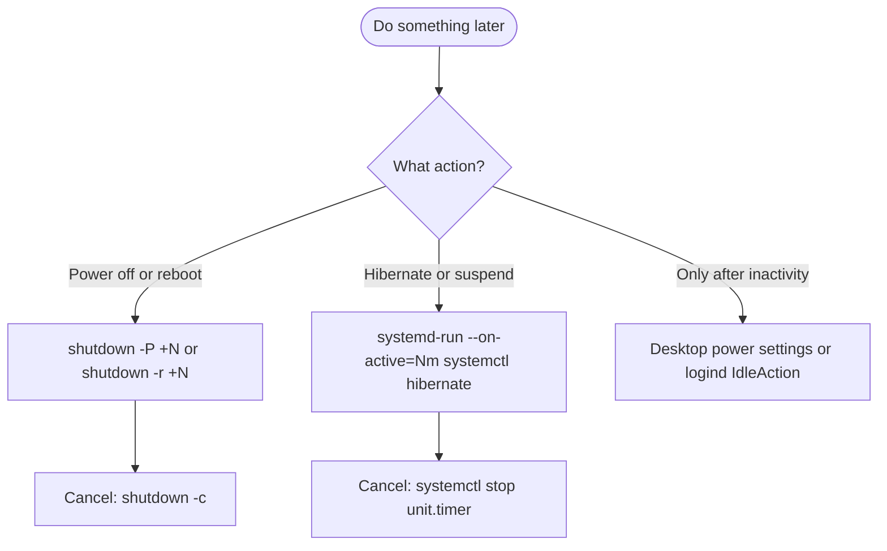

# ⏱️ Schedule Shutdown, Reboot & Hibernate After N Minutes on Linux

> [!NOTE]
> A practical, copy-paste guide to scheduling **power off**, **reboot**, **hibernate** and **suspend-then-hibernate** after *N* seconds, minutes or hours. Works on any **systemd** distro: **Ubuntu, Debian, Linux Mint, Fedora, RHEL-family, Arch, Manjaro, openSUSE** and more.

| | |
| :--- | :--- |
| 🎯 **Covers** | `shutdown`, `systemctl --when`, `systemd-run`, `at`, `sleep`, `suspend-then-hibernate`, idle actions in KDE, GNOME and `logind` |
| ✅ **You will learn** | time formats, scheduling, checking, cancelling, setting up hibernate (`resume=`) per distro, and a reusable `after` shell function |
| 🧩 **Requirements** | systemd, `sudo`, and for hibernate: a real swap partition or file plus a correct resume setup |
| 🏷️ **Tags** | `linux` `systemd` `ubuntu` `debian` `fedora` `arch` `opensuse` `shutdown` `reboot` `hibernate` `cheatsheet` |
| 📦 **Part of** | [`clean-system-guide`](https://github.com/itachi-re/clean-system-guide) |

---

## 📑 Table of Contents

- [⚡ Cheat sheet](#-cheat-sheet)
- [🧭 Which tool should I use?](#-which-tool-should-i-use)
- [🕒 Time formats](#-time-formats)
- [🔴 Shutdown (power off) after N minutes/hours](#-shutdown-power-off-after-n-minuteshours)
- [🔄 Reboot after N minutes/hours](#-reboot-after-n-minuteshours)
- [🛌 Hibernate after N minutes/hours](#-hibernate-after-n-minuteshours)
- [🌓 Suspend now, hibernate later](#-suspend-now-hibernate-later)
- [🔍 Check and cancel pending actions](#-check-and-cancel-pending-actions)
- [💤 Hibernate only when idle](#-hibernate-only-when-idle)
- [🧰 Handy shell function](#-handy-shell-function)
- [🩺 Troubleshooting](#-troubleshooting)
- [📚 References](#-references)

---

## ⚡ Cheat sheet

| Goal | Command |
| :--- | :--- |
| Power off in 30 min | `sudo shutdown -P +30` |
| Power off in 2 hours | `sudo shutdown -P +120` |
| Reboot in 15 min | `sudo shutdown -r +15` |
| Hibernate in 30 min | `sudo systemd-run --on-active=30m systemctl hibernate` |
| Suspend now, hibernate after 30 min | set `HibernateDelaySec=30min`, then `systemctl suspend-then-hibernate` *(see [details](#-suspend-now-hibernate-later))* |
| Cancel a pending shutdown/reboot | `sudo shutdown -c` |
| Show a pending shutdown/reboot | `shutdown --show` *(systemd 250+)* |
| Cancel a pending timer | `sudo systemctl stop <name>.timer` |

> [!IMPORTANT]
> `shutdown` can only **power off, halt or reboot**. It cannot hibernate. For hibernate, use `systemd-run` (or `at`) as shown below.

---

## 🧭 Which tool should I use?



| Tool | Power off / Reboot | Hibernate | Notes |
| :--- | :---: | :---: | :--- |
| `shutdown` | ✅ | ❌ | Minutes only (`+m`), simple, sends a warning to logged-in users |
| `systemctl poweroff --when=` | ✅ | ❌ | Newer systemd only, takes systemd timestamps |
| `systemd-run --on-active=` | ✅ | ✅ | Most flexible, accepts `s`, `m`, `h` units |
| `at` | ✅ | ✅ | Classic job scheduler, needs the `atd` service |
| `sleep N && cmd` | ✅ | ✅ | Quick and dirty, dies if the terminal closes |

> [!NOTE]
> Every command here needs systemd. That covers Ubuntu, Debian, Fedora, Arch, openSUSE and their derivatives. Check with `systemctl --version`. Distros without systemd (Alpine, Void, Gentoo with OpenRC, Devuan) need their own tools, though `shutdown +N` and `at` still work on most of them.

---

## 🕒 Time formats

### `shutdown`

| Format | Meaning |
| :--- | :--- |
| `now` | Immediately (same as `+0`) |
| `+m` | `m` **minutes** from now |
| `hh:mm` | A clock time in 24h format (see warning below) |
| *(nothing)* | Defaults to `+1` (one minute) |

> [!WARNING]
> `shutdown` only understands **minutes** after the `+`. `shutdown +1h` is **not valid**. Convert hours to minutes: 1 h = `+60`, 2 h = `+120`, 90 min = `+90`.

> [!CAUTION]
> The behavior of `hh:mm` when that time has **already passed today** differs between systemd versions. Some treat it as the next occurrence (tomorrow), newer man pages say it results in an **immediate** shutdown. Prefer `+m`, or check your version's `man shutdown`.

### `systemd-run`, `systemctl --when`, `sleep`

systemd time spans accept these units:

| Unit | Accepted spellings |
| :--- | :--- |
| seconds | `s`, `sec`, `second`, `seconds` |
| minutes | `m`, `min`, `minute`, `minutes` |
| hours | `h`, `hr`, `hour`, `hours` |
| days | `d`, `day`, `days` |

Units can be combined: `1h30m`, `2h 15min`, `90min`. A bare number means **seconds**: `--on-active=1800` is 30 minutes.

> [!TIP]
> Validate any time span or timestamp before using it:
> ```bash
> systemd-analyze timespan 1h30m
> systemd-analyze timestamp "+30min"
> ```

---

## 🔴 Shutdown (power off) after N minutes/hours

```bash
# Power off in 30 minutes
sudo shutdown -P +30

# Power off in 2 hours (120 minutes)
sudo shutdown -P +120

# Same thing, shorter. Power off is the default action
sudo shutdown +30

# With a message for logged-in users
sudo shutdown -P +10 "Powering off for maintenance"

# Power off immediately
sudo shutdown -P now
```

<details>
<summary>📌 Other options worth knowing</summary>

| Option | Effect |
| :--- | :--- |
| `-P`, `--poweroff` | Power off the machine (default) |
| `-H`, `--halt` | Halt the machine but leave the power on |
| `-r`, `--reboot` | Reboot |
| `-c` | Cancel a pending shutdown |
| `-k` | Do not shut down, **only send the warning message** (a safe way to test) |
| `--no-wall` | Do not send the warning message |
| `--show` | Show a pending action (systemd 250+) |

When you give a time, new logins are blocked during the final 5 minutes before the shutdown.

Dry run:

```bash
sudo shutdown -k +5 "This is only a test"
```

</details>

### Alternative: `systemctl poweroff --when`

On recent systemd versions:

```bash
sudo systemctl poweroff --when=+30min
```

> [!CAUTION]
> With `--when`, a **time-only** value such as `06:00` means *today at 06:00*. If that moment has already passed, the machine powers off **immediately**. Use a relative value like `+30min` or a full date-time such as `2026-11-08T06:00:00`. `--when` is not available on older systemd (for example the one in Ubuntu 22.04). Check with `systemctl --version`.

---

## 🔄 Reboot after N minutes/hours

```bash
# Reboot in 15 minutes
sudo shutdown -r +15

# Reboot in 1 hour
sudo shutdown -r +60

# Reboot with a message
sudo shutdown -r +5 "Rebooting to apply updates"

# Reboot immediately
sudo shutdown -r now

# Recent systemd, relative time
sudo systemctl reboot --when=+15min
```

Using `systemd-run` works too, and it accepts hours directly:

```bash
sudo systemd-run --on-active=1h systemctl reboot
```

---

## 🛌 Hibernate after N minutes/hours

Hibernate saves your RAM contents to swap, powers off completely and restores your session on the next boot.

### ✅ Step 1. Prerequisites (all distros)

> [!CAUTION]
> If hibernate is not fully set up, the machine will still power off, but the next boot starts a **fresh session and everything unsaved is lost**. Always run `systemctl hibernate` manually once and confirm it restores before relying on a timer.

**1. You need a real swap partition or swap file.** zram and other RAM-based swap cannot hold the hibernation image, and **Fedora uses zram by default**. Size the swap at least as large as your RAM in use. A swap at least as big as your total RAM is the safe choice.

```bash
swapon --show
free -h
```

**2. Check whether the kernel already knows where to resume from:**

```bash
cat /proc/cmdline | grep -o 'resume=[^ ]*'
```

**3. Check Secure Boot and kernel lockdown.** With Secure Boot on, many kernels enable *lockdown*, which refuses to hibernate to **unencrypted** swap:

```bash
mokutil --sb-state
cat /sys/kernel/security/lockdown
```

If lockdown shows `integrity` or `confidentiality` (in brackets) and hibernate fails, either disable Secure Boot, or use encrypted swap setups that your distro documents.

### 🧩 Step 2. Set up `resume` for your distro

First, gather the details you will need:

```bash
lsblk -f                                   # find the UUID of your swap partition
```

For a **swap file** you need two values: the UUID of the **filesystem that contains the file** (not of the file), and the file's **physical offset**:

```bash
sudo filefrag -v /swapfile | head -n 5     # use the first physical_offset value
sudo btrfs inspect-internal map-swapfile -r /swapfile   # Btrfs swap files only
```

Then the kernel options are:

```text
resume=UUID=<uuid>                              # swap partition
resume=UUID=<fs-uuid> resume_offset=<offset>    # swap file
```

Pick your distro:

<details open>
<summary><b>🟠 Ubuntu / Debian / Linux Mint / Pop!_OS</b></summary>

1. Add the option to GRUB. Edit `/etc/default/grub` and append to `GRUB_CMDLINE_LINUX_DEFAULT`:

   ```text
   GRUB_CMDLINE_LINUX_DEFAULT="quiet splash resume=UUID=<uuid>"
   ```

   Then:

   ```bash
   sudo update-grub
   ```

2. Tell the initramfs. Create `/etc/initramfs-tools/conf.d/resume`:

   ```text
   RESUME=UUID=<swap-uuid>
   ```

   Then:

   ```bash
   sudo update-initramfs -u
   ```

> [!NOTE]
> Ubuntu installs a **swap file** (`/swap.img` or `/swapfile`) by default, so you need `resume_offset=` as shown above. You may see a harmless "no matching swap device" warning from `update-initramfs` with a swap file. The real test is a reboot plus `systemctl hibernate`. GNOME may also hide the Hibernate entry from the power menu, but `systemctl hibernate` still works.

</details>

<details>
<summary><b>🔵 Fedora / RHEL-family (Rocky, Alma, CentOS Stream)</b></summary>

1. Create a disk swap first if you only have zram, and add it to `/etc/fstab`.
2. Include the dracut `resume` module:

   ```bash
   echo 'add_dracutmodules+=" resume "' | sudo tee /etc/dracut.conf.d/resume.conf
   sudo dracut -f
   ```

3. Add the kernel argument to all installed kernels:

   ```bash
   sudo grubby --update-kernel=ALL --args="resume=UUID=<uuid>"
   ```

   (With a swap file, add `resume_offset=<offset>` to `--args` as well.)

> [!WARNING]
> Fedora does not support hibernation out of the box. With **Secure Boot** on, kernel lockdown usually blocks hibernating to unencrypted swap, so you may need to turn Secure Boot off.

</details>

<details>
<summary><b>🟣 Arch Linux / Manjaro / EndeavourOS</b></summary>

1. Make sure the initramfs can resume. Check which hooks you use in `/etc/mkinitcpio.conf`:
   - **systemd-based initramfs** (the `systemd` hook): nothing to add, resume is already handled.
   - **busybox-based initramfs** (the default): add the `resume` hook **after `udev`** (and after `encrypt` or `lvm2` if you use them):

     ```text
     HOOKS=(base udev autodetect microcode modconf kms keyboard keymap consolefont block filesystems resume fsck)
     ```

   Then rebuild:

   ```bash
   sudo mkinitcpio -P
   ```

2. Kernel option. On **UEFI** with systemd 255+ and mkinitcpio 38+, the system picks a swap space automatically and stores it in an EFI variable, so `resume=` is usually **not needed**. On legacy BIOS, or to choose the swap yourself, add `resume=UUID=<uuid>` (plus `resume_offset=` for a swap file):
   - **GRUB:** edit `/etc/default/grub`, then `sudo grub-mkconfig -o /boot/grub/grub.cfg`
   - **systemd-boot:** add it to the `options` line in `/boot/loader/entries/*.conf`

</details>

<details>
<summary><b>🟢 openSUSE Tumbleweed / Leap</b></summary>

Add `resume=UUID=<uuid>` where your bootloader keeps its options:

| Bootloader setup | Where to edit | Apply with |
| :--- | :--- | :--- |
| GRUB2 | `GRUB_CMDLINE_LINUX_DEFAULT` in `/etc/default/grub` (or YaST → Bootloader → Kernel Parameters) | `sudo grub2-mkconfig -o /boot/grub2/grub.cfg` |
| GRUB2-BLS / systemd-boot | `/etc/kernel/cmdline` | `sudo sdbootutil update-all-entries` |

The initramfs normally resumes without extra setup. If you still have trouble, see the dracut fallback in [Troubleshooting](#-troubleshooting).

</details>

<details>
<summary><b>⚪ Other bootloaders (rEFInd, systemd-boot, Limine)</b></summary>

Add the same `resume=` option to that bootloader's kernel options line (for rEFInd, the `options` line in `refind.conf` or `/boot/refind_linux.conf`), then rebuild or regenerate your initramfs with your distro's tool (`update-initramfs -u`, `dracut -f` or `mkinitcpio -P`).

</details>

> [!NOTE]
> UUIDs change when you recreate or reformat a swap partition, and a swap file's offset changes if the file is recreated or moved. Update `resume=` and `resume_offset=` if that happens, and do not defragment the swap file.

### ✔️ Step 3. Verify and test

```bash
cat /proc/cmdline | grep -o 'resume=[^ ]*'
busctl call org.freedesktop.login1 /org/freedesktop/login1 org.freedesktop.login1.Manager CanHibernate
```

The second command should answer `s "yes"`. Then save your work and test manually:

```bash
systemctl hibernate
```

If the machine powers off and your session comes back after you power it on, hibernate works.

### ⏲️ Step 4. Schedule it

```bash
# Hibernate in 30 minutes
sudo systemd-run --on-active=30m systemctl hibernate

# In 1 hour 30 minutes
sudo systemd-run --on-active=1h30m systemctl hibernate

# In 45 seconds
sudo systemd-run --on-active=45s systemctl hibernate

# With a name, so it is easy to inspect and cancel
sudo systemd-run --unit=hibernate-later --on-active=30m systemctl hibernate
```

`systemd-run` prints something like this:

```text
Running timer as unit: run-p157689-i176593.timer
Will run service as unit: run-p157689-i176593.service
```

Timers created this way are **transient**. They live in `/run` and disappear on reboot.

### 🕰️ At a specific clock time

Use a full date and time so the timer fires **once**:

```bash
sudo systemd-run --on-calendar="2026-11-08 23:30:00" systemctl hibernate
```

> [!WARNING]
> A time-only calendar value such as `--on-calendar=23:30` is a **recurring daily** schedule, not a one-shot. Use the full date form above for a single run.

### Alternative: `at`

Install it and start the service once:

| Distro | Install |
| :--- | :--- |
| Ubuntu / Debian / Mint | `sudo apt install at` |
| Fedora / RHEL-family | `sudo dnf install at` |
| Arch / Manjaro | `sudo pacman -S at` |
| openSUSE | `sudo zypper install at` |

```bash
sudo systemctl enable --now atd
```

Then schedule (runs as root because of `sudo`):

```bash
echo "systemctl hibernate" | sudo at now + 30 minutes
echo "systemctl hibernate" | sudo at 23:30

# List and remove jobs
sudo atq
sudo atrm <job-number>
```

### Alternative: plain `sleep`

```bash
sleep 30m && systemctl hibernate
```

Press `Ctrl+C` to cancel. It stops if you close the terminal, so use `nohup` or `systemd-run` if you need it to survive:

```bash
nohup sh -c 'sleep 1800 && systemctl hibernate' >/dev/null 2>&1 &
```

---

## 🌓 Suspend now, hibernate later

`suspend-then-hibernate` suspends to RAM first (fast resume), then wakes briefly and hibernates to disk if you have not come back within a delay. It saves battery and protects your session from a power loss.

**Set the delay** in `/etc/systemd/sleep.conf` (or a drop-in in `/etc/systemd/sleep.conf.d/`):

```ini
[Sleep]
HibernateDelaySec=30min
```

**Trigger it:**

```bash
systemctl suspend-then-hibernate
```

If `HibernateDelaySec=` is not set, the default is 2 hours on current systemd versions. Hibernate must already work (see [Step 1](#-step-1-prerequisites-all-distros)) for the second phase to succeed.

> [!NOTE]
> This is different from "do something in 30 minutes". `suspend-then-hibernate` suspends **immediately**, then hibernates after the delay. To start suspend-then-hibernate at a later time, combine it with a timer:
> ```bash
> sudo systemd-run --on-active=30m systemctl suspend-then-hibernate
> ```

---

## 🔍 Check and cancel pending actions

### `shutdown` / reboot

```bash
shutdown --show        # show the pending action (systemd 250+)
sudo shutdown -c       # cancel it
```

### `systemd-run` timers

```bash
systemctl list-timers --all                 # all timers, pending ones show their trigger time
systemctl status hibernate-later.timer      # a named timer, shows the "Trigger:" line
sudo systemctl stop hibernate-later.timer   # cancel it
```

For an unnamed timer, use the generated name that `systemd-run` printed:

```bash
sudo systemctl stop run-p157689-i176593.timer
```

### `at` jobs

```bash
sudo atq
sudo atrm <job-number>
```

---

## 💤 Hibernate only when idle

A timer fires after a fixed delay **regardless of what you are doing**. If you want "hibernate after 30 minutes of no keyboard or mouse activity", use your desktop's power manager.

### KDE Plasma

**System Settings → Power Management → Energy Saving.** Set the inactivity action to **Hibernate** after **30 min**. If Hibernate is not offered in the list, Plasma thinks hibernate is unavailable, so go back to [Step 1](#-step-1-prerequisites-all-distros).

### GNOME (Ubuntu, Fedora Workstation, Debian)

The Settings app only offers **Suspend**, but the underlying setting accepts `hibernate`. The timeout is in **seconds**:

```bash
# On AC power
gsettings set org.gnome.settings-daemon.plugins.power sleep-inactive-ac-type 'hibernate'
gsettings set org.gnome.settings-daemon.plugins.power sleep-inactive-ac-timeout 1800

# On battery
gsettings set org.gnome.settings-daemon.plugins.power sleep-inactive-battery-type 'hibernate'
gsettings set org.gnome.settings-daemon.plugins.power sleep-inactive-battery-timeout 1800
```

List the allowed actions with:

```bash
gsettings range org.gnome.settings-daemon.plugins.power sleep-inactive-ac-type
```

### Other desktops (XFCE, Cinnamon, MATE, LXQt)

Use the desktop's own power manager (for example `xfce4-power-manager` settings), and look for a hibernate option there.

### systemd-logind (no desktop, or a server)

Edit `/etc/systemd/logind.conf` (or add a drop-in under `/etc/systemd/logind.conf.d/`):

```ini
[Login]
IdleAction=hibernate
IdleActionSec=30min
```

Apply it by rebooting (the safest way), or by restarting `systemd-logind`.

> [!NOTE]
> Desktop environments manage idle behavior themselves, so `IdleAction=` is unreliable on a desktop. Prefer the desktop's own setting there.

---

## 🧰 Handy shell function

Add this to your `~/.bashrc` or `~/.zshrc`:

```bash
# usage: after <time> <poweroff|reboot|hibernate|suspend-then-hibernate>
after() {
  if [ $# -ne 2 ]; then
    echo "usage: after <time> <poweroff|reboot|hibernate|suspend-then-hibernate>"
    return 1
  fi
  sudo systemd-run --on-active="$1" --description="after $1: $2" systemctl "$2"
}
```

Reload your shell, then:

```bash
after 30m hibernate
after 2h poweroff
after 15m reboot
after 45s suspend-then-hibernate
```

---

## 🩺 Troubleshooting

| Symptom | Likely cause | Fix |
| :--- | :--- | :--- |
| `shutdown +1h` is rejected | `+m` only accepts minutes | Use `+60` |
| `systemctl poweroff --when=06:00` shut down instantly | Time-only value in the past means "now" | Use `+30min` or a full date-time |
| `Hibernate` missing in the desktop menu | Swap or resume not set up, lockdown, or the desktop hides it | Complete [Step 1](#-step-1-prerequisites-all-distros), then test `systemctl hibernate` |
| Machine powers off but boots a fresh session | `resume=` is wrong, missing, or points at the wrong UUID | Fix `resume=`, regenerate boot entries and initramfs, test again |
| "Call to Hibernate failed" or "Not enough swap space" | Swap smaller than the memory image, or lockdown | Free memory, enlarge swap, check [lockdown](#-step-1-prerequisites-all-distros) |
| Fedora: hibernate unavailable | Only zram swap, or Secure Boot lockdown | Add disk swap, add the dracut `resume` module, consider disabling Secure Boot |
| Ubuntu swap file does not resume | Missing `resume_offset=` | Add `resume_offset=` to GRUB and update the initramfs |
| `systemd-run` timer never fires | Timer was stopped, or the system rebooted | Transient timers do not survive reboots, recreate it |
| `at: command not found` | `at` is not installed | Install it from the table above, then `sudo systemctl enable --now atd` |

<details>
<summary>🛠️ If resume still fails: force the dracut resume module</summary>

On dracut-based distros (Fedora, openSUSE, RHEL-family), force the `resume` module and rebuild:

```bash
echo 'add_dracutmodules+=" resume "' | sudo tee /etc/dracut.conf.d/99-resume.conf
sudo dracut -f
```

Then reboot and test again. With **encrypted swap**, the resume device and initramfs setup differ, so follow your distro's encrypted-swap documentation.

After a failed resume, these help find the cause:

```bash
journalctl -b -1 | grep -Ei 'hibernate|resume|swsusp|swap|image'
sudo dmesg | grep -Ei 'hibernate|resume|swsusp|lockdown'
```

</details>

---

## 📚 References

- [`shutdown(8)`](https://www.freedesktop.org/software/systemd/man/latest/shutdown.html): time formats and options
- [`systemd-run(1)`](https://www.freedesktop.org/software/systemd/man/latest/systemd-run.html): transient timers, `--on-active`, `--on-calendar`
- [`systemd.time(7)`](https://www.freedesktop.org/software/systemd/man/latest/systemd.time.html): time spans, timestamps, calendar events
- [`systemd-sleep.conf(5)`](https://www.freedesktop.org/software/systemd/man/latest/systemd-sleep.conf.html): `HibernateDelaySec=` and sleep modes
- [`logind.conf(5)`](https://www.freedesktop.org/software/systemd/man/latest/logind.conf.html): `IdleAction=` and `IdleActionSec=`
- [Arch Wiki: Suspend and hibernate](https://wiki.archlinux.org/title/Power_management/Suspend_and_hibernate): hooks, `resume=`, swap files
- [Fedora Magazine: Update on hibernation in Fedora Workstation](https://fedoramagazine.org/update-on-hibernation-in-fedora-workstation): zram, dracut, Secure Boot lockdown
- [openSUSE Tumbleweed power management docs](https://doc.opensuse.org/documentation/tumbleweed/power/): swap and `resume=`
- [GNOME System Administration Guide: automatic logout and sleep settings](https://help.gnome.org/system-admin-guide/logout-automatic.html): `sleep-inactive-*` keys

---

<sub>Maintained in [itachi-re/clean-system-guide](https://github.com/itachi-re/clean-system-guide). Suggestions and fixes welcome.</sub>
